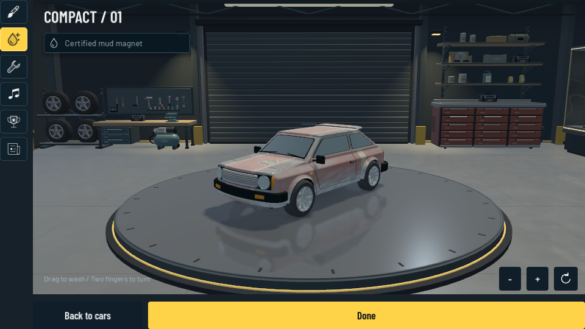
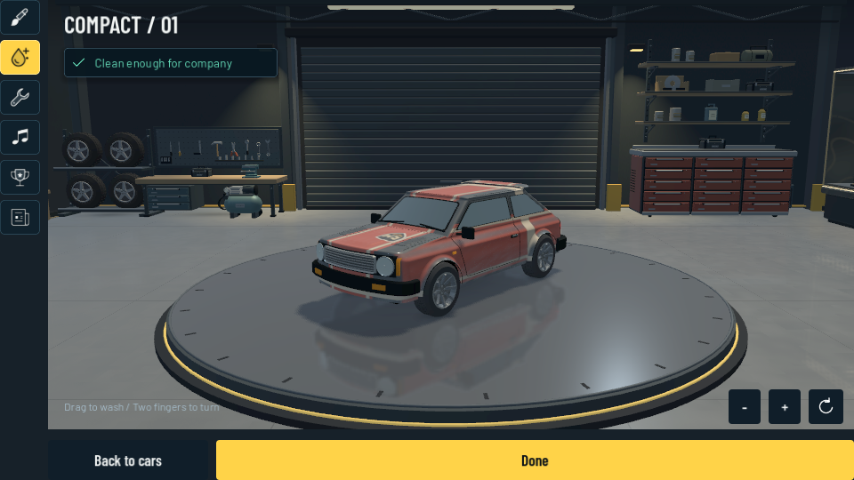
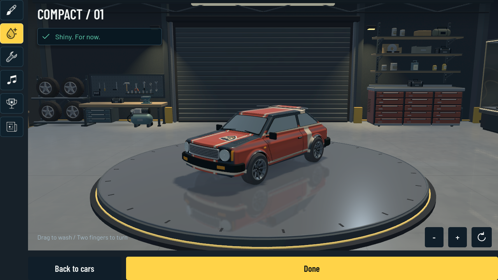

# Forgiving exterior washing and cleanliness grades — 2026-10-18

The owner reports a visually clean car still requiring washing, explicitly excludes the underside, and requests several gently humorous cleanliness labels. This supersedes the readiness thresholds and two labels in `GARAGE_WASH_READY_2026_10_17.md`.

| Requirement | Implemented behavior |
| --- | --- |
| GWF01 | Exclude downward-facing surfaces using actual triangle winding. Godot's ray-hit normal points toward the incoming ray on either side of a triangle, so it cannot identify the underside. Keep the original top/four-side first-hit occlusion sampling and exclude unbound material surfaces within otherwise washable meshes. |
| GWF02 | Inspect the finish shader's broad dirt/snow/rim/rear-trim footprints. Unwiped volume cells above a roof do not count as primary road dirt where the shader draws none. Raise tolerated residue from 0.10 to 0.20 and the missed-area allowance from 15% to 25%. Weight the affected exterior so a clean roof cannot dilute a broadly missed door. Slow dirt retains its 0.62 maximum film strength; slow snow uses its actual 0.38 strength. |
| GWF03 | Show **Certified mud magnet → Grubby but proud → Needs a rinse → Clean enough for company → Shiny. For now.** Update during washing. Both clean grades use the existing green check and permit customisation; the first three require more washing. The existing status tooltip states the editing decision. No numeric meter or additional permanent label is added. |
| R01 | Keep original washing gestures/rates, actual dirt and masks, saved condition, fitted parts, per-car editing/save guards, achievements, camera, canonical driving and backend contracts. The check and label share one cached inspection. |
| Q01 | Compare saved original sources, exercise all five native models and material/underside boundaries, validate graded labels and original washing, compile project scripts, inspect native narrow/desktop captures, and provide a task-only source checkpoint. |

Changed source: `game/ui/garage_cleanliness.gd`, `game/ui/garage_page.gd`, `game/tests/test_garage_clean_customisation.gd`, and new `game/tests/test_garage_wash_surfaces.gd`. Project instructions/status/plan record this slice. Existing concurrent changes are retained.

The broad footprint follows geometry/coverage from `vehicle_weathering.gdshader`; it intentionally omits fine procedural noise and individual splash specks. Inspection reuses prepared points/scopes until the actual car, fitted parts or bounds change, and reuses its decision until layer amounts or either wash mask change. It does not alter saved masks to manufacture a clean result.

Actual commands use the pinned Godot 4.7.2 entry point:

```powershell
powershell -NoProfile -ExecutionPolicy Bypass -File scripts/dev.ps1 -Action TestScript -ScriptPath res://tests/test_garage_wash_surfaces.gd -CommandTimeoutSeconds 180
powershell -NoProfile -ExecutionPolicy Bypass -File scripts/dev.ps1 -Action TestScript -ScriptPath res://tests/test_garage_wash_surfaces.gd -TestArgument '--before-file=res://../docs/evidence/garage-wash-forgiving-2026-10-18/before/game/ui/garage_cleanliness.gd' -CommandTimeoutSeconds 180
powershell -NoProfile -ExecutionPolicy Bypass -File scripts/dev.ps1 -Action TestScript -ScriptPath res://tests/test_garage_clean_customisation.gd -CommandTimeoutSeconds 180
powershell -NoProfile -ExecutionPolicy Bypass -File scripts/dev.ps1 -Action TestScript -ScriptPath res://tests/test_garage_clean_customisation.gd -Graphical -RenderingMethod gl_compatibility -RenderingDriver opengl3 -CommandTimeoutSeconds 240
powershell -NoProfile -ExecutionPolicy Bypass -File scripts/dev.ps1 -Action TestScript -ScriptPath res://tests/test_garage_clean_customisation.gd -Graphical -RenderingMethod mobile -RenderingDriver vulkan -CommandTimeoutSeconds 240
powershell -NoProfile -ExecutionPolicy Bypass -File scripts/dev.ps1 -Action TestScript -ScriptPath res://tests/test_car_wash.gd -Graphical -RenderingMethod gl_compatibility -RenderingDriver opengl3 -TestArgument '--evidence-root=res://../docs/evidence/garage-wash-forgiving-2026-10-18/regressions' -CommandTimeoutSeconds 240
powershell -NoProfile -ExecutionPolicy Bypass -File scripts/dev.ps1 -Action TestScript -ScriptPath res://tests/test_script_parse.gd -CommandTimeoutSeconds 240
git diff --check -- game/ui/garage_cleanliness.gd game/ui/garage_page.gd game/tests/test_garage_clean_customisation.gd game/tests/test_garage_wash_surfaces.gd
```

| Actual check | Outcome |
| --- | --- |
| Saved original checker against final surface regression | 46 checks, 19 reproduced failures (includes the extra successful source-compilation check) |
| Final surface regression, all five native cars | 45 checks, zero failures |
| Focused headless | 262 checks, zero failures |
| Focused native Compatibility / OpenGL | 286 checks, zero failures |
| Focused desktop Mobile / Vulkan | 286 checks, zero failures |
| Original manual washing and full-app washing flow, native Compatibility | 1,402 checks, zero failures |
| Whole-project script compilation | 893 scripts, zero failures |
| Scoped whitespace check | Passed |

Surface checks include sloping underside rejection with an upward-facing control, exact material-surface boundaries within a shared mesh, lowest-volume-row tolerance, clean high panels, faint remaining masks, a dirty half, immediate mask invalidation and complete washing. Focused checks retain original guarded livery/paint/sticker/kit/reset/save behavior, actual per-car local persistence and incoming race wear. Every grade appears in washing order; both green grades agree with the editing gate. Native captures cover every grade at 960x540 and 1280x720, plus the original wide readiness views. Actual captures were visually inspected on both desktop renderers. These are not phone tests.

Retained initial results and corrections:

- Restricted native execution could not open its normal `user://logs` directory. The pinned entry point subsequently ran with native access and isolated test saves. No phone attachment check was made.
- The first footprint-aware pass had seven focused failures: clean upper panels diluted broad dirty patches and one unwashed kart. Weighting the actual potentially dirty footprint fixes those failures while retaining the missed-half assertions.
- An initial triangle probe called a nonexposed `TriangleMesh.create` method. The fixture now constructs actual meshes using `SurfaceTool`. Its output confirmed that ray-hit normals flip to face rays; the implementation uses actual clockwise face winding instead.
- The first underside-volume fixture left two complete bottom voxel rows dirty. On pickup/classic those rows extend into visibly dirty sills. The corrected volume-boundary fixture leaves the lowest row untouched; separate sloping downward-facing triangles still prove underside exclusion directly. Original failures remain in the evidence. No missed-door assertion was relaxed.
- The first graded screenshot sequence seeded wear during an active car-reveal transition. The final fixture finishes that actual transition before seeding wear and enters washing, so captures show the intended material state.
- One later headless run hit a concurrent `PackedInt32Array.assign` compile error in `editor/track_compiler.gd`. That file was independently corrected; this task did not edit it.
- Headless inspection exposed an unavailable matrix shader-parameter read for a wheel material. The final implementation obtains wheel-local coordinates from the original saved wheel-rest frame already used by the wash mapping, without reading a renderer matrix.

Before-source snapshots, retained initial logs, final logs/reports, native captures, source hashes and the task-only patch are under `docs/evidence/garage-wash-forgiving-2026-10-18/`.







Owner washing-effort, wording and physical-device appearance acceptance remain. No phone attachment check, device test, APK/export/install, backend change/deployment or performance claim was made.
