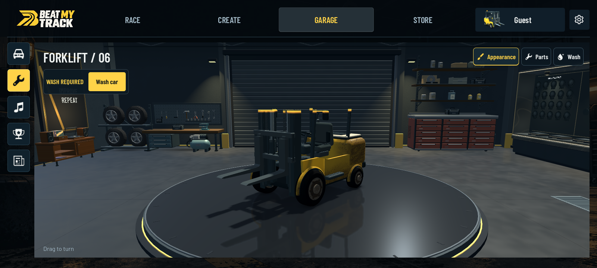

# Garage wash prompt and view-button cleanup — 2026-10-25

GWO04–GWO06/R01/Q01 address the remaining full-height Wash required sidebar and remove Top view / zoom out / zoom in / reset from the Garage 3D view.

Dirty Appearance/Parts now use the full showroom width with a compact Wash required / Wash car notice below the car name. The detailed explanation remains in its tooltip. The blocked workbench is hidden and reserves no sidebar. Wash car still enters actual manual washing; the requirement hides there, and clean cars reopen the existing editing workbench. Cleanliness, purchase and save guards are unchanged.

The four view buttons and their callback are removed. The bottom row contains only the non-interactive gesture hint. Mouse drag, touch orbit, wheel, trackpad and pinch remain; the former bottom-button strip now also accepts car gestures. Existing automatic part/sticker camera behavior is retained. Test-only overhead livery captures now set their fixture camera directly instead of pressing a removed shipping button.

Runtime changes are confined to `game/ui/garage_page.gd`. Updated tests are the cleanliness, sidebar, view-controls, tuning-layout and livery-pattern suites. The full cleanliness suite and all prior dirty mutation assertions are retained. A test fixture under `game/tests/fixtures/garage_wash_overlay_before/` is export-excluded with `.gdignore` and reloads the exact task-start Garage source only into its isolated process's memory; workspace runtime files and owner processes are not restored or restarted.

Actual App navigation/dirty-Forklift/touch-shortcut checks pass 549 on Compatibility and 549 on desktop Mobile. Actual view gestures/button absence pass 65 on each renderer. Customisation checks pass 320; App 141 and full parser 1178 pass.

The broader cleanliness suite retains **one existing failure**, `forklift heavy slow film still blocks`: current 342 headless / 367 Compatibility checks each have one failure. Exact task-start runtime and test sources reproduce the same assertion, with 327 headless / 351 Compatibility checks each having one failure (including the source-reload check). No cleanliness threshold or assertion was weakened. The initial baseline capture also exposed an evidence-path fixture issue; it is retained in `before/console.log`, and resource paths are now normalized after argument parsing.

Expanded commands, exact outcomes, source/capture hashes and the reverse-checked task-only patch are in [report.json](evidence/garage-wash-overlay-2026-10-25/report.json). The runner uses isolated APPDATA and local records with the pinned Godot engine through `scripts/dev.ps1`:

```powershell
powershell -NoProfile -ExecutionPolicy Bypass -File docs/evidence/garage-wash-overlay-2026-10-25/run.ps1 -Test test_garage_sidebar -Mode gl_compatibility
powershell -NoProfile -ExecutionPolicy Bypass -File docs/evidence/garage-wash-overlay-2026-10-25/run.ps1 -Test test_garage_sidebar -Mode mobile
powershell -NoProfile -ExecutionPolicy Bypass -File docs/evidence/garage-wash-overlay-2026-10-25/run.ps1 -Test test_garage_view_controls -Mode gl_compatibility
powershell -NoProfile -ExecutionPolicy Bypass -File docs/evidence/garage-wash-overlay-2026-10-25/run.ps1 -Test test_garage_view_controls -Mode mobile
```

[View the actual Forklift, Wash shortcut and original/current dirty-car comparison](evidence/garage-wash-overlay-2026-10-25/review.html).



Reload and owner visual/touch acceptance remain. Mobile here is Windows Vulkan, not a physical-device measurement. No attachment check/device test, APK, real purchase, live mutation, deployment or owner-process restart was performed. Concurrent work is preserved; no staging or commit is implied.
