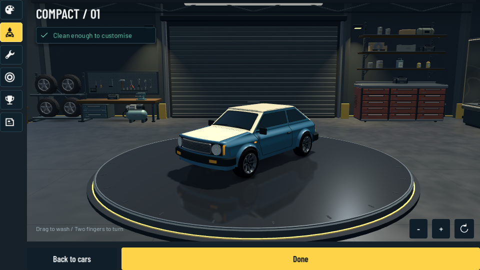
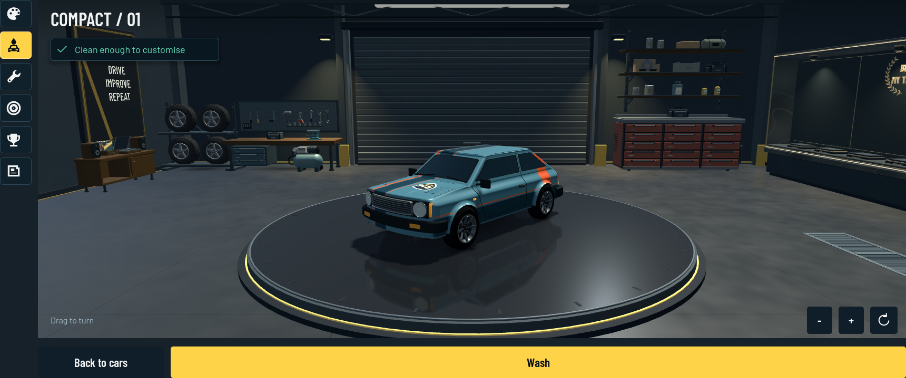

# Garage wash readiness and forgiving residue - 2026-10-17

The owner requests a nonnumeric indication when washing has made the car clean enough for painting/customisation, and more forgiveness when remaining dirt is barely visible. This supersedes the thresholds in `GARAGE_CLEAN_TOLERANCE_2026_10_16.md`.

| Requirement | Result |
| --- | --- |
| GWR01 | Care shows a compact droplet / **Needs washing** or green check / **Clean enough to customise**. The status updates from live wash masks before Done is pressed, using the same predicate as every cosmetic editing/save guard. No percentage, score or progress meter is shown. |
| GWR02 | Raise the residue limit from 0.05 to 0.10 and the allowance for samples above it from 5% to 15%; mean residue must remain at most 0.10. Use the stronger remaining layer rather than adding full-strength layers everywhere, and weight broad slow film by the finish shader's maximum 0.62 film strength. Heavy dirt, snow and broad missed patches continue to block. |
| GWR03 | Preserve actual dirt, partial wash masks, local saves/history, wetness, car/camera/parts, washing gestures and canonical behavior. Keep bounded cached exterior sampling, with no underside/interior scrubbing requirement and no new backend reads/writes, shaders or 3D render passes. |

The status is an input-transparent overlay within the existing preview; it consumes no extra layout row. Unchanged state reuses the cached decision. Its small state signature includes wash-image identity as well as mask-upload count, so restoring a newer race condition invalidates the indication even when its contamination amounts equal the earlier amounts. The readiness check itself never saves or modifies condition. The existing manual washing/Done/navigation save lifecycle remains intact.

The rule remains a bounded forgiving proxy, not a pixel-by-pixel integration of the finish shader. The two layers use complementary spatial coverage in that shader; summing their full input amounts at every point previously overstated residue. For example, two 0.08 layers were rejected by the old 0.16 sum; the new rule accepts the remaining 0.08 maximum. A washed car with dirt 0.85 / slow dirt 0.25 and both masks at byte 232 retains its real faint residue and now accepts painting. All five actual car models exercise both cases, alongside slow film 0.15, heavy slow film 0.4, unwashed primary film 0.15, snow, small missed patches and broad unwashed halves. This task does not claim exact perceptual visibility across every paint, lighting condition or device.

Changed source: `game/ui/garage_cleanliness.gd`, `game/ui/garage_page.gd`, and `game/tests/test_garage_clean_customisation.gd`. The original `game/tests/test_car_wash.gd` now waits for the existing menu tween before asserting settled full-app button bounds; its assertions remain unchanged. Local project status/plan/instructions record the new requirement. Concurrent repository work is retained.

Actual commands use the pinned Godot 4.7.2 build through `scripts/dev.ps1`:

```powershell
powershell -NoProfile -ExecutionPolicy Bypass -File scripts/dev.ps1 -Action TestScript -ScriptPath res://tests/test_garage_clean_customisation.gd -CommandTimeoutSeconds 180
powershell -NoProfile -ExecutionPolicy Bypass -File scripts/dev.ps1 -Action TestScript -ScriptPath res://tests/test_garage_clean_customisation.gd -Graphical -RenderingMethod gl_compatibility -RenderingDriver opengl3 -CommandTimeoutSeconds 180
powershell -NoProfile -ExecutionPolicy Bypass -File scripts/dev.ps1 -Action TestScript -ScriptPath res://tests/test_garage_clean_customisation.gd -Graphical -RenderingMethod mobile -RenderingDriver vulkan -CommandTimeoutSeconds 180
powershell -NoProfile -ExecutionPolicy Bypass -File scripts/dev.ps1 -Action TestScript -ScriptPath res://tests/test_car_wash.gd -Graphical -RenderingMethod gl_compatibility -RenderingDriver opengl3 -TestArgument '--evidence-root=res://../docs/evidence/garage-wash-ready-2026-10-17/regressions' -CommandTimeoutSeconds 180
powershell -NoProfile -ExecutionPolicy Bypass -File scripts/dev.ps1 -Action TestScript -ScriptPath res://tests/test_script_parse.gd -CommandTimeoutSeconds 120
git diff --check -- game/ui/garage_page.gd game/ui/garage_cleanliness.gd game/tests/test_garage_clean_customisation.gd game/tests/test_car_wash.gd
```

| Actual check | Outcome |
| --- | --- |
| Focused headless | 209 checks, zero failures |
| Focused native Compatibility / OpenGL | 223 checks, zero failures |
| Focused desktop Mobile / Vulkan | 223 checks, zero failures |
| Original manual washing, native Compatibility | 1,402 checks, zero failures |
| Whole-project script compilation | 854 scripts, zero failures |
| Scoped whitespace check | Passed |

Focused checks include actual paint saves without clearing tolerated dirt, original livery/kit/sticker/reset/save guards, live readiness without saving/pressing Done, matching care/editor decisions, incoming race wear, click-through status controls and responsive dirty/ready captures at 960x540, 1280x720 and 1720x720. Native images were visually inspected on both desktop renderers. These desktop renderer checks are not a phone test.

Retained initial outcomes:

- The first entry-point attempt collided with another process writing the existing generated build identity. A retry progressed past that step.
- Restricted native execution could not open its normal `user://logs` path and stalled. That test process was stopped; the same entry point ran with native access and isolated test saves. No phone attachment check was made.
- The first focused headless run had five failed incoming-race status assertions (one per car, 209 checks total). Restoring condition replaces wash images without incrementing the scrub upload counter; adding image identity to the cache signature fixes the stale readiness. `initial-state-refresh-failure.log` and its report retain the failure.
- The first original washing run passed 1,401/1,402 assertions. Its first 1280-width full-app action check ran during the existing 0.32-second incoming menu animation; the screenshot visibly captures that slide. The fixture now awaits that actual tween, then performs the original assertion. The final run passes all 1,402; initial log/screenshots remain under `initial-app-layout*`.

Evidence, before-source snapshots, initial failures, final logs, source hashes and a task-only patch are under `docs/evidence/garage-wash-ready-2026-10-17/`.






Owner washing-effort/appearance acceptance remains. No phone attachment check, device test, APK build/install, backend change/deployment or FPS claim was made.
