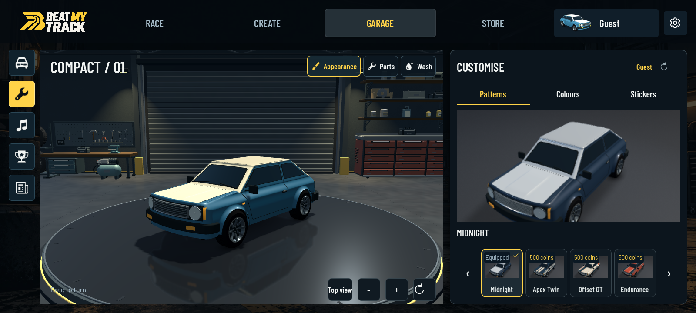

# Garage Workshop overlay navigation — 2026-10-25

GWO01–GWO03/R01/Q01 replace the rejected vertical Workshop submenu with three compact overlay buttons inside the car view. This supersedes the separate side-column placement in GWS01.

Appearance, Parts and Wash sit at the upper-right of the showroom. Wide views show the existing mode icons and captions; narrow views show the icons with translated tooltips and accessible names. The selected mode uses a small gold frame. Each button retains a 52×48 logical minimum. Captions reserve actual icon width and are measured only when the locale or caption mode changes. The overlay occupies the existing protected header area, and the car title yields width when needed. Care's duplicate coin readout yields this area to navigation; purchase balances remain in the customisation workbench.

The separate submenu column and WORKSHOP heading are removed, releasing their width to the car. Five primary rail destinations, the remembered Workshop mode, Appearance/Parts/Wash actions, retained actual car/camera/condition, washing, media views and cosmetic preview/equip authority remain. Overlay controls hide outside Workshop. The bottom customisation buttons are not reintroduced.

Runtime edits are confined to `game/ui/garage_page.gd`. `test_garage_sidebar.gd` now checks overlay parentage and bounds, no reserved column, clearance from the title/view controls/wash status/tools, named icons, pointer/touch navigation, unchanged orbit/zoom, fixed primary rail and remembered mode. `test_customisation_carousel.gd` replaces its superseded side-column assertion with actual overlay bounds; preview/equip/cancel and save assertions remain.

Native baseline: 484 checks pass. Final sidebar checks: 526 headless / 538 Compatibility / 538 desktop Mobile, all passing. Existing customisation checks pass 320 headless. App/parser results, expanded commands, hashes and a reverse-checkable task-only checkpoint are recorded in [report.json](evidence/garage-workshop-overlay-2026-10-25/report.json). Initial capture inspection found captioned buttons not reserving icon width; `initial/caption-icon-space.png` retains that view, and final captions include the icons.

```powershell
powershell -NoProfile -ExecutionPolicy Bypass -File docs/evidence/garage-workshop-overlay-2026-10-25/run.ps1 -Mode headless
powershell -NoProfile -ExecutionPolicy Bypass -File docs/evidence/garage-workshop-overlay-2026-10-25/run.ps1 -Mode gl_compatibility
powershell -NoProfile -ExecutionPolicy Bypass -File docs/evidence/garage-workshop-overlay-2026-10-25/run.ps1 -Mode mobile
```

The same isolated runner was used with `-Test test_customisation_carousel`, `-Test test_app` and `-Test test_script_parse`, each in headless mode. All commands use the pinned Godot build via `scripts/dev.ps1`, with task-local APPDATA and fixture records. No staging/commit is implied.

[View native before/after and all Workshop modes](evidence/garage-workshop-overlay-2026-10-25/review.html).



Reload and owner visual/touch acceptance remain. Desktop Mobile is Windows Vulkan; no phone/tablet attachment check or physical-device test was performed. No APK, real purchase, live mutation, deployment or owner-process restart. Concurrent work is preserved.
