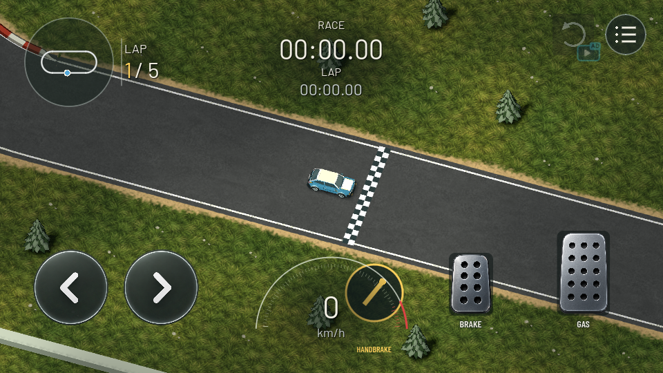

# Handbrake - 2026-10-01

## Powered hairpin exit catches backward slip: physics 0.49 (2026-10-02)

Requirements G01/R01/T01-T04/Q01. Owner reports that the car keeps reversing after an almost-180-degree handbrake turn and confirms it happens after release with accelerator held.

Reproduced from actual scripted turns: pickup reaches 160.3 degrees rotation with -12.37 m/s chassis-forward velocity. In 0.48 it travels backward 7.62 m in the following second and is still moving backward at -1.55 m/s despite full throttle. Classic travels backward 2.53 m and takes 0.533 s to catch. Compact/formula/kart stop rotating earlier under that specific long-pull sequence; separate seeded 170-degree snapshots cover the turned/backward state for all five cars.

Two causes: during rear-grip recovery, the lateral-energy redirection retained a negative longitudinal sign and could reinforce backward travel. Also, the zero-crossing guard repeatedly canceled forward acceleration when continuing chassis rotation produced tiny negative projections near rest. The latter can strand the car at zero forward speed after catching the main slide.

Fixes:

- During the existing rear-grip recovery window, sideways scrub no longer feeds negative longitudinal speed.
- After releasing the handbrake, a short dissipative correction catches negative chassis-forward motion as rear grip recovers. It reduces only backward speed, scales with grip and remaining recovery pressure, and does not flip velocity or add power. Foot brake input excludes this correction. It expires with the existing pressure state; no new persistent state or latch is introduced.
- Released-handbrake acceleration can cross the existing 0.15 m/s stopped band while grip recovers. Held-handbrake crossing remains prohibited. Ordinary driving retains its original zero-crossing rule, preserving wall sliding, recoil and manual reverse behavior.

Pickup: backward travel 7.62 -> 1.11 m; forward motion begins after 0.325 s and reaches 8.44 m/s forward at one second. Classic: 2.53 -> 0.56 m; forward after 0.200 s, 12.22 m/s at one second. Brief residual momentum remains possible; this resolves sustained backing and the powered-exit stall, not instantaneous reversal. Drift entry, angular-response tuning and hairpin checks remain unchanged.

Actual commands/results, pinned Godot 4.7.2 via `powershell -NoProfile -ExecutionPolicy Bypass -File scripts/dev.ps1 -Action ACTION`:

- `TestHandbrake`: 231 checks pass, retaining the preceding 201. New actual-turn/seeded-snapshot cases verify sub-0.5-second backward catch, limited retreat, subsequent forward acceleration, exact rewind restoration and the near-zero projection regression.
- `TestDriving`: 72 pass; three ObjectDB instances warned at shutdown.
- `TestHandling`: 88 pass, full diagnostic races/replays.
- `TestTracks`: 167 pass; ordinary-driving golden results unchanged.
- `TestRewind`: 57 pass. `TestKerbs`: 31 pass.
- `.tools/backend-venv/Scripts/python.exe -m pytest backend/tests/test_verifier.py -q`: 52 pass, one dependency deprecation warning, including standalone staged verification.
- `CaptureHandbrake`: four control, four maneuver and two seeded-exit captures saved; seeded before/after images inspected. The seeded case is actual canonical rendering from a diagnostic snapshot, not evidence of completing a scored circuit hairpin.
- Targeted `git diff --check`: passes.

An initial global stopped-band change failed two existing wall-slide checks. Narrowing it to rear-grip recovery restored both without changing the checks. The first screenshot run saved all images but the engine exited with -1073741819 during shutdown; the repeated capture completed with exit 0. No engine-crash cause is established.

Evidence: [exit-baseline-048.log](evidence/handbrake-research/exit-baseline-048.log), [exit-049.log](evidence/handbrake-research/exit-049.log), [seeded backward state](evidence/handbrake/exit-049-tick-000.png), [powered exit](evidence/handbrake/exit-049-tick-120.png). Physics 0.49 starts fresh boards; original PBs and immutable track content remain. Snapshot schema 9 and golden replay inputs/timings remain unchanged; only the expected fixture manifest advances.

Changed files: `game/vehicle/{vehicle_simulation,rally_handbrake}.gd`, `game/tests/{test_handbrake,capture_handbrake}.gd`, `backend/bmt_backend/runs.py`, `backend/tests/test_verifier.py`, `backend/tests/fixtures/{verified_oval.json,README.md}`, this document/status/plan and evidence. No UI/camera changes, Android export/install/device driving, backend deployment, commit or merge. Desktop must restart to load 0.49. Owner exit-feel acceptance and wet/loose-surface tuning remain outstanding; API and verifier must upgrade together before online use.

## Softer rotation after owner feedback: physics 0.48 (2026-10-02)

Requirements G01/R01/T01-T04/Q01. Owner says the reset effect is too strong and the car immediately swings almost 180 degrees.

Reproduced excessive angular travel in a new full-steering pull test across all five cars at 12/18/25/35 m/s for 0.2/0.3/0.5 seconds. Compact at 35 m/s rotated 152.06 degrees in a 0.5-second pull; at 25 m/s it rotated 145.60 degrees. Previous checks measured completed hairpin radius and brief drift slip, but did not bound how quickly the chassis swung around.

The fresh axle-force model remains. Rear-lock angular inertia is increased by 35%, slowing the response to tire torque. Available rear-lock yaw falls from 6 rad/s to 4 rad/s at hairpin speeds and 3.2 rad/s at higher speeds, blended through existing pressure. This changes angular response without imposing a target drift angle, steering boost or drift latch. Rear braking/lateral-force budgets and release timing are unchanged.

Compact 35 m/s, 0.5-second pull: 152.06 -> 84.79 degrees heading change. At 18 m/s, a 0.3-second pull produces 55.41 degrees heading change and 28.57 degrees slip, allowing a slide with more time to release/correct. The existing powered hairpin remains at least 25% tighter than ordinary driving; compact 18 m/s effective radius 9.37 -> 5.30 m. The slower 12 m/s hairpin remains under the unchanged 4 m bound. These are scripted simulation measurements, not owner acceptance of the feel.

All preceding 81 checks are retained. Added 120 checks across the full speed/car/pull-duration matrix: chassis rotation stays below 65 degrees for 0.2/0.3-second pulls and 105 for a 0.5-second pull; after releasing and centering, total residual rotation stays below 145 degrees. The earlier 0.47 baseline fails 24 of the first 60 new rotation checks. An initial softer candidate missed the retained slow-hairpin bound; speed-dependent rotation capacity keeps the hairpin behavior without restoring the fast-spin rate.

Actual commands/results, pinned Godot 4.7.2 via `powershell -NoProfile -ExecutionPolicy Bypass -File scripts/dev.ps1 -Action ACTION`:

- `TestHandbrake`: 201 checks pass.
- `TestDriving`: 72 pass.
- `TestHandling`: 88 pass, full race/replay regressions.
- `TestTracks`: 167 pass, ordinary-driving golden results unchanged.
- `TestRewind`: 57 pass. `TestKerbs`: 31 pass.
- `CaptureHandbrake`: four control and four actual-gameplay maneuver captures saved; pull/exit images inspected. Capture names now include the actual physics version to preserve preceding evidence. Scripted maneuver still leaves the oval road and is not a circuit-hairpin acceptance.
- `.tools/backend-venv/Scripts/python.exe -m pytest backend/tests/test_verifier.py -q`: 51 pass, one Starlette/httpx deprecation warning, including staged verifier integration.
- Targeted `git diff --check`: passes.

Evidence: [rotation-baseline-047.log](evidence/handbrake-research/rotation-baseline-047.log), [rotation-048.log](evidence/handbrake-research/rotation-048.log), [pull](evidence/handbrake/reset-048-tick-023.png), [exit](evidence/handbrake/reset-048-tick-180.png). Physics 0.48 starts fresh boards; historical PBs and immutable road content remain. Golden inputs/timing and snapshot schema are unchanged.

Changed files: `game/vehicle/{vehicle_simulation,rally_handbrake}.gd`, `game/tests/{test_handbrake,capture_handbrake}.gd`, `backend/bmt_backend/runs.py`, `backend/tests/test_verifier.py`, `backend/tests/fixtures/{verified_oval.json,README.md}`, this document, status/plan and evidence. No UI/camera redesign, APK export/install/device driving, backend deployment, commit or merge. Desktop must restart to load 0.48. Owner driving acceptance and loose/wet-surface feel remain outstanding; API and verifier must be upgraded together before online use.

## Colin McRae Rally research and handbrake reset: physics 0.47 (2026-10-02)

Requirements G01/R01/T01-T04/Q01. Owner rejects the accumulated handling changes, requests starting over, and names Colin McRae Rally as the reference. Original/Rally 2.0 is the current research reference; the optional question about the preferred era has no answer yet. This replaces the 0.40-0.46 handbrake controllers. It does not replace the whole ordinary-driving model, collision system or camera.

### Primary evidence and limits

- [Codemasters Colin McRae Rally 2.0 manual, Driver Guide](https://oldgamesdownload.com/manual/colin-mcrae-rally-2-0-windows-manual-english/) (archival copy, read 2026-10-02): explains slowing before the corner, using throttle to manage a slide and regain grip, handbrake use for a sharp turn or rapid deceleration, steering correction and powering out. It emphasizes differences between tarmac and other surfaces. This is evidence of intended player behavior, not internal equations.
- [Original developer Chris Southall interview](https://www.gamesradar.com/games/racing/26-years-later-codemasters-chris-southall-talks-colin-mcrae-rally-we-wanted-to-do-something-that-was-an-authentic-rally-experience-for-the-hardware-of-the-time/) (read 2026-10-02): describes work on loose-surface friction versus tarmac, McRae's handling feedback, and an accessible, plausible driving experience. He explicitly discusses attention to sliding/handbrake behavior. His discussion of spinning-wheel friction in Rally 04 is specific to that later game.

No public CMR handbrake source/equations were found. This is an original implementation informed by the documented behavior. No claim of copying Codemasters code, exact replication, or measured parity with the reference game. No proprietary game files downloaded or dependencies introduced.

### Fresh behavior

A small pure `RallyHandbrake` module calculates front/rear axle contact velocities from chassis velocity, yaw and wheelbase. Front tire force follows the actual steering angle. Locked rear friction opposes rear contact movement and shares its available friction between lateral resistance and braking. Axle forces produce both acceleration and a moment through the configured inertia. Locked-wheel drag releases with the input; rear lateral grip recovers over a finite transition. Surface/tire grip and vehicle dimensions/mass affect the response.

Removed the desired-entry-slip angular injection, 34-degree slip boundary, throttle/steering drift latch, and automatic front-wheel alignment. Pressure is purely input driven: approximately 33 ms rise and 333 ms full recovery. There is no mandatory drift angle or indefinite held drift. A longer pull can scrub momentum or over-rotate; countersteering and release are meaningful controls. Automatic clutch disconnection during a full pull remains, as does the prohibition on powered reverse while rear braking. Ordinary no-handbrake driving retains its accepted baseline, including golden lap/replay results. Soil/hazards/collision/camera behavior remains outside this reset.

The old tests encoded several assistant-chosen control targets that the owner has now rejected: identical minimum slip at 150 ms across all cars, a fixed maximum slide angle during sustained pulls, permanent drift while steering/throttle are held, and completing tight turns with uninterrupted handbrake. These were replaced with actual maneuver tests rather than tuned around again. Genuine invariants remain: input separation, stationary safety, no-energy-gain, straight stopping both directions, clutch behavior, countersteering, symmetry, recovery and exact replay/rewind. The new suite checks brief pulls followed by powered release, actual travel-direction hairpins, countersteer during grip recovery and repeated-pull coasting energy. Lower check count is a rewritten suite, not the old suite passing.

All five cars complete the open-ground 170-degree powered maneuver at 18 m/s with a 0.2-second pull and achieve at least 25% tighter actual travel paths than the ordinary powered turn. Compact effective radius: 9.37 -> 3.83 m, peak slip 45.13 degrees, exit 12.45 m/s. At 12 m/s with a 0.3-second pull, compact radius is 3.48 m. These scripted-input measurements are not proof of human driving feel, an ideal driving technique, or track clearance. Heavier cars may need different pull timing; there is no enforced identical breakaway.

### Actual validation and delivery

Pinned Godot 4.7.2.stable.official.ed1daf0bf via `powershell -NoProfile -ExecutionPolicy Bypass -File scripts/dev.ps1 -Action ACTION`:

- `TestHandbrake`: 81 checks pass, rewritten around the fresh maneuver model.
- `TestDriving`: 72 pass; existing three-ObjectDB-instance shutdown warning.
- `TestHandling`: 88 pass, including full diagnostic races and JSON replay.
- `TestTracks`: 167 pass, ordinary-driving golden timing unchanged.
- `TestRewind`: 57 pass. `TestKerbs`: 31 pass.
- `CaptureHandbrake`: four existing control captures and four new actual-gameplay maneuver captures saved; pull and exit screenshots inspected. The scripted diagnostic leaves the oval road; it illustrates response, not a successful road hairpin. UI/camera unchanged.
- `.tools/backend-venv/Scripts/python.exe -m pytest backend/tests/test_verifier.py -q`: 50 pass, one Starlette/httpx deprecation warning. Adds standalone staging/import/real canonical track and race verification to ensure the new module ships with the verifier.
- Targeted `git diff --check`: passes.

Evidence: [reset-047.log](evidence/handbrake-research/reset-047.log), [pull capture](evidence/handbrake/reset-047-tick-023.png), [exit capture](evidence/handbrake/reset-047-tick-180.png). First tire-force candidates exposed excessive braking/rotation; friction tuning was measured against the complete maneuver. The new standalone-verifier check initially failed without its required import step, then passed with the actual staging/import workflow. Snapshot shape/schema 9 unchanged; physics 0.47 creates fresh boards while keeping old PBs/immutable content. Golden fixture changes only expected physics version. API and canonical verifier must update together before online use.

Changed files this revision: `game/vehicle/{vehicle_simulation,vehicle_state,rally_handbrake}.gd`, `game/tests/{test_handbrake,capture_handbrake}.gd`, `backend/bmt_backend/runs.py`, `backend/deploy/stage_verifier.py`, `backend/tests/test_verifier.py`, `backend/tests/fixtures/{verified_oval.json,README.md}`, this document/status/plan and evidence.

No phone driving or APK export/install, backend deployment, commit or merge. Desktop must restart to load physics 0.47. Owner acceptance of the reset, sustained-sliding feel, wet/loose surface tuning and cross-platform determinism remain outstanding. This is a cleaner candidate, not an assertion that Colin McRae Rally feel has been achieved.

## Short-pull initiation: physics 0.46 (2026-10-02)

Requirements G01/R01/T01-T04/Q01. Owner confirms testing the desktop game and reports inadequate drift initiation. Prior continuation tests did not establish responsive initial breakaway.

New baseline test: 60% steering, turn in for 0.2 seconds, then pull for 150 ms at entry speeds 12/18/25 m/s. Physics 0.45 failed six of fifteen cases against the proposed minimum 15-degree slip and 5-degree increase over ordinary coasting. Pickup at 12 m/s produced 3.09 degrees versus ordinary 3.13: essentially no rear breakaway. Compact produced 15.05 degrees. A second test presses steering and handbrake together, with no preparatory turn, requiring 12 degrees within 150 ms across all five vehicles.

The canonical step now adds bounded angular entry assistance while pulling and steering forward. It responds to missing rear slip rather than applying a fixed kick, so repeated taps cannot accumulate impulses beyond the existing bounded rear swing. Assistance fades out below 8 m/s and reduces above 25 m/s to avoid low-speed stalls and high-speed instability. It does not change velocity directly, add engine power, increase steering angle or act at rest. Tire forces and carried-drift behavior remain. Centered-steering release restores the traction blend over 50 ms; steering-held release retains 100 ms recovery unless the powered drift is being carried. This prevents residual pickup yaw after a fast entry. This is explicit arcade assistance, not a claim of realistic tire-only behavior.

Final results: compact/pickup at 12 m/s reach 23.82/22.22 degrees within the 150 ms turn-in pull. Simultaneous steer/pull reaches 20.91/13.16 degrees respectively; all five pass. Compact still sustains the full 0.5-second released-drift window and completes its powered 170-degree hairpin at 3.18 m effective path radius. All 315 preceding assertions remain; no slip, energy, recovery, hairpin or replay limit was relaxed. Initial stronger-entry candidates failed low-speed rolling turns/high-speed pickup recovery; speed gating and centered release recovery resolved those failures.

Commands and actual outcomes, pinned Godot 4.7.2 via `powershell -NoProfile -ExecutionPolicy Bypass -File scripts/dev.ps1 -Action ACTION`:

- `TestHandbrake`: 335 checks pass, including 20 new initiation checks.
- `TestDriving`: 72 pass; existing three-ObjectDB-instance shutdown warning.
- `TestHandling`: 88 pass, full diagnostic race/replays.
- `TestTracks`: 167 pass, unchanged ordinary-driving golden lap times.
- `TestRewind`: 57 pass.
- `.tools/backend-venv/Scripts/python.exe -m pytest backend/tests/test_verifier.py -q`: 48 pass, one dependency deprecation warning.
- Targeted `git diff --check`: pass (line-ending warnings only).

Evidence: [entry-baseline-045.log](evidence/handbrake-research/entry-baseline-045.log), [entry-046.log](evidence/handbrake-research/entry-046.log). Physics 0.46 separates new boards; old PBs and immutable track content remain. Golden fixture changes only expected physics version. Snapshot schema is unchanged.

Changed files: `game/vehicle/vehicle_simulation.gd`, `game/tests/test_handbrake.gd`, `backend/bmt_backend/runs.py`, `backend/tests/test_verifier.py`, `backend/tests/fixtures/{verified_oval.json,README.md}`, this document, status/plan and evidence logs. No UI/art change or screenshot requirement. No Android export/install or device driving, backend deployment, commit or merge. Desktop must restart to load this code. Owner driving acceptance, loose/wet-surface feel and cross-platform replay equivalence remain outstanding.

## Drift continuation correction: physics 0.45 (2026-10-02)

Requirements G01/R01/T01-T04/Q01. Owner reports that drifting and tight hairpins are still difficult. This supersedes 0.44's immediate post-release traction recovery while steering and accelerating.

Reproduced the issue with a new all-car drift-continuation test: enter at 12 m/s, steer and pull for 0.2 seconds (0.3 for the heavier pickup), then release while holding steering and 70% throttle. In 0.44 the compact remained above 15 degrees slip for only 14 ticks (0.117 seconds) after release; pickup/classic never reached that angle, formula managed 11 ticks and kart 4. All five failed the new minimum-duration check. The former tests verified maximum slip and rapid recovery, but did not require a sustained drift.

Changes:

- Rear traction remains in its sliding state after a pull when steering into the slide with throttle. The input must first activate the handbrake; ordinary driving cannot enter this state on its own. Centering, countersteering, lifting or dropping below walking speed lets traction recover.
- Released-wheel sliding friction is separate from locked-wheel braking. During a carried drift, releasing the button removes longitudinal rear-brake drag and reconnects engine drive while the rear retains reduced lateral grip.
- Front-wheel alignment assistance reduces steering scrub as a released drift develops. Ordinary lateral-energy redirection is retained during the powered slide. Neither increases the requested steering angle or adds a speed boost. The bounded rear-swing assist remains.
- The existing deterministic `handbrake_pressure` field now represents the rear-traction blend, including carried drift, rather than literal brake pressure. Requested input still controls actual locking/clutch. Snapshot shape and recorder schema 9 remain unchanged; the physics version advances to 0.45 and board migration preserves historical PBs.

Results: the compact sustains more than 15 degrees slip for the entire 0.5-second post-release window, peaks at 29.52 degrees and retains 10.17 m/s from its 12 m/s entry. Pickup/classic/formula/kart sustain 35/51/60/60 ticks respectively; all retain more than 5 m/s. A separate compact 0.3-second-pull powered 170-degree hairpin has effective travel-path radius 3.45 m versus 4.13 m in 0.44, with 9.18 m/s exit speed. These measurements establish repeatable drift continuation and a tighter path, not owner acceptance of driving feel.

Actual validation with pinned Godot 4.7.2, using `powershell -NoProfile -ExecutionPolicy Bypass -File scripts/dev.ps1 -Action ACTION`:

- `TestHandbrake`: 315 checks pass. All 290 preceding checks retained; new checks cover visible post-release drift duration, useful momentum, countersteering, centered recovery and exact rewind restoration during an active carried drift.
- `TestDriving`: 72 pass; existing three-ObjectDB-instance exit warning remains.
- `TestHandling`: 88 pass, including full diagnostic races and JSON replay.
- `TestTracks`: 167 pass; ordinary-driving golden lap/replay results unchanged.
- `TestRewind`: 57 pass. `TestKerbs`: 31 pass.
- `.tools/backend-venv/Scripts/python.exe -m pytest backend/tests/test_verifier.py -q`: 47 pass, one Starlette/httpx deprecation warning. Real-engine verification and board upgrade from 0.44 included.
- Targeted `git diff --check`: passes. `adb devices -l`: one authorized DN2103 attached.

Evidence: [baseline-044-drift.log](evidence/handbrake-research/baseline-044-drift.log), [tests-045.log](evidence/handbrake-research/tests-045.log). Changed files: `game/vehicle/{vehicle_simulation,vehicle_state}.gd`, `game/tests/test_handbrake.gd`, `backend/bmt_backend/runs.py`, `backend/tests/test_verifier.py`, `backend/tests/fixtures/{verified_oval.json,README.md}`, this document, status/plan and evidence. Golden fixture changes only its expected physics version.

No UI/art changes, APK export/install, physical-device driving, backend deployment, commit or merge. Phone APK is unchanged. Owner acceptance still requires driving: steer, briefly tap Space/mobile handbrake, release while keeping steering and throttle, then straighten/countersteer to exit. Loose/wet-surface feel and cross-platform determinism remain unverified. API and verifier must use matching physics before online use.

## Rear-lock correction from the owner reference: physics 0.44

Requirements G01/R01/T01-T04/Q01. Supersedes the 0.43 powerslide behavior below.

The owner supplied [Fanatec: The art of the handbrake](https://www.fanatec.com/us/en/explorer/products/handbrakes/the-art-of-the-handbrake-knowing-when-to-use-it/) (read 2026-10-01). Its rally guidance describes a brief rear-wheel lock, rotating toward the exit, releasing and applying power; it also explains clutch/drivetrain disconnection. This is qualitative driving guidance, not game source code or numerical vehicle parameters. The previous boosted-front-steering/powered-slide implementation did not represent that maneuver.

Implementation:

- Separate front and rear axle contact velocities include yaw and wheelbase. The rolling front tire supplies lateral steering force; a locked rear tire opposes its contact velocity, producing both drag and reduced lateral resistance. The difference between axle forces supplies rotation through the configured rotational inertia. Ordinary steering angle is retained; the dedicated steering boost is removed.
- Full handbrake disengages engine drive automatically, including when the accelerator stays held. Releasing permits throttle again. Partial input blends the clutch and axle model. No release boost or free speed is added.
- Engagement takes approximately 80 ms; release/regrip takes 100 ms. Pressure remains deterministic and rewind-safe (existing recorder schema 9, snapshot index 20).
- An explicit arcade stability assist limits rotation as rear slip approaches 34 degrees. It constrains angular velocity relative to tire-driven travel-direction change; it does not snap velocity onto heading. This is our assist and tuning, not something specified by Fanatec. Surface/tire grip, mass, wheelbase and inertia affect the forces. This remains a planar arcade approximation, not a full wheel/drivetrain simulation.
- No UI, camera, wheel animation or control-mapping change in this revision. Space and the existing mobile button remain the controls.

Validation changes follow the clarified behavior: the former powered-while-held assertion now requires clutch disconnection. The 170-degree small-radius test uses a 0.4-second pull followed by release instead of continuous braking through the entire turn. Its completion and 4.5 m maximum effective radius assertions are retained. All previous held-slide, no-energy-gain, recovery, symmetry, countersteering and exact-replay assertions remain. Added straight rear-brake-only stopping in both directions, stationary lock, and turn-in then pull then powered release across all five cars.

Measured compact results: from 12 m/s (43 km/h), 0.4-second pull then coasting release completes a 170-degree travel-direction turn with effective radius 3.18 m and 3.04 m/s exit speed. From 18 m/s, radius is 4.45 m. A separate 0.3-second pull with 70% throttle held, followed by powered release, completes from 12 m/s in 1.24 seconds, radius 4.13 m, exit 13.48 m/s, peak slip 29.82 degrees. These are simulated open-ground path measurements, not a player-feel acceptance or a minimum geometric turning radius. Holding continuously dissipates momentum and can stop the car.

Actual commands and outcomes (pinned Godot 4.7.2.stable.official.ed1daf0bf):

- `powershell -NoProfile -ExecutionPolicy Bypass -File scripts/dev.ps1 -Action TestHandbrake`: 290 checks, zero failures.
- Same command with `TestDriving`: 72 pass; existing warning about three ObjectDB instances at exit.
- `TestHandling`: 88 pass, full diagnostic race/replay coverage.
- `TestTracks`: 167 pass, ordinary-driving golden replay/lap timings unchanged.
- `TestRewind`: 54 pass. `TestKerbs`: 31 pass.
- `.tools/backend-venv/Scripts/python.exe -m pytest backend/tests/test_verifier.py -q`: 46 pass, one dependency deprecation warning. Includes real-engine replay and migration from all preceding handbrake physics versions.

The first force-model candidate over-rotated and failed the held-slide tests; the stability assist corrected it. A 250 ms release retained unwanted pickup yaw; 100 ms recovery passes the unchanged recovery bounds. Evidence: [tests-044.log](evidence/handbrake-research/tests-044.log). Physics 0.44 starts fresh boards, preserves historical PBs and immutable road content; only the fixture's expected physics manifest changed, not its input/timing golden. API and verifier must be updated together for online use.

Changed files this revision: `game/vehicle/vehicle_simulation.gd`, `game/tests/test_handbrake.gd`, `backend/bmt_backend/runs.py`, `backend/tests/test_verifier.py`, `backend/tests/fixtures/{verified_oval.json,README.md}`, this document, `DEVELOPMENT_STATUS.md`, `docs/PHASE_0_PLAN.md`, and evidence log.

Targeted `git diff --check` passed. `adb devices -l` showed one authorized phone (DN2103). No APK export/install, physical-device driving, backend deployment, commit or merge was performed. The installed phone build is unchanged. Owner driving acceptance, wet/loose-surface feel and cross-platform replay equality remain unverified. Restart the desktop game to load 0.44; try turn-in, a short Space/button pull, release and accelerate. No new UI screenshot is applicable to this physics-only revision.

## Research-led revision: physics 0.43

Owner request: investigate existing games and adapt working handbrake ideas after rejecting the preceding tuning passes. Requirements G01/R01/T01-T04/Q01. This section supersedes the earlier current-behavior descriptions below.

### Sources inspected

Primary source repositories, accessed 2026-10-01:

- [VDrift CarBrake](https://github.com/VDrift/vdrift/blob/master/src/physics/carbrake.h): service brake and handbrake have separate factors and configurable torque contributions; handbrake handling is separate from ABS. Adapted the separation of rear-brake demand from service braking and engine traction. This game still uses its planar model, not VDrift's wheel simulation.
- [RocketSim Car::_UpdateWheels](https://github.com/ZealanL/RocketSim/blob/main/src/Sim/Car/Car.cpp): powerslide engagement has rise/fall state, blends a separate speed-dependent steering curve and slip-dependent friction, and is separate from throttle/brake evaluation. RocketSim is an independent reconstruction of Rocket League physics, NOT Psyonix's source or a guarantee of matching Rocket League. Adapted those architectural ideas with our own parameters.
- [SuperTuxKart Skidding](https://github.com/supertuxkart/stk-code/blob/master/src/karts/skidding.cpp): explicit skid entry/release states, controlled steering and saved skid state for rewind. Adapted the transition/state-persistence principle. Its visual-only yaw, jump and boost mechanics were not imported.

Original GDScript implementation; no third-party code files, proprietary code, assets, packages or runtime dependencies imported. The game's constants and curves are authored locally, not copied as supposedly universal values. Searches also surfaced Trackmania community material; no implementation claims rely on it.

### What was wrong and what changed

Previous tests mostly held the handbrake without throttle. That missed a common driving sequence: steer, briefly pull the handbrake with accelerator held, release and accelerate out. Versions 0.40-0.42 cut the engine completely during engagement and switched handling on/off immediately. Their small measured turn radius did not establish good player feel.

- New canonical `handbrake_pressure` rises to full in 80 ms and falls in 250 ms. It is updated at the fixed tick even in the airborne/rolling branches and restored by rewind.
- A dedicated front-steering curve blends with ordinary steering. The earlier direct wheelbase-relative pivot target is removed. The existing bounded turn-in guard remains to prevent sustained broadside rotation.
- Rear-grip reduction varies with slip instead of using a fixed loss. It eases as slip becomes large, preserving control. Grip/steering transitions persist briefly on release; rear braking demand releases immediately with the button.
- Throttle is independent: reduced engine traction remains available during the pull. The service brake still overrides engine drive. There is no automatic speed reward or release boost; additional speed requires actual throttle.
- No-handbrake driving, ordinary engine/grip configuration and input mappings remain unchanged.

### Validation and contracts

`powershell -NoProfile -ExecutionPolicy Bypass -File scripts/dev.ps1 -Action ACTION`, using pinned Godot 4.7.2.stable.official.ed1daf0bf:

- `TestHandbrake`: 265 checks pass. Retains all previous 215 checks and adds all-car engagement timing, useful throttle while held, release/regrip, powered exits, pressure capture and exact rewind restoration halfway through release. New 0.3-second pull/70%-throttle hairpin tests complete for all five cars. Compact: 170-degree travel-direction turn in 1.04 s, effective radius 4.38 m, exit speed 15.22 m/s from 12 m/s, peak slip 9.85 degrees. This is a powered release maneuver, not comparable to a held/no-throttle radius.
- `TestDriving`: 72 pass; three ObjectDB instances warned at exit.
- `TestHandling`: 88 pass, including full diagnostic race/replays.
- `TestTracks`: 167 pass, preserving exact ordinary-driving replay/lap times.
- `TestRewind`: 54 pass.
- `TestKerbs`: 31 pass, including the updated snapshot layout.
- `.tools/backend-venv/Scripts/python.exe -m pytest backend/tests/test_verifier.py -q`: 45 pass; one dependency deprecation warning. Real-engine replay validation and migration from 0.39/0.40/0.41/0.42 boards covered.
- `git diff --check` on changed canonical/test/backend files: passed.

Initial research candidate did not meet several existing actual-path bounds. The steering curve was being capped by normal understeer; blending the dedicated curve after normal handling and refining the slip-dependent rear-grip curve resolved these without relaxing any check. Raw final results: [tests.log](evidence/handbrake-research/tests.log).

Physics advances to 0.43, with separate new boards while retaining immutable track content and historical PBs. Diagnostic recorder schema advances to 9: snapshot index 20 appends handbrake pressure; indices 0-19 retain their meanings. Network replay remains quantized input, so no new wire field is needed beyond the existing fourth handbrake channel. Golden fixture changes only its expected physics manifest, not input/timing evidence.

Changed files this revision: `game/vehicle/{vehicle_simulation,vehicle_state}.gd`, `game/persistence/handling_recorder.gd`, `game/tests/{test_handbrake,test_tracks,test_kerbs}.gd`, `backend/bmt_backend/runs.py`, `backend/tests/test_verifier.py`, `backend/tests/fixtures/{verified_oval.json,README.md}`, this document/status/plan and final evidence log.

One phone was attached at verification. No APK install/export or physical-device driving test was performed. No backend deployment, broad backend suite, UI/art change or merge/commit. Live player feel and loose/wet-surface acceptance remain unverified; passing these tests does not establish a match to another game's feel. Restart the desktop game to load this revision; the installed phone APK is unchanged. Update API and canonical verifier together before online use.

## Tight-corner correction: physics 0.42

Owner clarification: the handbrake must enable very tight corners, not merely a smaller slide. This supersedes the 0.41 cornering tune below. Requirements G01/R01/T01-T04/Q01.

Reproduced the missing behavior by measuring actual velocity-direction turns. With 0.41, the compact stopped before completing a held-handbrake quarter-turn at 8 m/s; at 25 m/s it turned wider than an ordinary service-brake turn. Heading/slip-only tests had missed this.

0.42 blends into a wheelbase-relative rolling pivot with higher available yaw at cornering speeds. Assistance fades as entry speed rises. Lateral response now guides the travel path into the corner while retaining nearly all lateral capacity, instead of increasing broadside slip. Handbrake braking eases below 14 m/s so the car can roll around a hairpin rather than stopping halfway through. Rear lock no longer stacks with lift-off unloading (especially important for the rear-heavy classic). Service braking remains stronger when both controls are held, stationary steering does not spin the car, and normal driving is unchanged.

Measured compact, full steering, clean ground, initial speed indicated. Effective radius is distance travelled divided by actual change in travel direction, not chassis rotation:

| Entry speed | Ordinary 90-degree turn | Old handbrake | New handbrake |
| --- | ---: | ---: | ---: |
| 29 km/h | 4.62 m | Stopped before completing | 2.55 m |
| 43 km/h | 5.65 m | 4.28 m | 2.98 m |
| 65 km/h | 7.80 m | 6.56 m | 4.95 m |
| 90 km/h | 11.72 m | 11.14 m | 9.04 m |

Held-handbrake 170-degree hairpins now complete at 29/43/65 km/h with effective radii of 2.28/2.50/3.51 m and remaining speeds of 3.06/5.53/7.43 m/s. These are dry open-ground measurements; high-speed entry still needs braking distance.

Changed this correction: `game/vehicle/vehicle_simulation.gd`, `game/tests/test_handbrake.gd`, `backend/bmt_backend/runs.py`, `backend/tests/test_verifier.py`, `backend/tests/fixtures/verified_oval.json` (manifest only), fixture README, status/plan, this document and [before](evidence/handbrake-tuning/corner-before.log)/[after](evidence/handbrake-tuning/corner-after.log) logs. No UI changes or new screenshots. Physics 0.42 boards replace 0.39/0.40/0.41 for new tickets while preserving track content and historical scores. No server deployment performed.

Validation commands use `powershell -NoProfile -ExecutionPolicy Bypass -File scripts/dev.ps1 -Action ...`:

- `TestHandbrake`: 215 checks pass. Added actual quarter-turn completion for all five cars at 8/12/18/25 m/s, at least 15% tighter than coasting, at least 5% tighter than service-brake turns that complete, plus compact rolling hairpins. Existing energy, slip bounds, symmetry, release, countersteering and rewind/replay checks retained. The first candidate failed the classic-versus-service-brake path check; fixing stacked lift-off unloading resolved it without relaxing the requirement.
- `TestDriving`: 72 pass.
- `TestHandling`: 88 pass, including complete diagnostic races/replays.
- `TestTracks`: 167 pass.
- `TestRewind`: 54 pass.
- `.tools/backend-venv/Scripts/python.exe -m pytest backend/tests/test_verifier.py -q`: 44 pass, one dependency deprecation warning; unchanged five-lap golden timings and three historical physics-version transitions checked.

Owner feel acceptance, loose/wet surfaces and actual phone driving remain. No APK export/install, physical-device test, backend deployment or merge/commit for this correction. Relaunch the desktop game to load the revised scripts; an already installed phone build does not receive these edits automatically.

## Current tuning: physics 0.41

Owner feedback: 0.40 felt excessively sideways and unlike the expected racing-game handbrake. Requirements G01/R01/T01-T04/Q01.

The original implementation removed 65% of total lateral capacity and added up to 1.8 rad/s of rotation. This allowed near-broadside slides. The revision removes 55% of the rear axle's contribution only (27.5% of total grip for equal axles), preserving front guidance. Added rotation is 0.65 rad/s, fading between 10 and 28 degrees of slip; further turn-in eases off between 16 and 35 degrees while countersteering remains available. This is a smooth arcade steering response, not a hard clamp on the car's angle. Handbrake longitudinal force is 45% of the service-brake force, and applying both controls retains the stronger service brake. No new state, UI, controls or ordinary unassisted handling changes.

Measured on the shipping Original+ compact, clean ground, 70% steering:

| Initial speed / hold | Previous peak slip | Revised peak slip |
| --- | ---: | ---: |
| 90 km/h / 0.2 s | 13.87 degrees | 6.43 degrees |
| 90 km/h / 0.5 s | 49.55 degrees | 14.83 degrees |
| 90 km/h / 1.5 s | 87.81 degrees | 17.55 degrees |
| 126 km/h / 0.5 s | 55.51 degrees | 27.07 degrees |
| 126 km/h / 1.5 s | 88.80 degrees | 27.07 degrees |

Raw evidence: [before](evidence/handbrake-tuning/before.log), [after](evidence/handbrake-tuning/after.log). These are deterministic maneuver measurements, not human driving acceptance. The revised matrix clamps starting speed to each car's maximum; the older kart 35 m/s rows started above its speed cap and are not directly comparable. All tested release cases recover below three degrees within 0.75 s with centered steering and 60% throttle.

Changed in this refinement: `game/vehicle/vehicle_simulation.gd`, new `game/tests/test_handbrake.gd`, `scripts/dev.ps1`, `backend/bmt_backend/runs.py`, `backend/tests/test_verifier.py`, golden fixture manifest/README, these docs/status/plan and raw logs. Physics advances to 0.41; new boards for tracks pinned to 0.39 or 0.40 retain immutable content and historical boards. No backend deployment performed; API/verifier must be updated together.

Actual commands (pinned engine through `powershell -NoProfile -ExecutionPolicy Bypass -File scripts/dev.ps1 -Action ...`):

- `TestHandbrake`: final 155 checks, zero failures. All five cars, 45 speed/hold combinations, energy loss, recovery, full-lock control, left/right symmetry, countersteering, and exact mixed-input replay after rewind restore. Initial harness shutdown reported script-resource leaks; matching the existing handling harness's native-track preload resolved them without weakening any assertion.
- `TestDriving`: 72 pass (three ObjectDB instances warned at exit).
- `TestHandling`: 88 pass, including full Original+ replay races.
- `TestTracks`: 167 pass.
- `TestRewind`: 54 pass.
- `.tools/backend-venv/Scripts/python.exe -m pytest backend/tests/test_verifier.py -q`: 43 pass; one dependency deprecation warning. Includes real five-lap golden verification and both physics-version board transitions.

No UI/art change, so no new screenshots. ADB confirmed one attached phone; it was not tested. No Android export/install, phone driving, cross-platform handbrake replay, or full backend suite run for this refinement. Owner acceptance of turn-in, release and countersteering feel remains, especially on loose/wet surfaces. No merge/commit made in the shared dirty workspace.

## Initial implementation (0.40, superseded tuning)

Requirements: owner request, G01 active controls, R01 deterministic handling, T01?T04 recorded/verified input, V03 touch UI, Q01 validation.

Hold Space on keyboard or Handbrake beside Brake on touch controls. Release to regain grip. S/down remain brake/reverse. Handbrake suppresses engine drive, dissipates longitudinal speed, reduces lateral grip by up to 65%, and adds bounded steering-dependent rotation above crawling speed. It cannot engage reverse or rotate a stationary car. The existing airborne/roll branches remain unchanged. Applies to every vehicle through the shared canonical simulation.

Touch ownership, cancellation, pause/focus release, handed layouts and analog steering remain supported. Brake and handbrake share the existing customizable brake group: moving, scaling or changing opacity applies to both, with independent touch targets. A new original vector lever icon turns yellow while held; no external assets added.

Physics is arcade-planar-0.40. Frames retain [steer, throttle, brake] with an optional fourth unsigned-byte handbrake channel; recorded nonzero handbrake always includes it. Client submission, API validation, JSON schema and canonical server decoding support it. The server selects a new physics-specific board for existing 0.39 track versions, retaining immutable track content and historical boards. The golden oval manifest advances to 0.40; its inputs and exact lap timing expectations are unchanged. Deploy the updated API and canonical verifier together before online use; no service deployment was performed here.

Changed files: game/input/{drive_frame,driver_input,control_layout}.gd, game/project.godot, game/vehicle/vehicle_simulation.gd, game/ui/{touch_controls,touch_control_art,control_layout_editor,playground_hud}.gd, game/core/app.gd (help text), game/backend/{runner,backend_client}.gd, backend/bmt_backend/{verifier,runs}.py, backend/schemas/replay-v2.schema.json, backend/tests/test_verifier.py and fixtures/{verified_oval.json,README.md}, game/diagnostics/mobile_control_probe.gd, game/tests/{test_driving,test_mobile_controls,test_control_layout,capture_handbrake}.gd, scripts/dev.ps1, status/plan and this document. Existing unrelated workspace edits were preserved; no merge or commit was made.

## Actual validation

All Godot actions used `powershell -NoProfile -ExecutionPolicy Bypass -File scripts/dev.ps1 -Action ACTION`, pinned engine 4.7.2.stable.official.ed1daf0bf:

- TestDriving: 72 checks pass, including independent Space binding, release, bidirectional stopping without reverse, slide initiation/recovery and exact handbrake JSON replay.
- TestHandling: 88 pass, including complete Original+ diagnostic lap replays.
- TestTracks: 167 pass, including native three-lap regression fixtures.
- TestRewind: 54 pass.
- TestMobileControls: 747 pass across sizes/scales/handedness and all five controls.
- TestControlLayout: final 211 pass, including 90 viewport synthetic multitouch probe checks.
- CaptureControlLayout: 214 passed before the final preset-spacing adjustment.
- CaptureControls: completed five-vehicle captures, but focus-triggered pause obscured the pedal region; not used as visual evidence.
- CaptureHandbrake: four actual gameplay captures; 960x540 held image inspected, after the preset-spacing adjustment.
- `.tools/backend-venv/Scripts/python.exe -m pytest backend/tests/test_verifier.py -q`: final 42 passed (one dependency deprecation warning), including real-engine rejection of a replay held stationary by handbrake and immutable board migration.
- `git diff --check` on input/touch/simulation/verifier edits: passed.

Initial layout suite failed solely because its exact expected probe count was still 72; added explicit handbrake checks and updated the count to 90. Initial verifier suite identified the old 0.39 golden manifest; updated only its version and revalidated unchanged golden timing. System Python had no pytest, so the repository environment was used. Broad `BackendTest` emitted failures/errors and then stalled; interrupted without a complete report. It is NOT a successful full backend regression. Some Godot runs warned of three ObjectDB instances at exit; final layout run did not.

## Evidence and remaining acceptance

Other captures: `evidence/handbrake/960x540-released.png`, `1280x720-held.png`, `1280x720-released.png`.

ADB reported one attached authorized phone. No APK export/install or physical touchscreen/driving test was performed. Owner handling balance and physical-phone button reach/visual acceptance remain. Compact layout places the additional button close to the speedometer; assess this on-device. Android/server cross-platform handbrake replay and the broad backend suite remain unverified. No production deployment or player-file deletion.
