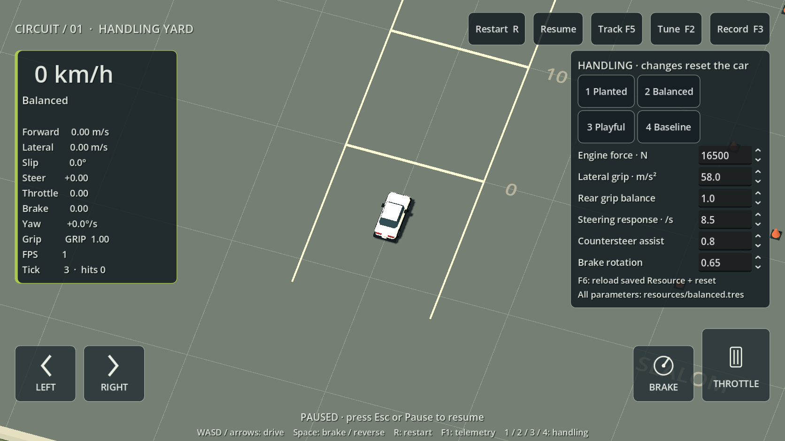

# Deliberate rotation and recovery — 2026-09-14

**Owner follow-up:** Original is now the default; comparison is available in normal races and creator practice. See [HANDLING_SELECTOR.md](HANDLING_SELECTOR.md). The implementation/testing history below describes the initial iteration.

Requirements: **G01** (responsive steering, momentum, recoverable slip and collision losses), **R01** (digital/touch controls), replay/rules identity foundations of **R03/R07**. The owner's supplied handling notes reopen a focused handling iteration. Balanced is the default in ordinary races and creator practice. Ordinary races still use five laps; creator practice remains untimed.

## Implemented behavior

- Steering responds on the first 120 Hz tick and reaches full input in 15 ticks (125 ms). Unwinding/reversing uses 20 input units/s, crossing centre from full lock in six ticks (50 ms). Speed-sensitive wheel angles remain.
- Front turning demand smoothly saturates against available grip. Excess entry speed produces a wider path, with world momentum separate from chassis heading. Surfaces and dirty/oily/wet tyres still affect grip.
- Brake plus steering supplies bounded sustained rotation and reduced rear traction. It fades out below 4 m/s and is fully available above 12 m/s. It is a per-tick target, not an additive impulse that repeated taps can accumulate. Brake overrides throttle, including grip/power effects; simultaneous pedals at rest do not engage reverse.
- Countersteering follows the player's correction faster during a slide. Unwinding progressively settles yaw. Recovery never chooses a racing line or pulls toward a road. Coasting steering cannot create energy.
- Broad slides sacrifice engine traction; clean exits accelerate better. Engine force (16,500 N), maximum speed (46 m/s), physical dimensions, camera, collision settings and tracks retain their prior settings.
- Quiet original synthesized tyre scrub follows measured slip and speed. Steering input alone produces no sound. Airborne, paused and countdown states are silent. Audio is presentation-only, with listening/device acceptance outstanding.

The debug tuning panel offers **1 Planted**, **2 Balanced**, **3 Playful**, **4 Baseline**. Presets have equal engine power and top speed. Brake rotation is exposed alongside grip, steering response and recovery assistance. Switching resets the attempt. Production races use Balanced and do not expose debug tuning.

Baseline explicitly freezes all previous exported values and disables the new dynamics. `tests/fixtures/handling_baseline.json` was captured from physics 0.18 before editing: ten state checkpoints across 1,200 mixed-input ticks. Tests never regenerate it. The comparison reproduces those recorded scalar checkpoints within JSON precision. Shared audio also applies to Baseline.

## Identity and changed files

**handling-0.14 / arcade-planar-0.19** version this change. Quantized inputs and the canonical snapshot layout are unchanged; diagnostic schema 6 remains valid. Config snapshots include all new assistance/tuning values. Record keys include physics identity and complete configuration: old PB files remain intact, and incompatible times are not compared against new handling.

Runtime files under `game/`: `vehicle/handling_config.gd`, `vehicle/vehicle_simulation.gd`, `vehicle/tire_audio.gd`, `resources/stable.tres` (Planted), `resources/loose.tres` (Playful), `resources/baseline.tres`, `core/game.gd`, `ui/playground_hud.gd`. Balanced inherits config defaults.

Verification: `tests/test_handling.gd`, `tests/test_driving.gd`, `tests/capture_handling.gd`, baseline fixture and generated script UIDs; `scripts/dev.ps1` adds TestHandling/TestDriving/CaptureHandling and includes handling checks in Validate. Documentation: this file, status/phase-plan entries and audio provenance in `licenses/ASSETS.md`. Concurrent menu edits are separate.

The old full-lock-within-50-ms assertion now checks that turning has already begun during the requested 100–150 ms ramp. Momentum, powered-corner slip, collision and replay invariants remain. The historical low-power comparison disables the new dynamics so its metrics still describe that controller.

Full validation also exposed two stale `_preview_document` calls in `test_editor_v2.gd` and `test_free_editor.gd`. The obsolete calls predate this handling change (confirmed against HEAD). Both tests now use `_save_track_explicit`, retaining save/export/import and physical-identity assertions. `test_creator_refinement.gd` also now explicitly saves before racing the edited saved circuit and dismisses the correctly owned confirmation dialogs; WIP autosave intentionally leaves the saved original intact. No obsolete application API was restored or save invariant weakened.

The first shared-workspace Validate stopped on the obsolete preview calls. The next reached the refinement fixture, which stalled after a stale saved-document assumption; its specific headless process was stopped to collect the error output. After fixing the fixture, concurrent menu edits introduced a preload of a not-yet-present `compact_illustration_v1.png`, preventing menu-dependent tests from compiling. Validation therefore moved to a detached checkout at `build/handling-validation`, based on HEAD `88435bf`, with only handling files, the three test-workflow corrections and handling script commands copied in. The shared menu work was preserved.

## Actual verification

Commands use `powershell -NoProfile -ExecutionPolicy Bypass -File scripts/dev.ps1` from the repository and **4.7.2.stable.official.ed1daf0bf**.

| Action | Outcome |
|---|---|
| `powershell -NoProfile -ExecutionPolicy Bypass -File build/handling-validation/scripts/dev.ps1 Validate` | Exit 0: pinned-engine import, 86 script parses, main-scene startup and all **1,277 checks across 20 suites**, including full race/replay and creator hazards. This verifies the isolated handling checkpoint, not concurrent menu changes. |
| `TestHandling` | 47 checks passed: steering onset/reversal, clean cornering, entry-speed penalty, ordered preset rotation/recovery, exit advantage, brake-tap/steering energy bounds, symmetry, audio signal/muting and 16 exact JSON replay comparisons across four presets and 1/2/4/8 ticks per render. |
| `TestDriving` | 56 checks passed: acceleration, braking, reverse, momentum, collisions, touch lifecycle, scene integration and exact replay. |
| `TestTracks` | 163 checks passed: three diagnostic laps each on FREEWAY, 1WAY, 66 and OFFROAD, zero contacts, exact full-lap replay, bridge/underpass/ramp recovery, wall scraping and tire cleanup. |
| `Import` | Passed on the pinned engine. |
| `CaptureHandling` | Passed; 1672×941 engine screenshot inspected for preset/button/field visibility. |
| `Snapshot -Track slicks_freeway_test -AI -CaptureTick 600` | Passed; actual FREEWAY driving screenshot inspected. Scripted diagnostic driver, not a human feel test. |
| `Doctor` | Android readiness failed: matching templates, SDK/ADB/build-tools and JDK missing. No phone enumerated; attachment state unknown. No APK/device test performed. |

Measured maneuvers (not human playtests):

- Quarter-second full-lock entry at 18 versus 36 m/s: approximate path radii 17.92 versus 46.26 m.
- Trail braking for 0.3 s at 24 m/s: 5.83° / 6.85° / 7.83° slip in Planted / Balanced / Playful; 1.53° / 3.97° / 5.94° extra rotation compared with each preset without brake-transfer effects. All recover under centred steering and throttle.
- Seeded-slide countersteer: unwanted heading change falls from 0.1074 to 0.0726 radians over 100 ms (about 32%).
- Ten seconds full throttle/full lock: 28.44 m/s, 6.85° slip, below the 46 m/s straight-line cap. This does not prove full-lock driving is slower on every track.
- Baseline scalar checkpoint error: about 5e-13 after JSON serialization. New same-engine replay comparisons are exact.



[Scripted FREEWAY capture](evidence/handling-freeway.png), [focused check output](evidence/handling-focused.txt), [track/replay output](evidence/handling-tracks.txt), [Android prerequisites](evidence/handling-android-doctor.txt).

[Full isolated validation output](evidence/handling-validation.txt) records every suite and warning. Several UI suites emit two-instance ObjectDB shutdown leak warnings; the run has no script errors or failed assertions. The warnings are retained as a limitation, not classified as a clean leak check. `git diff --check` passed. The local checkpoint stages handling changes and only its own paragraphs/commands in shared docs/scripts, preserving the concurrent menu work.

## Manual acceptance still needed

Restart to load the new default, then drive normally. For comparisons:

```powershell
powershell -NoProfile -ExecutionPolicy Bypass -File scripts/dev.ps1 Run -Track slicks_freeway_test
```

Use WASD/arrows, Space or S to brake, R to restart, F2 for tuning and 1/2/3/4 for presets. Compare the same bend: brake early and drive cleanly; enter faster and feel the wider path; briefly brake while turning; unwind and accelerate; countersteer a larger slide. Listen for scrub before a large slide. Use OFFROAD/F5 for grass and bridges. Existing fixtures supply hairpins/sweeps/grass; no new track was added.

Record ten consecutive laps per preset, contacts/spins and exit speed, varying preset order. Check repeated brake tapping, wall riding and grass cutting for lap-time exploits; invariant tests cannot rank every racing strategy. A physical phone must verify two-thumb response, sound balance, rendering frame rates and pacing. No human playtest, sound-quality approval, camera calibration or cross-device replay equivalence is claimed. Engine sound, suspension polish and further touch-layout options from the ideas are outside this first iteration.
