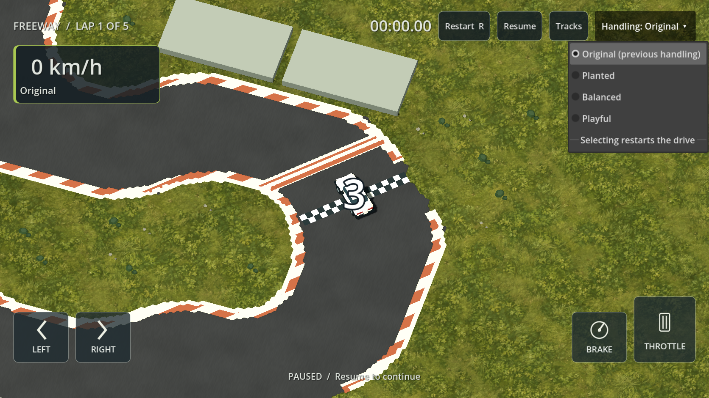

# Original default and accessible comparison — 2026-09-14

**Latest owner follow-up:** [Original+](ORIGINAL_SLIDE.md) now defaults to the requested original-based slide/forward-drive tune. Unchanged Original remains selectable beside it. The history below describes the selector's initial release.

**G01/R01/R03/R07:** the owner prefers the previous handling and could not access the comparison controls during normal play. Original (the frozen pre-iteration Baseline resource) is now the default at application startup. The experimental Planted, Balanced and Playful presets remain optional. This supersedes the Balanced-default and debug-only comparison statements in HANDLING_FUN.md. The canonical physics solver and its version are unchanged.

A visible **Handling: Original ▾** button in the top bar opens the same four choices in ordinary races and creator practice, including non-debug builds. The menu pauses the drive and releases touch/keyboard input. Selecting a preset restarts the drive, including the normal race countdown. Cancelling resumes without changing the preset. As with the existing Pause action, pausing an ongoing timed attempt marks it practice; restarting starts a fresh attempt. Selecting Original restores the previous handling. The selection carries to subsequent tracks and menus for the current application session; reopening the application defaults to Original again.

Garage information and home PB lookup use the selected config. Existing record keys still separate different physics/configs; comparisons do not combine times from different handling presets. No key rebinding or pedal-layout redesign is part of this fix—the inaccessible controls reported here were the handling comparison controls.

Changed files: `game/vehicle/handling_config.gd` (shared profile paths/session selection), `game/resources/baseline.tres` (Original label), `game/core/game.gd` (default, switching and pause lifecycle), `game/ui/playground_hud.gd` (visible selector), three config lookups in `game/core/app.gd`, `game/tests/test_driving.gd`, `game/tests/capture_handling.gd`, and this documentation/status entry. Concurrent menu artwork/layout changes are preserved separately.

Actual commands, using `powershell -NoProfile -ExecutionPolicy Bypass -File scripts/dev.ps1` and pinned Godot `4.7.2.stable.official.ed1daf0bf`:

| Action | Actual outcome |
|---|---|
| `TestDriving` | 70 checks passed, including selector visibility in production race and practice, Original default, pause/input release, switch/restart, cancel/resume, session config and restoring Original. |
| `TestHandling` | 47 checks passed, including original baseline golden checkpoints and exact replay for every preset. |
| `TestApp` | 84 checks passed, including navigation/racing/records. |
| `CaptureHandling` | Production-race selector screenshot captured and inspected; no debug lab or special launch flags are required for the selector. |
| `git diff --check` | Passed. |

Some scene tests still report ObjectDB shutdown leak warnings; these checks do not establish leak-free operation. No physical-phone test or new subjective handling approval was performed. Real two-thumb reach and popup usability remain to be checked on a phone.

Restart the application, start any race or creator practice, then use **Handling** at the top right. **Original** is already selected. Choose one of the alternatives to compare on the same track; choose Original again to return.
