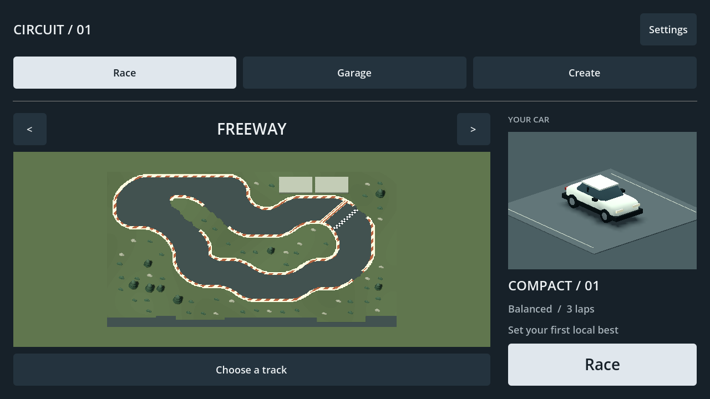

# HCR2 menu structure revision — 2026-09-12

Owner request: improve the menu structure using Hill Climb Racing **2** specifically. Requirements: V03 (menu composition), G03 (garage access), R01 (touch navigation), R06 (race access/retry). This is a revision within the authorized local menu slice.

Reference reviewed: [HCR2 Cups screenshot](https://imag.malavida.com/mvimgbig/download-fs/hill-climb-racing-2-18381-8.jpg), linked from [HCR2 screenshot gallery](https://www.malavida.com/en/soft/hill-climb-racing-2/android/). It shows persistent mode tabs, separate settings, an illustrated selected cup and a prominent Race action. This is a publicly available screenshot, not verification of every screen in the latest installed release. HCR1 was excluded after the owner's clarification. Reference assets are not included in the game.

Adaptation: Race, Garage and Create are the three main destinations. Settings sits separately at the top right. Race opens directly onto the selected circuit's native 3D preview, previous/next buttons, current original car, three-lap rule, real local PB (or first-record prompt) and a large Race button. Choose a track opens the complete built-in/local library. Circuit cycling includes saved creations. The redundant introductory slogan and duplicate creator link are removed. Existing local racing, garage, creator and results remain connected; no HCR2 economy, progression, cups or online services are introduced.

Changed implementation: `game/core/app.gd` navigation/home/circuit selector; `game/tests/test_app.gd` real selection-to-race checks and updated Create navigation. Documentation: this file, development status and phase plan; evidence below. Concurrent creator changes in other files belong to separate ongoing workspace work.

Actual commands (PowerShell with `-NoProfile -ExecutionPolicy Bypass -File`):

- `scripts/dev.ps1 TestApp`: initial attempt stalled while newly added concurrent creator classes had not been imported; interrupted, not reported as passed.
- `scripts/dev.ps1 Snapshot -Screen play`: initial attempt detected missing CreatorObjects registration; after the validation import, exit 0 and inspected a real Windows capture.
- `scripts/dev.ps1 CaptureApp > build/hcr2-menu-capture.txt`: exit 0, 86 checks, zero failures. Includes actual menu circuit selection and matching launch, native touch navigation, three-lap creator drive (zero contacts), results, retry, return and local records. Inspected home and returned-editor captures.
- `git diff --check`: passed with existing line-ending notices.
- `scripts/dev.ps1 Validate > build/hcr2-menu-validation.txt`: exit 1. Import/parses/startup and 56 driving + 163 original-track + 27 extra-track checks passed. Creator suite had 6 failures out of 86, including the compiler-v1 golden identity, during concurrent creator document/compiler changes. No creator expectation was weakened for this menu change. Full-suite green status remains outstanding; the separate graphical app run above passed.

Capture log: [hcr2-menu-capture.txt](evidence/hcr2-menu-capture.txt). No physical-phone test or APK export was performed; attachment was not enumerated. Owner menu acceptance, physical touch/safe-area usability and performance remain pending. Existing desktop editor sidebar scrolls when controls exceed available height. Local PBs remain unverified and use the current Balanced rules key.
