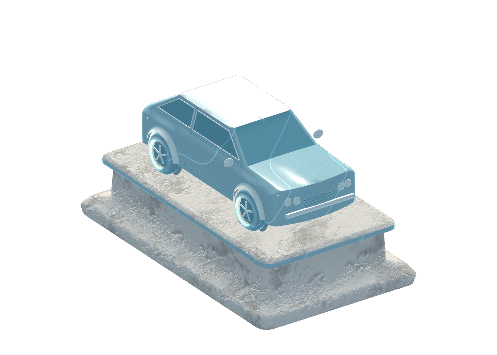
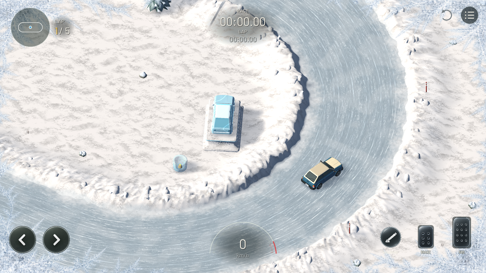

# Ice Compact sculpture — 2026-10-19

The owner requested an ice sculpture of the Compact on a pedestal. **Winter → Props → Ice Compact** now places the stock fictional car carved in pale blue ice on a stepped, snow-covered plinth. The original Compact's analytical coachwork supplies the body, shaped hood, roof, windows, wheel arches and door outline. Carved wheels, paired round lamps, grille, bumpers and mirrors retain its identity. Frosted cuts, filtered crystals and quiet trapped fracture planes give the surfaces an ice treatment. The tyres sit 5 mm into the pedestal cap rather than floating above it.

| Requirement | Delivered and verified |
|---|---|
| ICS01 | Recognisable stock Compact sculpture using `CompactCoachwork` profiles, including the actual hood, roof and nose samples. No live car instance or cosmetics are constructed. |
| ICS02 | Fitted rounded pedestal with stepped snow foot, snow-covered cap at 1.10 m and a narrow ice band. Car and pedestal place, rotate and scale together. The solid contact footprint follows the rounded pedestal and excludes its empty corners. |
| ICS03 | Winter-only Props entry, label, search, Recent, thumbnail, contact shading, saved-document schema and compiled object support. Actual editor placement, undo, redo and local JSON draft reload pass. |
| G01 | Existing five Winter craft retain every mesh channel. Existing catalog restrictions, contacts, replay/rewind and bounded world preparation pass their original checks. |
| R01 | 7,908 triangles for the entire car and pedestal, below the existing 10,000 ceiling. Original shared opaque WinterCraft surface, cache budgets and upload bounds remain. Prop15 fences prepared model/world/thumbnail caches. |
| Q01 | Unretouched native studio, front/rear detail, actual editor and Winter race captures in Compatibility and desktop Mobile; actual logs and isolated task-only checkpoint. Owner art judgement and physical-device acceptance remain. |

The ice is deliberately thick and opaque, with rim/specular/frost cues. A new vertex-tag branch in the existing snow shader supplies the treatment; it introduces no transparency sorting, screen copy, refraction pass, new texture, sampler, material surface, light or runtime service. The pedestal reuses the exact existing world snow tile and castle snow treatment. Existing igloo/castle/snowman/lantern tags retain their branches. The separate ice-lantern shader is unchanged. No external model, generated image or third-party asset was added.

The complete mesh contains 23,724 vertices: 23,106 ice-tagged and 618 snow-tagged. Bounds are `(-1.64, -0.035, -2.78)` with size `(3.28, 2.643, 5.56)` m; the selection dimensions are 3.4 × 5.8 m. It is a static solid prop, not a breakable or a drivable vehicle. Populate retains its existing curated roster; this addition is manually placeable. Existing saved objects and physical car/camera dimensions are unchanged. The schema remains creator-track-v5 with an additional `ice_compact` kind. Existing compiler27, physics and rules contracts remain. A document containing the new prop has its own normal content identity; old document identities are unchanged. Live sharing needs the matching client/verifier source rollout, which was not performed here.

The existing 32 MiB prop / 24 MiB thumbnail / 64 MiB finished-world budgets and original bounded upload limits are retained. `authored-props-15-ice-compact` refreshes existing visual keys. Geometry and surface counts are verified; no frame-rate, phone-loading, peak-memory or thermal claim is made.

[Native review gallery](evidence/ice-compact-2026-10-19/review.html) · [exact receipts and hashes](evidence/ice-compact-2026-10-19/report.json)

Changed runtime files: new `game/track/prop_ice_compact.gd` (+ UID); `game/track/prop_winter_craft.gd`, `winter_craft_snow.gdshader`, `creator_prop_visual.gd`, `contact_shading.gd`; `game/editor/creator_objects.gd`, `creator_catalog.gd`; `docs/schemas/creator-track-v5.schema.json`. Tests: new `game/tests/test_ice_compact.gd` (+ UID), explicit six-craft/Winter24 expectations in `test_winter_craft.gd` and `test_biome_object_kits.gd`. Documentation: this file, AGENTS.md, DEVELOPMENT_STATUS.md, docs/PHASE_0_PLAN.md, licenses/ASSETS.md and current-task evidence. Unrelated workspace changes and the main Git index are preserved.

Actual commands use pinned Godot 4.7.2 through `powershell -NoProfile -ExecutionPolicy Bypass -File scripts/dev.ps1`:

| Arguments | Actual outcome |
|---|---|
| `-Action TestScript -ScriptPath res://tests/test_ice_compact.gd -CommandTimeoutSeconds 180` | 39 checks, zero failures. Geometry/normals/winding, stock profiles, seated wheels, bounded cache, transforms, compiled solid/empty-corner contacts, JSON identity and exact original five meshes. |
| `-Action TestScript -ScriptPath res://tests/test_ice_compact.gd -Graphical -RenderingMethod gl_compatibility -CommandTimeoutSeconds 300` | Final 56 checks, zero failures. Includes real palette/thumbnail, rotated loaded objects, place/undo/redo, saved draft reload, race context and one shipping craft surface. |
| Same focused graphical command with `-RenderingMethod mobile -RenderingDriver vulkan` | Final 56 checks, zero failures on desktop RTX 3090. This is not Android execution. |
| `-Action TestScript -ScriptPath res://tests/test_winter_craft.gd -CommandTimeoutSeconds 180` | Final 603 checks, zero failures, including original contacts, persistence, breakup/rewind and driven replay fixtures. |
| `-Action TestScript -ScriptPath res://tests/test_biome_object_kits.gd -CommandTimeoutSeconds 180` | 999 checks, zero failures. |
| `-Action TestScript -ScriptPath res://tests/test_prepared_race_load.gd -CommandTimeoutSeconds 180` | 85 checks, zero failures; original 64 MiB finished-world budget remains. |
| `-Action TestScript -ScriptPath res://tests/test_snow_castle_fit.gd -Graphical -RenderingMethod gl_compatibility -CommandTimeoutSeconds 240` | Final 35 checks, zero failures, including strict original-shader pixel controls for existing craft. |
| Same castle command with `-RenderingMethod mobile -RenderingDriver vulkan` | 35 checks, five strict igloo pixel failures. Original-shader → original-shader repeat controls fail too: 641 channel bytes differ by at most 1. Assertions retained; this broader result is not reported as passing. |
| `-Action Import -CommandTimeoutSeconds 240` | Completed successfully; new script resource UIDs registered. |
| `-Action TestScript -ScriptPath res://tests/test_script_parse.gd -CommandTimeoutSeconds 180` | Final 906 scripts, zero failures in the shared current workspace. |

Initial native focused runs retained one draft-comparison fixture failure. Waiting for the actual asynchronous editor write and comparing the loaded document to its exact JSON roundtrip corrected the fixture: float serialisation changes in-memory numeric representations, while the logged stored/expected JSON objects were identical. This follows the existing editor persistence contract; no production saving code or invariant was relaxed. The first expanded Compatibility fixture had 53 checks and one failure; the intermediate expanded runs had 56 and one failure. Both final expanded renderers pass all 56. The earlier 44-check visual fixture passed before placement/reload/race coverage was added. The roof frost, wheel seating, closed ice wheel wells and fracture strength were refined after native visual review. No existing test assertion was removed or weakened.

The older castle suite writes to its historical fixed capture folder; this rerun's logs and igloo control images are copied into the present task evidence. Historical captures were refreshed by that suite, so the present report records its own hashes rather than asserting old report hashes remain current. The task-only checkpoint uses the saved pre-task runtime files and saved documentation baselines, excluding unrelated concurrent documentation inserts.

Remaining acceptance: owner judgement of the sculpture in the Winter world; actual Android appearance, interaction, frame pacing, memory and thermals. No phone attachment check or device test, APK/export/install, live publication/account/queue mutation, backend change or deployment was performed.
