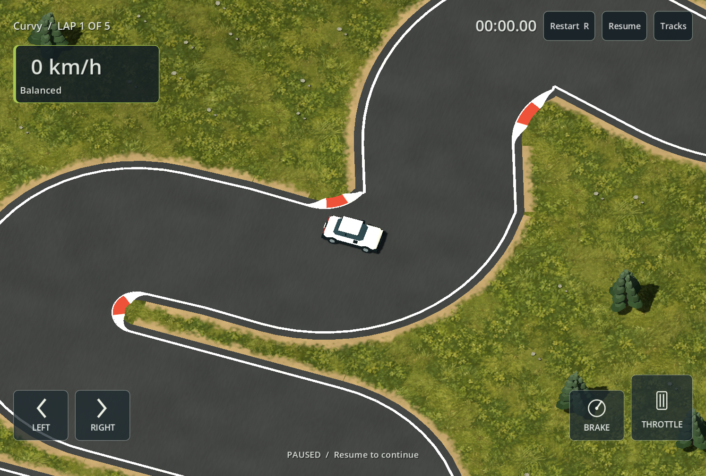
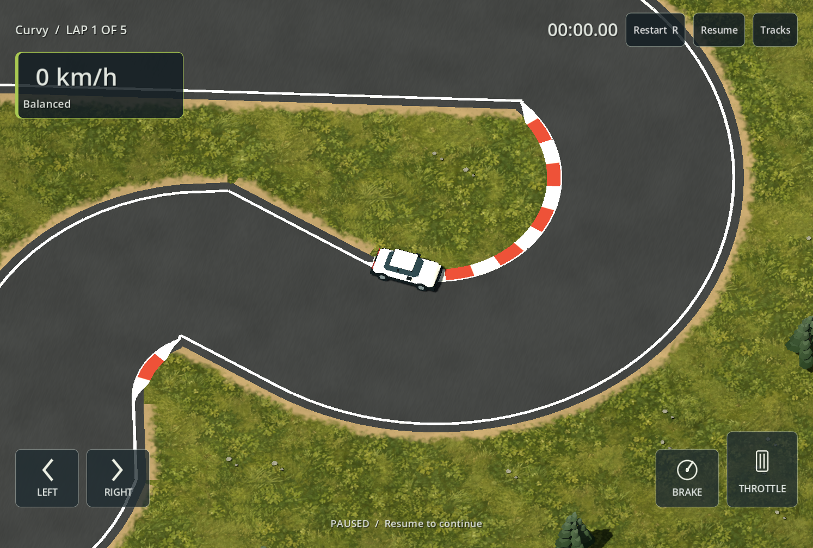
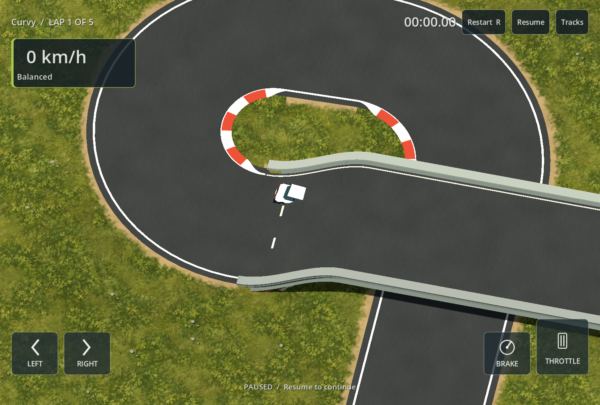
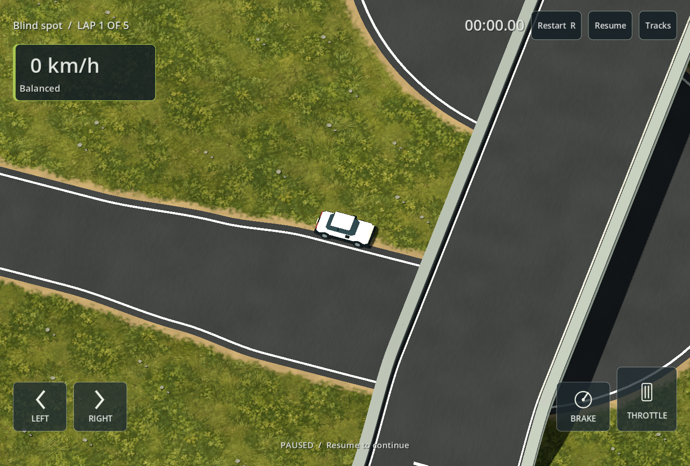

# Curvy kerb and marking tips - 2026-09-14

Requirements: R01 / T01-T04 / V02 / V04 / V05. Follow-up to ROAD_JOIN_FIXES.md: the owner showed three remaining protruding kerb tips and white marking tails on Curvy. The earlier shared cross-section fix did not prevent near-end curve samples from doubling back past an angled miter, and roadside extrusion still included the hidden full-width cap in its tangent calculation.

Presentation now trims only the contiguous folded samples at each connected tip. It preserves distant returning hairpin geometry, retains the short marking connection to the shared cross-section, omits the full-width internal cap, and computes kerb/shoulder endpoint extrusion from the exposed roadside. Short join connectors receive white paint rather than kerb blocks. Asphalt cover and ground skirt use the same locally trimmed outline to avoid folded offset polygons.

Visual kit is track-kit-14. Compiler identity, native surface cells, physics, lap route and saved documents are unchanged. No user files were resaved or deleted.

Changed files: game/track/native_track_visual.gd, game/tests/test_road_pieces.gd, game/tests/capture_style.gd, this document, DEVELOPMENT_STATUS.md, docs/PHASE_0_PLAN.md and the evidence images below. CaptureStyle now samples twelve route positions rather than six so the joints between previous capture positions are visible.

## Actual commands and outcomes

All commands used the pinned Godot 4.7.2 build through `powershell -NoProfile -ExecutionPolicy Bypass -File scripts/dev.ps1`.

- `TestPieces`: 158 checks, zero failures. Nine added checks cover backwards tip removal, preserving the distant returning hairpin, keeping short seam connectors, hiding full-width caps, excluding cap directions from kerb extrusion, and triangulating both mirrored sharp-join fixtures. Existing kerb UV, taper, normal and surface-preservation checks still pass. Five-lap witness: zero contacts.
- `TestHazards`: 150 checks, zero failures.
- `TestConstruction`: 73 checks, zero failures. Bridge witness completed five laps with zero contacts; upper/lower traversal counts 801/807.
- `CaptureStyle -StyleDocument <Curvy JSON>` and the same command for Blind spot: start plus twelve route views each; all road normals upward, both captures reported native cells preserved, all PNG writes succeeded. Read actual owner files `%APPDATA%/Circuit01Lab/tracks/track_5765ff853b63dea5.json` (Curvy) and `track_183e0afb5090a6eb.json` (Blind spot).
- `git diff --check`: passed.

Targeted presentation, kerb, hazard and bridge checks were run; a full Validate invocation was not repeated for this presentation-only follow-up. Logs remain in build/road-pieces-tests.log, build/hazards-tests.log, build/construction-tests.log and build/style-capture.log (the latter is the final Blind spot capture).

## Reviewed Windows evidence

Owner visual acceptance remains open. No phone test, device enumeration or Android export was performed. Existing authored sharp corners remain sharp; this change removes folded tips rather than redesigning the roads. Extreme overlapping multi-way joins are not exhaustively covered by these screenshots. Existing raster surface approximation and physical-phone performance limits remain.
