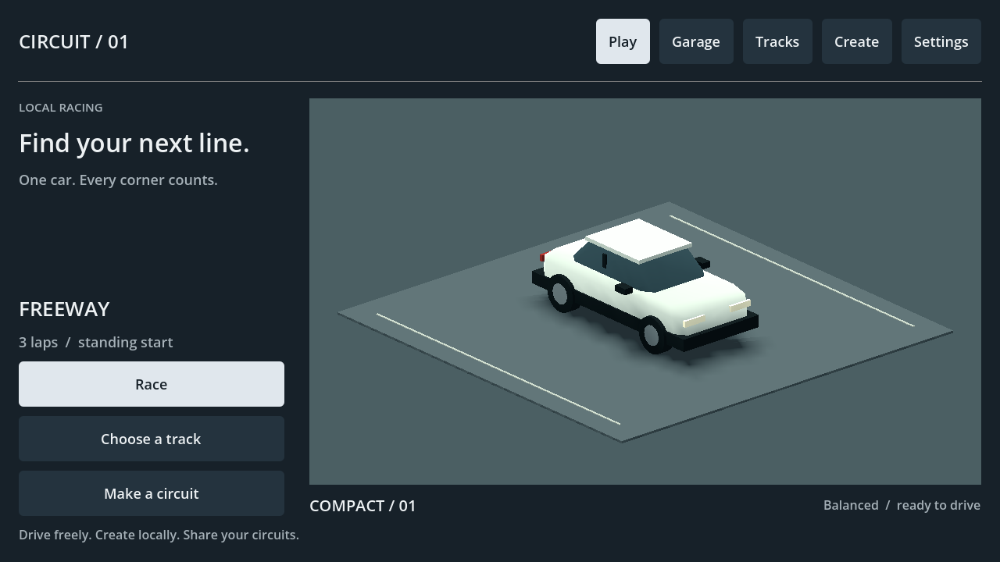
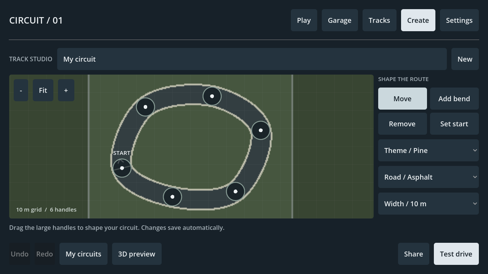
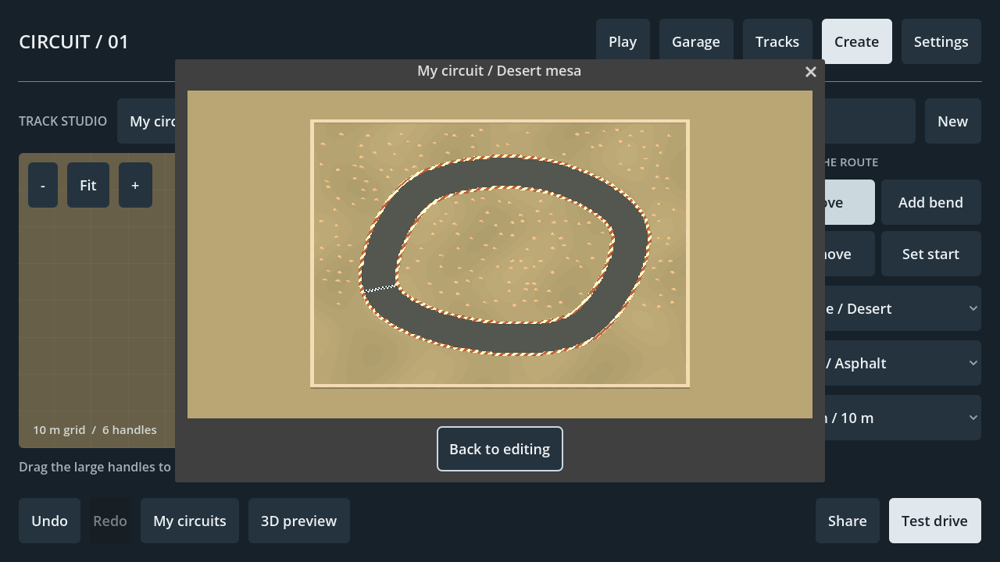
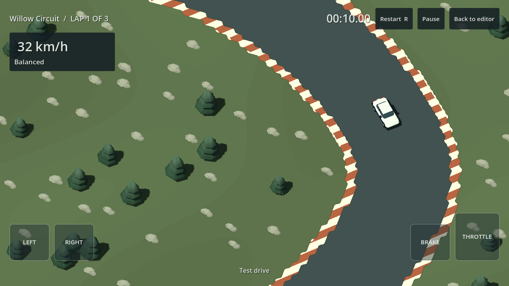
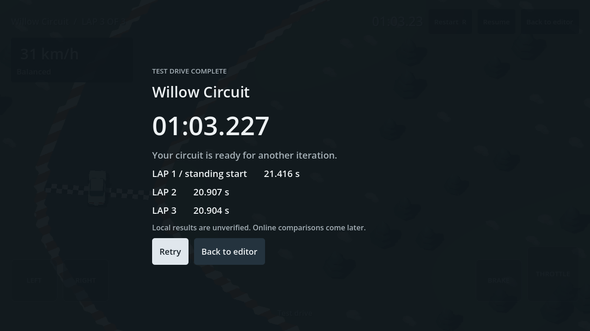

# Menus and track studio — 2026-09-12

The owner accepted handling and collisions and authorized the next local slice: menus, more Slicks circuits, a creator usable on a phone and coherent themed track graphics. This supersedes the earlier handling-only/editor restriction for this slice. The engine remains `4.7.2.stable.official.ed1daf0bf`; handling remains `handling-0.13` and canonical physics remains `arcade-planar-0.12`.

## What to try

Run `powershell -NoProfile -ExecutionPolicy Bypass -File scripts/dev.ps1 Run`, or run `game/project.godot` from the pinned Godot editor. Restart an older running instance to load these changes.

1. **Play** opens a menu-only showroom using the same original Compact / 01 car. Race starts the selected circuit; Garage shows the current car. Tracks offers seven imported layouts and local creations. Settings saves handedness and three touch-button sizes.
2. **Create** starts with a complete circuit. Drag the large handles; Add bend inserts another handle, Remove deletes one and Set start moves the start around the loop. The road smooths automatically. There are no tangent handles or precision placement requirements.
3. Choose **Pine, Coast or Desert**, **asphalt or dirt**, and **8/10/12/14 m width**. Fit, + and − are visible over the canvas. Drag empty space to pan; two fingers pan and zoom. Tool, pan and zoom survive theme/width changes and test drives.
4. Valid edits save locally. Undo/Redo work through route edits. Invalid changes remain visible with a concrete correction message and disabled Test/Share actions; fix or undo them. New/import will not discard an invalid active route. The last valid disk save remains available.
5. **3D preview** shows the exact compiled native geometry with the same theme kit as racing. **Test drive** starts a three-lap session using the unchanged follow camera. Back to editor returns to the same draft and planning view.
6. **Share** copies a small circuit document or exports a JSON file. **Tracks → Import a circuit** accepts pasted data or a file and creates a fresh local copy. No scripts, images, URLs, resource paths or arbitrary objects are accepted. Use clipboard exchange on a phone until native Android file-picker behavior is device-tested.
7. Select a saved circuit under **My circuits** to race it; Edit circuit opens its draft. Normal menu races have a standing three-second countdown, three laps, results, local race PB and a separate flying-lap best. Retry immediately resets the loaded scene. A paused run is practice; editor test runs do not write PBs.

There is no local draft count quota, payment, hosting requirement or paid retry. The menu implements working local pages. League, online comparisons, progression, commerce and hosted publication are deferred; no fabricated league/economy data or inactive purchase flow is included.

## Requirement coverage and files

| Requirements | Delivered behavior | Main changed files |
|---|---|---|
| V03, G03, R06 | Functional dark menu/navigation, original car showroom, local race/results/retry | `game/core/app.{gd,tscn}`, `game/ui/menu_style.gd`, `car_showroom.gd`, `track_showroom.gd`, `game/project.godot` |
| R01, R04, R07 | Native menu touch/text input, adjustable racing touch zones, separate countdown, recoverable local PB/settings | `game/core/game.gd`, `game/ui/playground_hud.gd`, `touch_controls.gd`, `game/persistence/local_records.gd` |
| G05, T01, T02, T03, T04, V05 | Bounded closed-route creator, native compilation, autosave/recovery, undo/redo, test drive, free file/clipboard exchange | `game/editor/{editor_canvas,track_document,track_compiler}.gd`, `game/persistence/track_library.gd`, `game/ui/track_map.gd`, `docs/schemas/creator-track-v1.schema.json`, `game/tests/fixtures/creator_default.json` |
| G02, R03, V05 | Three additional native circuits, tested three-lap timings and exact replays | `game/resources/tracks/slicks_{arto4,hiekka,ovaali3}_test.json`, `scripts/slicks/{convert.py,config.json,extra_golden.json,test_extra_convert.py}` |
| V02, V05, V06 | Shared matte themes, faceted natural scenery, quieter terrain and clearer road/water edges | `game/track/{track_theme,native_track_visual,bridge_presentation}.gd`, `terrain.gdshader`, `licenses/ASSETS.md` |
| Engineering/verification | Pure native construction adapter, targeted and integrated suites, pinned entry points and evidence | `game/track/native_track.gd` (read/from_data only), `game/tests/test_{app,creator,extra_tracks,records}.gd`, `scripts/dev.ps1`, root status/plan/README/AGENTS and linked documentation |

The canonical simulation step, existing collision resolver, car proportions, camera profile and four original native fixture files are unchanged. `NativeTrack.from_data` allows the pure creator compiler to construct the same native type without disk I/O. Editor planning and independent menu cameras are presentation views; test driving returns to the existing follow contract.

The blueprint's initial snap-road-piece UI has been interpreted as a simple automatically smoothed starter-loop UI under this owner's phone-usability request. This is a reviewable proposal, not a claim that every later editor feature is complete. The schema has one directed ground-level route and a built-in theme; hand-authored bridges, water placement and scenery-object tools are not in this first creator.

## Actual validation

| Command/check actually run | Outcome |
|---|---|
| `powershell -NoProfile -ExecutionPolicy Bypass -File scripts/dev.ps1 Validate *> build/menus-creator-validation.txt` | Exit 0: import, 39 script parses, APP_READY startup and 443 checks (56 driving, 163 original tracks, 27 extra tracks, 86 creator, 63 app, 48 records). Full original three-lap/replay/ramp/wall/tire regressions retained. |
| `scripts/dev.ps1 TestCreator` through PowerShell with `-NoProfile -ExecutionPolicy Bypass` | 86/86. Strict malformed/oversize/hostile geometry handling, schema golden fixture, backup recovery and three full theme races with zero contacts and exact JSON replays. |
| `scripts/dev.ps1 TestRecords` through the same wrapper invocation | 48/48. Integer-ms records, standing/flying separation, identity partitions, strict corrupt-state recovery, legacy migration/rollback and failed-write rollback without phantom PBs. |
| `scripts/dev.ps1 TestApp` through the same wrapper invocation | Final focused suite: 67/67, exit 0. Real viewport-injected touch opens menus and focuses the name field; emulated duplicate mouse is ignored by native editor gestures. Both pinch-release orders, view retention, keyboard R from results and clean normal-result PB persistence are checked. Complete production test drive, results/retry/return and isolated persistence pass. |
| `scripts/dev.ps1 CaptureApp` through the same wrapper invocation | 81/81, exit 0. Eleven actual home, editor theme/3D preview, countdown, moving test drive, results and returned editor PNGs captured and inspected. Synthetic input, not a human/phone usability session. |
| `scripts/dev.ps1 Snapshot -Screen play`, `-Screen create`, `-Screen tracks` | All exit 0; inspected actual 1280×720 menu captures. |
| Offline converter, source/golden/schema tests | Original converter 4/4; added converter 2/2 covering all three new source/native contracts. Original fixture bytes unchanged. Commands and hashes in [MORE_SLICKS.md](MORE_SLICKS.md). |
| `scripts/dev.ps1 Doctor` through the same wrapper invocation | Exit 1: exact Android templates, SDK/ADB/build-tools and JDK still missing. No APK export or device test. |
| `git diff --check` | Passed; only repository CRLF/LF normalization notices. |

The three added layouts completed nine AI laps without a contact: Pine Loop 18.725/16.763/16.752 s, Dune Run 25.261/24.140/24.158 s, Coast Oval 16.475/15.432/15.456 s. Original compiler fixture laps are about 21–22 s; all themes completed three zero-contact laps and exact JSON replays. The modified circuit in the real app test completed 21.416/20.907/20.904 s, zero contacts.

Intermediate failures were fixed rather than hidden: an incomplete app call during integration; an initial Fit before layout produced NaN transforms; pinch-to-single-finger panning jumped; and the new save schema initially rejected JSON's numeric schema type. Final suites retain regression coverage. The countdown received a dark outline after visual review. Final review also connected keyboard R on results to the same visible retry transition as the Retry button. The Android diagnostic warning remains a real prerequisite failure.

## Actual Windows evidence

Additional screenshots: [track browser](evidence/menu-tracks.png), [pine preview](evidence/creator-preview-pine.png), [coast preview](evidence/creator-preview-coast.png), [countdown](evidence/creator-countdown.png), [returned draft](evidence/creator-returned.png). Evidence logs: `menus-creator-validation.txt`, `menus-creator-app-capture.txt`, `creator-tests.txt`, `records-tests.txt` and `more-slicks-*-tests.txt` under `docs/evidence/`.

## Acceptance still required

- Owner: create a different circuit without instruction beyond the on-screen controls, change theme/width, preview it, drive it, return and reshape it. Save/share/import it and race the imported copy. Judge whether the new themes fit the current car's style.
- Physical Android: **no phone test or APK export was performed**. ADB is unavailable, so attachment could not be enumerated. Verify target sizes under real device density, native text keyboard, safe areas/system bars, simultaneous gestures/pedals, cancellation/background recovery, clipboard/file exchange and screen ratios. Desktop-injected touches are regression evidence only.
- Performance: Compatibility is still the baseline. No phone 20-minute thermal/p95 trace, renderer comparison or exact reference-camera calibration has been completed. Scenery is batched/capped; that is not a measured phone performance claim.
- Timing: ordered directed practice gates are retained. Results are local/unverified; this does not complete competition-grade shortcut/replay verification or online authority. Paused attempts are practice, and flying-lap records exclude the standing first lap.
- Content: creator tracks are plain bounded ground-level circuits. Invalid in-progress route geometry is held in memory/undo, with the last valid disk save preserved. Hosted sharing/challenges, custom scenery placement and creator bridges remain later work. Slicks source layouts remain owner-supplied development references with redistribution clearance unverified.

Detailed contracts and limitations: [CREATOR_FORMAT.md](CREATOR_FORMAT.md), [LOCAL_RECORDS.md](LOCAL_RECORDS.md), [MORE_SLICKS.md](MORE_SLICKS.md), [TRACK_THEMES.md](TRACK_THEMES.md).
