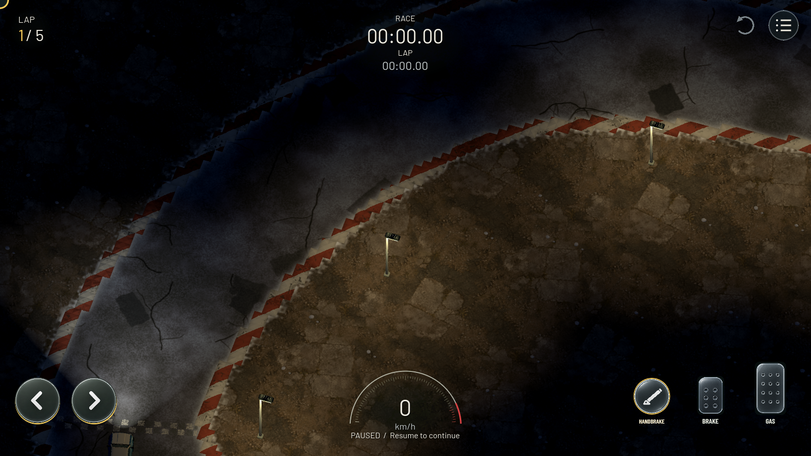

# Worn Night asphalt — 2026-10-17

Night roads now use faded charcoal binder, exposed mineral aggregate, irregular dark tar repairs and sparse branching cracks to match the abandoned industrial surroundings. The same continuous world-space finish covers authored road pieces, painted asphalt and bridge ramps/decks. Existing industrial terrain, lighting, road dimensions, geometry, car/camera, road markings and canonical driving remain unchanged.

[Original road in the same view](evidence/night-asphalt-2026-10-17/gl_compatibility-Windows/road-1-before.png) · [Bridge and warehouse](evidence/night-asphalt-2026-10-17/gl_compatibility-Windows/bridge-1-after.png)

| Requirement | Delivered and verified |
| --- | --- |
| NA01: worn industrial asphalt | Original offline data bake: oxidized binder/aggregate coverage, old resurfacing patches and fine branched cracks. Actual native views use existing lamps/headlights and the original gameplay camera. No painted potholes or collision changes. |
| NA02: coherent road and bridge finish | One 48m seamless world-space tile continues across road pieces and both creator/raster bridge material paths. Road edges, kerbs and marking layout remain original. |
| G01: preserve driving and other biomes | Presentation-only changes; exact canonical track/state and geometry comparisons pass. Non-Night shaders alias the inactive sampler away and keep their original asphalt branch. |
| R01: bounded work/cache | One shared 1024×1024 RGB data texture with mipmaps; one wear sample and existing grain fields, no new mesh/decal/draw populations or runtime generation. Visual kit209 invalidates retained presentation artifacts. |
| Q01: actual evidence and reviewable checkpoint | Pinned Godot4.7.2, disposable test saves/caches, paired Compatibility/Mobile views, frozen original shader sources, command logs and task-only patch/archive. Owner/device appearance acceptance remains. |

The new PNG is original numeric project artwork, generated by `scripts/bake_night_asphalt.py` with the existing offline NumPy installation and standard-library PNG encoding. It contains material factors, not a colour photograph. No external image, AI service, source licence or runtime dependency is added. Two bakes produce SHA256 `064181dab0d1aa3473a3a68b99b6203b04175a3900feb6cc76e75740bcc0bb61`; file size1,060,392bytes. The full RGB mip chain is approximately4MiB before driver alignment and is shared across materials.

Changed runtime files: `game/track/native_track_visual.gd`, `surface_detail.gdshaderinc`, `surface_shader_variants.gd`, `creator_bridge_visual.gd`, `bridge_presentation.gd`, and the new `game/assets/textures/night_asphalt_wear_v1.png` plus its import settings. New bake/integration tools and frozen original shader fixtures live in `scripts/bake_night_asphalt.py` and `game/tests/test_night_asphalt.gd` / `game/tests/fixtures/night_asphalt_*`. Provenance and project status are updated separately.

The focused headless run passes172 checks; Compatibility and desktop Mobile/Vulkan each pass192 checks. Existing sampler63, prepared-resources162, Night-lighting15 and parser854 checks pass. Full commands, native results, hashes, initial attempts and remaining limits are in [report.json](evidence/night-asphalt-2026-10-17/report.json).

The focused bridge fixture reaches pre-existing nine-declaration materials in Grass/Desert/Winter. Frozen original sources confirm9→9 for these, Storm8→8 and Night6→7. The existing terrain-sampler regression still passes63/63; this task does not claim all original material roles meet an eight-declaration ceiling. Initial integration failures also exposed a shader identifier collision, stale disposable road-cache artifacts and missing separate bridge bindings; all were corrected before final acceptance runs. Winter's unspecialized bridge required fixture detection through its expanded original source. A preprocessor guard also keeps the new sampler out of unspecialized non-Night shaders. Retained shared-texture metadata restores the binding after material duplication and prepared-cache hits; compiled-uniform checks cover every non-Night fixture material.

No physical-phone test or attachment check, APK export/install, backend mutation/deployment or FPS measurement was performed. Owner visual review and physical-device appearance/performance acceptance remain.
