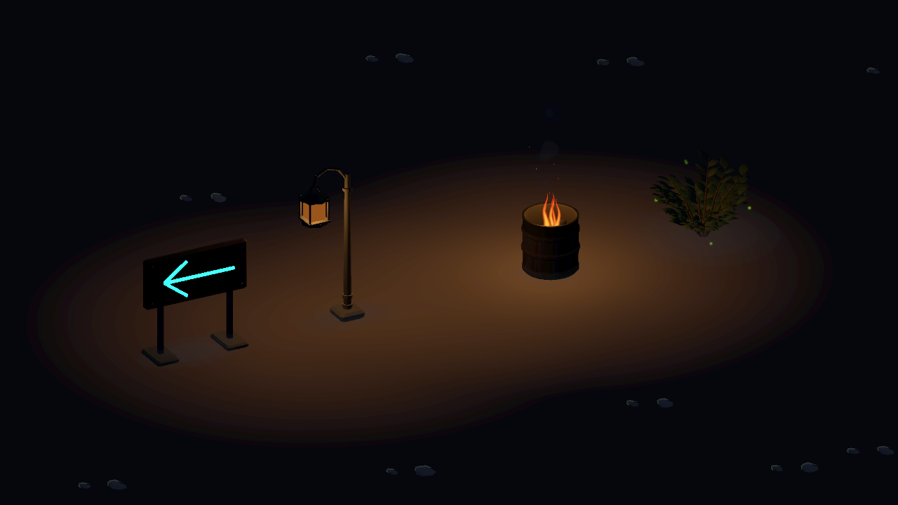
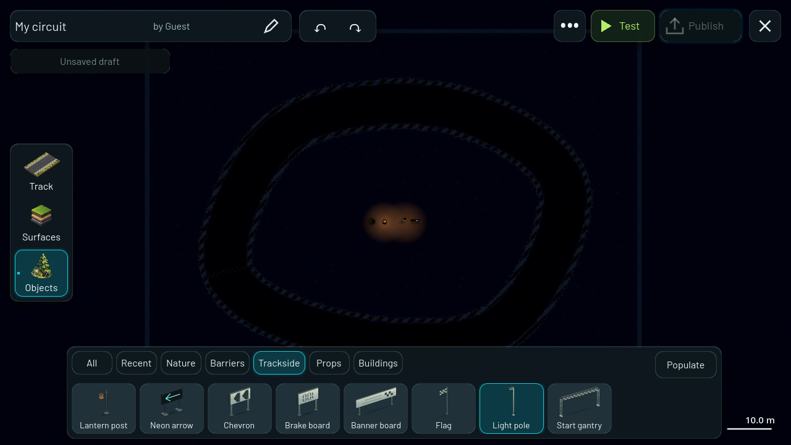

# Night scenery additions — 2026-10-16

Night now offers Firefly bush in Nature, Burning barrel in Props, and Lantern post / Neon arrow in Trackside. The existing Populate action chooses these roadside objects and scatters firefly bushes among broadleaf trees. These are original native models; no downloaded or generated media was used.

The bush has eighteen tapered woody leaders and 198 attached curved leaves. Twelve independently phased fireflies drift and blink around each supported bush. The open steel drum has rolled rims, pressed reinforcing bands, a welded seam, rust runs and recessed charred fuel. Flames, rising embers and soft smoke accompany its warm light. The hanging lantern has a shaped hook, suspension ring, recessed amber panes and a metal cage. The bolted arrow sign uses actual luminous tube geometry on both faces.

| Requirement | Result / evidence |
| --- | --- |
| NP01: Night-specific placement and saving | Four allowlisted IDs, biome filtering, JSON round trips, native palette photographs and actual editor views. |
| NP02: Firefly bushes | Original attached foliage, independent drifting/blinking instances, decorative footprint. |
| NP03: Burning barrels and matching details | Open drums, flames/embers/smoke, caged hanging lanterns and luminous arrow signs. Barrels, posts and signs are fixed obstacles; the original movable barrel remains available separately. |
| NP04: Bounded retained presentation | One clock per world; at most32 animated bushes /384 fireflies,32 fires /160 flame cards /224 embers /96 smoke cards and four additional shadowless warm lights. Extra placements retain their static models. Existing street lamps are unchanged. |
| NP05: Canonical isolation and lifecycle | Cosmetic uniforms only; actual race pause, hidden-world stop, restart, prepared-world ownership, editor edit/delete and one-shot thumbnail cleanup pass. Vehicle snapshots remain exact during presentation. |

Shared opaque geometry uses one Night material and retains authored normals. Effects use four immutable instance streams, with shader displacement inside conservative culling bounds; there is no CPU particle simulation or per-frame instance-buffer upload. Each restored world receives its own animation materials and instance buffers. Unchanged editor refreshes retain the controller; edited sources rebuild once. Existing mesh/thumbnail/editor/prepared-world entry and byte caps remain. The prop visual cache version changes to `authored-props-7-night-furniture` so prepared worlds and browser photographs cannot reuse an older prop set. Compiler27, physics0.60, saved vehicle state and existing track documents are unchanged by this task. Authored placement of the three solid new objects uses the normal compiler collision-mask path.

| Model | Triangles at scale1 |
| --- | ---: |
| Firefly bush | 4,032 |
| Burning barrel | 2,100 |
| Lantern post | 1,356 |
| Neon arrow | 644 |

Validation used Godot4.7.2 and isolated APPDATA folders under `build/night-*-user`:

- Focused Night checks:75 headless,94 Compatibility and94 Mobile. Covers saved identities, geometry/footprints, open drum, source caps, pause/hidden state, independent cached clocks, covered-light restoration, retained edits/deletion, real race pause/restart and canonical snapshot isolation. Native checks also verify changed animation pixels, exact paused images, released thumbnail viewports and actual editor startup.
- Existing all-prop checks:804; deterministic Populate clearance/spacing and save checks:20,580; browser placement/undo/moving-object checks:84; creator:113; raster:8.
- Existing Night lighting:15 Compatibility +15 Mobile. Original shader-identity assertions failed before correction, including with the captured pre-task terrain builder:zero identity matches despite64 actual specialized terrain tiles. The fixture now follows `surface_dynamic_material` to its original terrain shader, retaining the original area, bounds, UV, road, light and resolution assertions. No lighting/terrain implementation was altered for this diagnostic.
- Existing covered Night preparation:19 Compatibility; whole-project parser:819 scripts, zero failures at the observed run. Later independent workspace changes are outside this result.

Initial work retained in the logs includes a capture-fixture call to nonexistent lighting getters, corrected to the actual `TrackTheme.apply_lighting`; a post radius too small to hit the central compiler cell, corrected to the existing light-post minimum; the old Night-lighting diagnostic failure and subsequent fixture iterations. The first visual review also corrected inward drum normals and replaced block-like foliage clusters with attached sculpted leaves. Final source hashes, commands, logs, captures and the task-only patch/checkpoint are recorded in [report.json](evidence/night-props-2026-10-16/report.json).

Existing saved tracks are not rewritten. Use Night's object browser or Populate to add these objects to a track. No physical-phone test, APK, export, live track mutation, backend change, deployment, new audio recording, measured phone FPS or final art acceptance is claimed. Owner and device visual/performance review remain.
