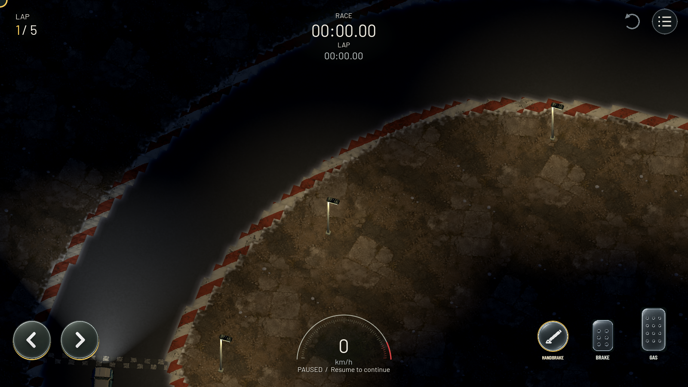
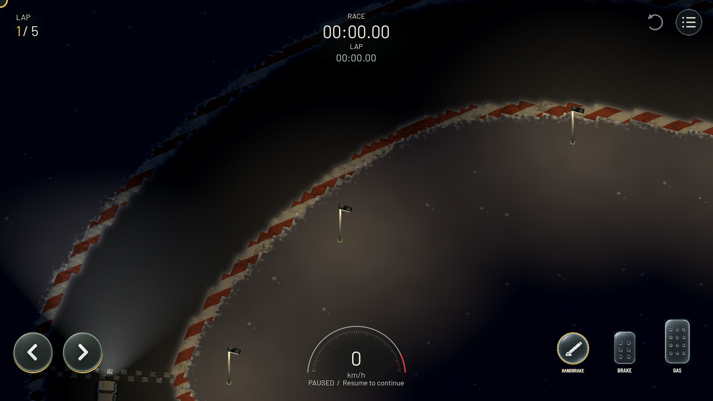

# Night industrial terrain — 2026-10-16

The Night biome now has worn charcoal asphalt, broken weathered concrete, compacted dusty gravel and sparse dry weeds, following the owner's industrial-outskirts reference. The racing road keeps its existing asphalt, height and markings. Existing blue moonlight, warm street lamps and vehicle headlights illuminate the terrain.

| Requirement | Implementation and evidence |
| --- | --- |
| NT01: reference-led industrial ground | Original generated albedo with restrained concrete/asphalt/dirt/gravel/weed detail. The supplied concept board is inspiration only. PNG, exact prompt, origin and hash are recorded in [generation.txt](evidence/night-terrain-2026-10-16/generation.txt). |
| NT02: coherent native integration | Ground, tiled terrain and grass skirts share the same 12-metre world coordinates. Four offset samples blend only the outer 10% at each source border, hiding arbitrary image-edge discontinuities. The central 80% retains coherent slabs. |
| NT03: bounded presentation | One shared texture, 1024-pixel import limit, mipmaps and anisotropic minification. No additional geometry, viewports, lighting, jobs or per-frame CPU work. Other biomes compile away the new sampler. Existing eight-surface-sampler allowance and world/cache limits remain. |
| G01/R01: gameplay isolation | Track documents, canonical cells/route/hash, vehicle snapshots and original camera are retained. Prepared worlds retain the new material bindings; visual kit205 prevents stale artifacts. |
| Q01: native review | Paired views use the actual game scene, original FollowCamera, road, car, lights and HUD in Compatibility/OpenGL and Mobile/Vulkan on desktop. Phone appearance/performance acceptance remains. |

Changed runtime files: `game/track/native_track_visual.gd`, `surface_detail.gdshaderinc`, `surface_shader_variants.gd`, new `night_ground.gdshaderinc`, and `game/assets/textures/night_industrial_ground_v1.png` with its import configuration. `game/tests/test_night_terrain.gd` exercises actual production materials, canonical isolation and prepared-world restoration, and captures paired native views. The original PNG remains unchanged; all palette/scale/border treatment is editable shader code.

This task's scoped kit revision is205. Concurrent grass-verge work advances the combined working tree to206; that version and its separate changes are retained. Paired captures change only the Night material mode in the same world, and do not claim cross-build or cross-renderer pixel identity.

Actual commands, results, source hashes, logs and the task-only patch are recorded in [report.json](evidence/night-terrain-2026-10-16/report.json). The working tree contains concurrent changes; the checkpoint excludes those changes.

Validation with pinned Godot4.7.2 and disposable workspace APPDATA folders: focused63 headless /72 Compatibility /72 Mobile; existing terrain sampler budget63, exact terrain packing3885, Night lighting15 and prepared race resources162 all pass. Whole-project parser836 scripts, zero failures at the recorded run. These are desktop renderer/integration checks, not Android-device results or performance measurements. The native captures use the final fixture with the car/headlights presented and the start-light overlay cleared.

Initial attempts retained in the logs: Windows blocked direct script execution, so commands use `powershell -NoProfile -ExecutionPolicy Bypass -File scripts/dev.ps1`; sandboxed Godot could not read Windows resources, so the pinned native engine was run outside that sandbox. The new fixture initially inserted a StringName dictionary key through dot syntax, rejected by the existing strict document validator; changing the fixture to a String key fixed it without weakening validation. Initial captures froze before car presentation and retained the start lights; the final fixture presents the original car once and clears that overlay before freezing the view.

No physical-phone attachment check/test, APK export/install, backend change, deployment or FPS/performance measurement was performed. Final owner/device artistic and performance acceptance remains. Material detail is flat albedo on the existing terrain, with existing geometry and light response; no raised rubble collision or surface-traction changes are implied.
