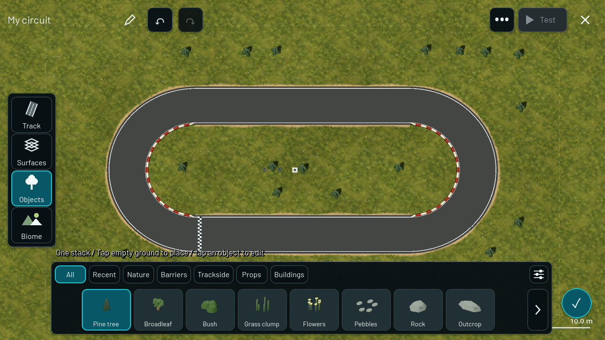

# Object placement latency

2026-09-17 owner report: tyres appear long after clicking. Requirements R01/T01-T04/V03/V05/Q01. This editor-only change preserves compiler-12 content identity and the canonical simulation.

Every placement previously synchronously compiled the entire track and rebuilt its 3D scene before rendering the click. Object-only edits now render the placed prop meshes immediately, save the document, and compile a deep snapshot on one background thread. Further edits coalesce to the latest document; obsolete results are discarded. Undo, navigation, explicit Save and Test retire outstanding work before using a synchronous validated track. Test remains disabled while collision validation is pending. The scene tree and rendering stay on the main thread.

A bounded per-editor raster cache reuses unchanged roads and paint. Its key includes native base/hash, grid/extent/cell size, layout, road pieces, surface, paint and terrain objects. Ordinary race/export compiles do not use this cache. Tyre-only changes also retain road/terrain meshes, refreshing object and low-cover layers. Generated trees displaced by tyres update when compilation completes. Terrain/solid-object edits or changed map bounds still rebuild the affected full preview.

## Actual measurements

Pinned Godot 4.7.2, Windows desktop, Compatibility renderer, RTX 3090. A four-piece oval and three tyre-stack clicks at the same locations:

| Path | Synchronous click handling | First rendered frame |
| --- | --- | --- |
| Former full compile + full scene rebuild, reproduced with optimization disabled | 382.690 / 385.883 / 390.166 ms | Not recorded |
| Optimized | 23.244 / 25.545 / 24.573 ms | 33.140 / 30.888 / 28.786 ms |

Roughly 16x less input-thread work in this fixture. An initial unmodified default-track reproduction also measured 249-253 ms per click. These are local samples, not phone latency guarantees or worst-case bounds. Surface stamping and large maps can still cost more when their final scene is rebuilt.

## Commands and checks

All actions used `powershell -NoProfile -ExecutionPolicy Bypass -File scripts/dev.ps1 ACTION`:

- ProfilePlacementBaseline: 20 checks passed; deliberately disables background placement, raster reuse and static-scene reuse to reproduce the former path on the same circuit.
- ProfilePlacement: 24 checks passed; graphical timing and screenshots.
- TestPlacement: 24 checks passed; headless regression also added to Validate.
- TestWorkflow: 166 checks passed.
- TestObjects: 58 checks passed.
- TestCreator: 86 checks passed, including unchanged content golden and driven races.
- TestRefinement: 32 checks passed, including loose tyres and saved-track refresh.
- TestHazards: 150 checks passed.
- TestStartLine: 27 checks passed, including five-lap races and exact replays in both directions.
- TestApp: 86 checks passed.

629 checks passed across the eight targeted suites (counting placement once; graphical and baseline runs are additional).

The placement test checks actual mesh instances before compilation finishes, latest-state collision equivalence after rapid clicks, autosave, undo while work is pending, static-road reuse, and exact cached/uncached outputs after water, paint, road width, extent and theme changes. The workflow test now waits for background completion before comparing collision grids; its invariant is unchanged. Its initial synchronous assertion failed and the updated asynchronous check passed. Targeted git diff --check passed (line-ending warnings only).

No Android export or phone test was performed. Full Validate was not run. Owner acceptance on a larger working track and on-device latency remain pending.

## Changed files and evidence

Runtime: game/core/app.gd, game/editor/editor_world.gd, game/editor/track_compiler.gd, game/track/native_track_visual.gd. Tests/tools: game/tests/profile_placement.gd, game/tests/test_editor_workflow.gd, scripts/dev.ps1. Documentation: this file, DEVELOPMENT_STATUS.md and docs/PHASE_0_PLAN.md. No schema or content version change was needed because independent compiles remain identical.

[Logs and captures](evidence/object-placement/).

Immediate visible tyres while validation is pending:

Completed collision/scenery update:

