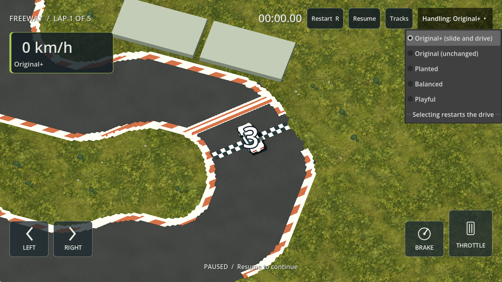

# Original+ slide and forward drive — 2026-09-14

**G01/R01/R03/R07:** the owner prefers Original, requesting slightly more slide with strong drive toward the car's nose while sideways. **Original+** is the new startup default. Unchanged **Original** remains immediately below it in the visible Handling menu, for direct comparison. Preset switching still restarts the drive; the choice carries across tracks during the application session.

This tune uses Original's steering, yaw response and momentum model. `original_slide.tres` copies its frozen configuration, changing lateral response from 17 to 14 /s, lateral grip from 58 to 54 m/s², and longitudinal grip from 19 to 25 m/s². Existing engine force, top speed, steering ramp, steering angle, yaw limit, recovery, corner energy retention, car dimensions and collision settings remain Original's values.

The optional new `slide_power_recovery` parameter restores a fraction of the engine's existing speed-related force falloff under throttle. Original+ uses 0.75, fading in smoothly between 0.06 and 0.30 radians of slip. The engine force remains at or below its existing full-force limit, acts along the current chassis direction, and is still limited by surface/tyre traction. Braking and reverse retain their early-return behavior. With no throttle there is no added drive. The original engine falloff is unchanged at zero slip, giving exactly identical straight-line acceleration and top speed. Increased longitudinal traction also helps braking while sliding; straight-line brake force remains unchanged.

All other presets leave `slide_power_recovery` at zero. The frozen Original golden trace still matches; no golden file was regenerated. Physics identity is **arcade-planar-0.20**, and Original+ is **handling-0.15-original-slide**. Canonical state and diagnostic schema 6 are unchanged. The exported new parameter is captured by existing config snapshots; record keys include the physics/config identities, so old incompatible PBs are kept on disk but not mixed with new times.

## Measured behavior

The same 24 m/s, 0.8-steering, full-throttle corner for 100 ticks produces 13.03° slip in Original versus 17.61° in Original+ (about 35% more). A seeded slide at 18 m/s forward plus 8 m/s lateral produces 11.24 versus 14.79 m/s² of throttle-added acceleration toward the nose (about 32% more). That measurement subtracts an otherwise identical coasting step, isolating engine drive from lateral energy redirection.

Rotated-chassis tests verify the pull follows the nose in different world directions, without an instantaneous sideways velocity change or automatic heading alignment. Coasting and brake tapping cannot generate energy. A ten-second full-throttle/full-lock run remains bounded at 20.21 m/s and about 28.16° slip, then settles when the steering is released. These are diagnostic maneuvers, not proof of player enjoyment or fastest racing technique.

The first resource-only experiment produced about 26% more slip but only 15% more forward drive; it failed the new minimum forward-pull test. Adding bounded engine-force recovery produced the final results above without changing that test's acceptance threshold.

## Verification and files

Changed runtime files: `game/resources/original_slide.tres`, `game/vehicle/handling_config.gd`, `game/vehicle/vehicle_simulation.gd`, `game/core/game.gd` (debug key 5), `game/ui/playground_hud.gd` (fifth preset and label), `game/ui/handling_selection.gd` and its UID (session preference), and three selection lookups in `game/core/app.gd`. Tests: `game/tests/test_handling.gd`, `game/tests/test_driving.gd`. Documentation: this file, HANDLING_SELECTOR/HANDLING_FUN, development status and Phase 0 entry. Concurrent menu work is preserved separately.

Full validation exposed a cold-parse shutdown error retaining HandlingConfig after the prior selector added mutable static state to it. Session selection and resource loading now live in the separate HandlingSelection UI helper, with no selection-state dependency from canonical HandlingConfig. The failing recorder and game parse checks pass after this separation. Godot's [static-variable lifetime documentation](https://docs.godotengine.org/en/latest/tutorials/scripting/gdscript/gdscript_basics.html#static-variables) was consulted; the pinned-engine parse results, rather than assumptions about cleanup annotations, determined the fix.

Commands use pinned **Godot 4.7.2.stable.official.ed1daf0bf** through `powershell -NoProfile -ExecutionPolicy Bypass -File scripts/dev.ps1`:

| Action | Actual result |
|---|---|
| `powershell -NoProfile -ExecutionPolicy Bypass -File build/original-slide-validation/scripts/dev.ps1 Validate` | Exit 0: import, 87 script parses, startup and **1,321 checks across all 20 suites**. No script errors or failed assertions. Several scene suites still emit ObjectDB shutdown leak warnings (two or six instances); this is not a leak-free acceptance claim. |
| `TestHandling` | 77 checks pass: frozen Original trace, exact JSON replay for all five presets at 1/2/4/8 ticks per render, more slide/stronger nose drive, unchanged straight performance, input/energy bounds and recovery. Includes three ordered laps with zero contacts and exact whole-run JSON replay on FREEWAY, 1WAY, 66 and OFFROAD using Original+. |
| `TestDriving` | 70 checks pass, including production/practice default and comparison controls. |
| `CaptureHandling` | Actual normal-race selector screenshot captured and visually inspected. |

Full validation passed in `build/original-slide-validation`, a detached checkout of `e42dbdb` with only this change copied in, because the shared workspace contains concurrent menu work. [Full output](evidence/original-slide-validation.txt) and [focused metrics](evidence/original-slide-focused.txt) retain the actual results. `git diff --check` also passed. Runtime logic has no network, file I/O, wall-clock access or rendering-rate dependency in the canonical step. Cross-device float equivalence remains unproved. No phone test or human handling acceptance was performed; the prior Android prerequisite gaps remain.

Restart the app to try **Original+**. Turn into a bend, let the rear move out, then hold throttle while unwinding steering to feel the pull toward the nose. Use **Handling → Original** on the same track for comparison. Check whether the additional slide and throttle pull are enough, and whether wall/grass driving, abrupt countersteer and braking remain comfortable on the actual device.
