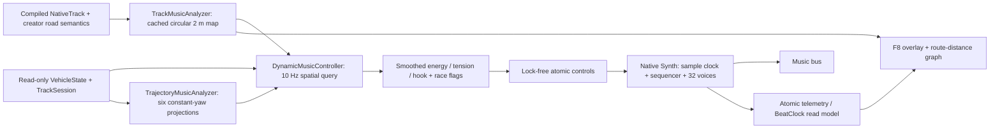

# Beat My Track procedural music — Grass listening milestone

2026-09-25. MUSIC_ENGINE_VERSION **1**. Requirement IDs below describe this owner-requested local slice; R01/V03/V05/Q01 also apply. Canonical handling, race rules and track formats are unchanged.

## Try it

Race an existing **Grass** track (internal biome `pine`) normally. Music starts with driving, pauses with the race and resets on retry. **F8** toggles the developer overlay and route-state graph; **F7** toggles music mute without changing effects. Other biomes are deliberately silent pending Grass acceptance. The separate Music bus and conservative gain leave the existing tyre/environment/UI audio alone. This is not a masking guarantee; relative balance needs listening on speakers/headphones/phone.

```powershell
powershell -NoProfile -ExecutionPolicy Bypass -File scripts/dev.ps1 Run
powershell -NoProfile -ExecutionPolicy Bypass -File scripts/dev.ps1 MusicLab
powershell -NoProfile -ExecutionPolicy Bypass -File scripts/dev.ps1 TestMusic
powershell -NoProfile -ExecutionPolicy Bypass -File scripts/dev.ps1 CaptureMusicDrive
```

Music Lab has energy/tension/hook/risk sliders, Grass selection, BPM, six road scenarios, off-track risk, final lap, finish, restart and mute. BPM changes restart the audition; gameplay BPM is fixed. Scenario buttons set musical targets, not a fake physics simulation. F8's distance graph is populated during racing. Lab only lists the implemented biome.

[60-second synthetic audition](evidence/music/grass-audition.wav): 20 seconds open, 20 seconds tense, 20 seconds release. Rendered by exactly the native DSP core at 48 kHz; no recording, sample pack or runtime service. It is louder than in-game because the game's additional -9 dB music-bus player gain is not baked into this diagnostic WAV.

[Music Lab screenshot](evidence/music/music-lab.png) · [Driving and route graph](evidence/music/music-drive.png).

## Architecture and ownership



| Requirement | Implementation / boundary |
|---|---|
| MUS01 native synthesis | `native/music/synth.hpp`, `extension.cpp`; no GDScript sample loop |
| MUS02 common timing | Native sample clock; `BeatClock` exposes beat/bar/8-bar phrase and boundary times |
| MUS03 composed patterns | Fixed A-minor/modal 8-bar harmony, 16-bar arrangement, three hook and bass variants, seeded drum accents and chord inversion |
| MUS04 track analysis | `track_music_analyzer.gd`; 2 m target spacing, circular smoothing, curvature, widths, bridge, biome/surface, expected speed, straight ahead and semantic labels |
| MUS05 anticipatory controls | `dynamic_music_controller.gd`; current/future blend, six corridor probes, 2-second lookahead, exponential smoothing |
| MUS06 fingerprint | Versioned SHA-256 content fingerprint; 32-bit seed; excludes names, authors and publication timestamps |
| MUS07 trajectory | `trajectory_music_analyzer.gd`; read-only velocity/yaw/slip projection, risk weights .5/.3/.2; tension contribution capped by 0.1 default |
| MUS08 race context | First lap lighter; final-lap energy/hook targets; maximum arrangement joins at next 8-bar phrase; finish cadence on next beat followed by four-beat fade |
| MUS09 tools | `music_test.tscn/.gd`, `music_debug.gd`, automated native/Godot tests and captures |
| MUS10 configuration | Inspector-editable `MusicProfile` / `grass.tres`; compiled pattern data and native build version |

`game/core/game.gd` only creates the controller, resets it when the race restarts, and passes presentation snapshots. No vehicle simulation or checkpoint method is modified. Cache lives with the loaded controller and is reused on retry; no player files are rewritten. Publishing does not change its fingerprint because publication-only metadata is excluded. Disk-persisted music caches are unnecessary for this first slice.

Road-piece semantics reuse `RoadPieces.samples`: loading-time spatial buckets and tangent matching associate S-bends/hairpins with the racing line. Widths and elevated flags reuse compiled track data. Raw route curvature remains the fallback for free paint and older locally supported authoring shapes. Ambiguous overlapping pieces can still need inspection; music never controls route validation.

The controller samples spatial state at 10 Hz and smooths at display cadence using `1-exp(-dt/tau)`. Native timing does not integrate display delta. Backward travel looks backward along the route. Corridor probes prevent a fast lookahead from jumping completely over a tight bend. Constant-yaw trajectory prediction is a lightweight estimate, not a duplicate tyre solver: braking, future steering changes and bridge elevation are not dynamically predicted. Geometry still dominates; risk cannot rewrite notes, harmony, tempo or the fingerprint.

## DSP and sequencing

The audio callback owns all voice and sequencing state. A packed 32-bit control word publishes E/T/H together. Race flags and preset scalars use lock-free 32-bit atomics. Setup allocates the stream/playback/synth and fills its lookup table before mixing. Render traverses a fixed 32-slot pool and fixed delay arrays; it creates no Godot objects, emits no logs, takes no mutex and allocates no heap memory. Godot's surrounding mixer has its own implementation; the guarantee is for this module's render path.

Sine-table/additive oscillators avoid naive saw/pulse aliasing. The pluck combines a restrained FM transient, harmonic brightness, fast attack, damping/decay and short cross-delay. Kick uses a downward pitch envelope and short noise click; snare uses high-passed noise and a tonal body; hats use differentiated noise; bass is a small harmonic sum. Pad uses two detuned sine voices per note. Percussion, tension pulse, lead and finish accent share the fixed pool. Quietest voices are reused if full. Conservative gain, a DC blocker and soft saturation bound output. No convolution, FFT or oversampling; no recorded full songs.

The MVP intentionally does not implement every proposed oscillator/filter parameter. It exposes brightness, metallicity, decay and width as a coherent Grass preset; the bass/pad use restrained harmonic spectra rather than a resonant-filter bank. Reverb, deeper sound design and independently editable parameters per instrument follow ear acceptance.

Notes use a quarter-beat grid. `Note` stores step (a quarter beat), scale degree, decay length and velocity; `HOOKS` and `BASS_MASK` are the pattern data. Duration here is an envelope time constant, not MIDI note-off. Drum levels change at bars with .72/.60 hysteresis; hook gating changes every four bars with .62/.38 thresholds. The arrangement repeats over 16 bars with deterministic per-hit variation. Tension pulse density is beat-grid constrained. No geometry-to-note spam. Finish is latched once, including when the flag remains high.

`BeatClock` is a GDScript read model of native timing, not a second sequencer. Telemetry is quantized to 0.001 beat and reflects the rendered audio head; it is ahead of the speaker by the device buffer/latency. This does not drift. Tight visual/audible marker alignment and output-latency compensation are deferred. Gameplay runs at fixed BPM; unsupported pitch-scale/seek/loop-offset controls must not be used on this stream.

## Extend the content

1. **Tune Grass:** edit `game/music/grass.tres` in the inspector. Mapping, lookahead, smoothing, trajectory weight, BPM, gain and signature timbre live in `MusicProfile`. Restart the race to hear preset changes.
2. **Add a pattern:** add bounded `Note` arrays/masks in `native/music/synth.hpp`; schedule only from the native sample clock. Keep notes compatible with the four chord roots and retain rests. Do not add runtime stochastic selection. Rebuild native libraries and run both test suites.
3. **Add a synth preset:** create another `MusicProfile` resource and route its brightness/metallicity/decay/width through `set_preset`. For new native controls, publish bounded scalar atomics outside render; never pass dictionaries or allocate voices in `_mix`.
4. **Add a biome after Grass acceptance:** map the internal track theme to a profile in `DynamicMusicController.start`, retaining the same synthesis/pattern engine. Do not create separate engines or enable an untested placeholder palette.
5. **Change identity intentionally:** increment `MUSIC_ENGINE_VERSION` in native and GDScript code, update fingerprint tests/evidence. Same inputs guarantee identical PCM on the tested build; cross-architecture floating-point PCM equality is not promised. Pattern identity is deterministic.

Further authoring conveniences (Resource-based pattern editor, separately editable transition thresholds/key/scale) are deferred. Major apex/release accents are not yet wired to individual geometry events; the present release comes from arrangement recovery. There is no saved music-volume settings UI yet; F7 is the desktop audition control.

## Build and provenance

Use the pinned Godot executable through `scripts/dev.ps1`. Native libraries for Windows x86-64 and Android ARM64 debug/release are included under `game/music/bin`. The engine's GDExtension compatibility interface uses godot-cpp 4.5 bindings with the project's pinned 4.7.2 runtime; the actual runtime tests are listed below. No downloaded code executes as a gameplay service.

```powershell
powershell -NoProfile -ExecutionPolicy Bypass -File scripts/dev.ps1 BuildMusic
# Or one platform:
powershell -NoProfile -ExecutionPolicy Bypass -File scripts/build_music.ps1 -Platform windows
g++ -std=c++17 -O2 -static native/music/test_synth.cpp -o build/music-tests.exe
./build/music-tests.exe docs/evidence/music/grass-audition.wav
```

Close project/editor processes before rebuilding a loaded DLL. An editor open before this change may need restarting to register the final native library. A prototype DLL locked by the existing editor was retained locally and excluded from Git; the final manifest uses `bmt_music_v1` filenames.

Pinned build-only sources: godot-cpp `e83fd0904c13356ed1d4c3d09f8bb9132bdc6b77` (MIT, copied license `licenses/godot-cpp-music-MIT.txt`); SCons 4.9.1 `dfd6b7e45985eb73462d2efa878651c92745099c`. Build script verifies revisions and fetches missing source into export-excluded `.tools`. Android NDK r28b / 28.1.13356709, minimum API 24, builds with the static C++ runtime. Its official Windows archive is https://dl.google.com/android/repository/android-ndk-r28b-windows.zip; unpack under `.tools` or pass `-NdkPath` to `scripts/build_music.ps1`. The SDK manager failed to fetch manifests in this session; direct HTTPS download succeeded. No engine PATH alias was used.

All melodies, patterns, synthesis code and rendered evidence in this slice are original procedural output. No external samples, AI media, cloud calls, analytics or new runtime SDKs. The native stream follows [Godot's AudioStreamPlayback extension API](https://docs.godotengine.org/en/stable/classes/class_audiostreamplayback.html).

## Actual verification and remaining acceptance

- Native `test_synth.cpp`: 60-second repeated seeded PCM equality, different-seed divergence, render allocation guard, finite/gain bounds, sample-clock duration, 32-voice cap, pause, finish decay, bar scheduling and hysteresis pass. Three simultaneous 60-second renders plus WAV output took 4.25 s on this desktop; this is an offline throughput measurement, not Android callback CPU. RMS .035289 and peak .154489 before the additional player gain.
- `dev.ps1 TestMusic`: 23 checks pass, including seed, metadata exclusion, geometry identity change, wrapping, seam continuity, curvature, lookahead, timestep-independent smoothing, BeatClock arithmetic, trajectory risks, physics immutability, real native stream telemetry and release of retired playback pools.
- `dev.ps1 CaptureMusicDrive`: 25 checks pass including real driving integration; final desktop screenshot inspected. Final six-second run: 24 peak voices; sampled mix 170 us, maximum 316 us, 512 frames / 48 kHz, zero callback render-budget overruns, sampled controller 34 us. These are short desktop observations, not a sustained worst-case guarantee.
- `dev.ps1 CaptureMusic`: graphical lab captured and inspected; final evidence is under `docs/evidence/music`.
- `dev.ps1 Validate -QuickValidation` and final `ExportAndroid -QuickValidation`: import/startup, 74 driving, 18 catalog, 26 menu checks pass. Final driving suite reported four ObjectDB instances at shutdown; focused music tests exit cleanly. Full physics regression was not run because canonical physics was not changed.
- Windows x86-64 and Android ARM64 debug/release native builds pass. Final Android debug export, signing and verification pass: `build/android/circuit01-debug.apk`. ZIP inspection confirms `lib/arm64-v8a/libbmt_music_v1.android.template_debug.arm64.so` and `assets/music/NOTICE.txt`. No device installation was performed for this slice.
- Initial export rejected the missing Android `lib` filename prefix; build/manifest corrected. Another preflight exposed an intermittent teardown access violation after driving assertions completed. Native playback now resolves lazy virtual dispatch on its creating thread before audio mixing. Twelve `TestMusicExit` process runs, each with 64 immediate create/play/free cycles and no grace delay, exit without crash. Abrupt stress-process exit still warns about 11–64 pending ObjectDB instances; the normal-lifetime test explicitly confirms all 16 playback weak references expire after mixer retirement. This distinction is retained rather than suppressing shutdown diagnostics.

An Android phone (ADB serial PRQKU4U4PREQNRWG) was attached. **No physical-device music listening, audio-glitch, thermal-soak, Bluetooth, focus/resume or CPU test was performed in this slice.** Render-budget overruns detect this callback exceeding its own block time; they cannot detect every OS/device underrun. No system-underrun count is exposed, so the overlay does not pretend to measure one.

Human acceptance remains: pluck identity, repeated-lap fatigue, audible approach/release, harmony/mix balance versus tyre/engine/UI sounds, finish timing, and mobile audio/performance. Also inspect branching/intersecting tracks, large tracks and aggressive braking/steering: the approximate trajectory predictor can overestimate risk. Grass is the only accepted-for-testing preset, not an approved final score. Phases 6–7 expansion waits for that listening review.
