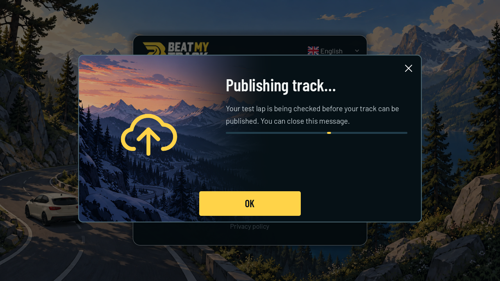

# Publishing wait correction — 2026-11-07

PWP01: A publication taking more than five seconds must remain a pending operation, without an apparent fault before success. PWP02: Preserve dismissal, authoritative receipts, actual failures, account/navigation guards and durable operation identity.

The existing publication dialog changed to “Publication not confirmed” after its five-second dismissal deadline, even when the server had acknowledged the request and was still checking the creator lap. The same dialog then showed “Track published” on acceptance. This is a local explanation for the reported sequence; no device logs or live publication were inspected for this task.

`game/ui/publication_dialog.gd` now keeps “Publishing track…” and the indeterminate activity visible after that deadline. Its message follows the existing queued/verifying/uncertain-upload presentation, and OK/Close become available at the same deadline. Real failures and unreadable journals retain their warning; a public receipt still produces success immediately. Existing translated strings are reused. No lifecycle, upload, verification or retry contract changes.

Changed regression files: `game/tests/test_publication_confirmation.gd` and `game/tests/test_publication_notice.gd`. The former checks the actual five-second deadline, queued-to-verifying-to-published transitions, animation, dismissal, single submission, genuine admission errors and account/navigation fences. The latter retains uncertain upload wording without claiming acceptance and verifies a later real failure replaces the pending state.

Commands run from the repository root, with workspace-local disposable user data:

```powershell
$env:APPDATA = Join-Path (Get-Location) 'build/publication-pending-user'
powershell -NoProfile -ExecutionPolicy Bypass -File scripts/dev.ps1 -Action TestScript -ScriptPath res://tests/test_publication_confirmation.gd -Graphical -RenderingMethod gl_compatibility -TestArgument '--evidence=res://../docs/evidence/publication-pending-2026-11-07/compatibility' -CommandTimeoutSeconds 150
powershell -NoProfile -ExecutionPolicy Bypass -File scripts/dev.ps1 -Action TestScript -ScriptPath res://tests/test_publication_notice.gd -TestArgument '--evidence=res://../docs/evidence/publication-pending-2026-11-07/notice' -CommandTimeoutSeconds 150
git diff --check -- game/ui/publication_dialog.gd game/tests/test_publication_confirmation.gd game/tests/test_publication_notice.gd
```

Pinned Godot 4.7.2: graphical Compatibility confirmation **74 checks / 0 failures**; headless notice **75 checks / 0 failures**. Diff whitespace check passed. All service responses in these regressions are fixtures. Eleven native screenshots cover warning/wait/success at three dimensions, prolonged verification and actual failure. The prolonged-verification screenshot was visually inspected:



Initial attempts are retained as execution limitations: direct PowerShell invocation hit execution policy; the default sandbox run could not open the owner user log; the workspace-data sandbox retry failed reading the Windows certificate store. Normal-access reruns using disposable workspace user data passed. The standard dev entry point regenerated build identity; that generated file and concurrent work are excluded from this change.

No physical-device query/test, APK export/install, real publication or backend deployment was performed. Reload/rebuild and owner/tablet acceptance remain.
