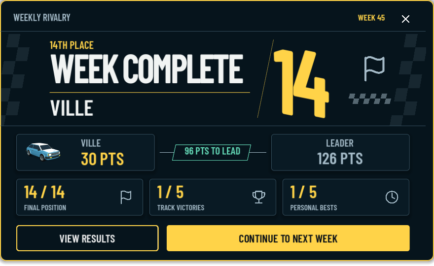
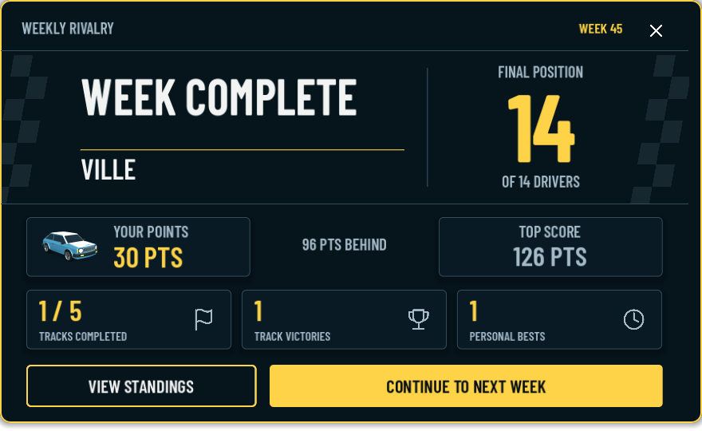

# Weekly Rivalry summary clarity — 2026-11-09

The owner supplied the completed Week 45 popup and described it as confusing.
The implementation keeps the existing results and rollover behaviour while
clarifying what each number describes.

| Requirement | Delivered behaviour |
| --- | --- |
| RSC01 | Final position appears once, with the actual number of drivers immediately beneath it. Remove the repeated ordinal and position card. Keep earned champion, shared champion, podium and Perfect Week states. |
| RSC02 | Replace the repeated position card with tracks completed out of the five pinned tracks. Victories and personal bests are counts, without misleading `/ 5` fractions. An ended week can therefore clearly show partial participation. |
| RSC03 | Label the two scores Your points and Top score (or the existing runner-up/co-leader state). Replace the green future target `PTS TO LEAD` with neutral `PTS BEHIND`. Unranked or missing-opponent summaries have no gap claim. |
| RSC04 | View standings dismisses the summary onto the existing results overview; Continue to next week retains the original explicit rollover action. Six new messages have directly authored translations in all twelve supported languages. |

Production changes are in `game/ui/rivalry_summary_dialog.gd`,
`game/ui/rivalry_summary_banner.gd`, the twelve localization catalogues and their
source template. Authored copy is in
`scripts/translations/rivalry_summary_clarity.tsv`. No scoring or membership
contract changes.

## Preview

These are native Compatibility captures of the actual popup component using an
offline fixture with the owner's shown final facts: position 14 of 14, 30 points,
top score 126, one completed track, one victory and one personal best. They do
not represent a live service response. Vehicle art uses the fixture's Compact.





[Finnish preview](evidence/rivalry-summary-clarity-2026-11-09/ui/after-fi-partial-gl_compatibility.png).
The evidence folder also retains champion, shared champion, empty-week and
German/Japanese previews from both desktop renderers.

## Actual verification

Pinned standard engine: `4.7.2.stable.official.ed1daf0bf` at
`C:\apps\Godot 4.7.2\Godot_v4.7.2-stable_win64_console.exe`.

Initial `scripts/dev.ps1` attempts encountered the shell execution policy, then
the default profile log access restriction and the machine's existing Windows
certificate-store diagnostic. Completed checks use
`scripts/run_rivalry_summary_clarity.py`, which verifies that exact engine,
launches through the existing crash-dialog helper, sets private workspace
APPDATA/LOCALAPPDATA, disables the backend URL, selects Dummy audio and retains
bounded process receipts and complete logs. The existing certificate-store
diagnostic is retained and is the only diagnostic exempted by this runner.

Run from the repository root:

```powershell
python scripts/run_rivalry_summary_clarity.py headless res://tests/test_rivalry_summary_clarity.gd --headless
python scripts/run_rivalry_summary_clarity.py compatibility res://tests/test_rivalry_summary_clarity.gd --rendering-method gl_compatibility
python scripts/run_rivalry_summary_clarity.py mobile res://tests/test_rivalry_summary_clarity.gd --rendering-method mobile
python scripts/run_rivalry_summary_clarity.py before-compatibility res://tests/test_rivalry_summary_clarity.gd --rendering-method gl_compatibility -- --clarity-before
python scripts/run_rivalry_summary_clarity.py popup-headless res://tests/test_rivalry_summary_popup.gd --headless
python scripts/run_rivalry_summary_clarity.py popup-control res://tests/probe_rivalry_summary_clarity_control.gd --headless
python scripts/run_rivalry_summary_clarity.py popup-flow res://tests/test_rivalry_summary_popup.gd --headless -- --flow-only
python scripts/run_rivalry_summary_clarity.py popup-flow-compatibility res://tests/test_rivalry_summary_popup.gd --rendering-method gl_compatibility -- --flow-only
```

| Check | Actual outcome |
| --- | --- |
| Focused popup matrix, headless | 7,872 checks, zero failures |
| Focused popup matrix, Compatibility | 7,872 checks, zero failures |
| Focused popup matrix, desktop Vulkan Mobile | 7,872 checks, zero failures |
| New messages in all catalogues, exact authored text and placeholders | 72 checks, zero failures |
| Task-start popup loaded only into the before-capture process | 2 checks, zero failures |
| Actual App lifecycle and rollover, headless | 128 checks, zero failures |
| Actual App lifecycle and rollover, native Compatibility | 128 checks, zero failures |
| Actual App full summary suite, revised UI | 1,344 checks, 80 failures |
| Untouched task-start suite and task-start UI control | 1,291 checks, the same 80 failures |

The focused matrix covers twelve languages, two viewport sizes and eight
states: partial participation, perfect/champion/podium/middle/shared finishes,
unranked and missing opponent. It checks real label geometry and text widths,
data-derived counts and absent-value behaviour. The isolated App lifecycle
slice retains the existing assertions for dismissal, stale accounts,
authoritative refresh, invalidation, blocked background input, keyboard actions,
single scoped Continue, failure/retry idempotency and successful enrollment.

The full suite is **not passing**. Its 80 failure messages and multiplicities
match the task-start control exactly: 72 minimum displayed button-height
assertions under the App's scaled viewport, four Perfect Week badge-gap checks
and four legacy empty-week automatic-popup expectations. None of those failing
assertions was weakened or removed. See
[failure comparison](evidence/rivalry-summary-clarity-2026-11-09/failure-comparison.txt)
and the original/current raw logs. This slice does not claim to resolve them.

## Checkpoint and limits

The [task-only source patch](evidence/rivalry-summary-clarity-2026-11-09/source-only.patch)
is relative to captured task-start files, including already-dirty catalogues.
Original sources and hashes are retained with the command receipts. The shared
Git index was not written; unrelated concurrent work is preserved.

No physical-device test, APK/export, owner save edit or process restart,
live backend request or deployment was performed. Desktop Vulkan Mobile is a
desktop renderer check, not Android qualification. Owner visual acceptance,
fresh application reload and device appearance/touch acceptance remain.
