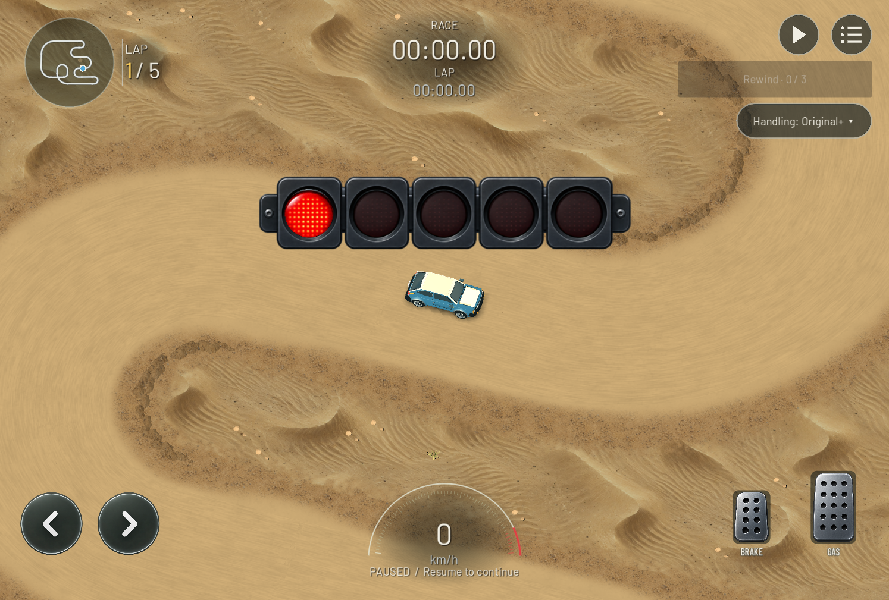

# Road scenery build optimization — 2026-09-30

Requirements: R01 (canonical identity preserved), V04/V05 (presentation/performance), Q01 (measured verification). Implements the next local performance slice from `TRACK_LOAD_REVIEW.md`.

Follow-up: [BAKED_ROAD_LOADING.md](BAKED_ROAD_LOADING.md) adds persistent artifacts, saved-editor preparation and parallel shoulder work, with explicit first-use and end-to-end limits.

## Result

Same Windows desktop, pinned Godot 4.7.2, Compatibility/RTX 3090, saved Speedy and Knot documents. Timings are scene instantiation through synchronous ready, excluding compilation, network ticket, countdown and process startup.

| Track | Before, every start | After, cold road cache | After, cached road resources |
| --- | ---: | ---: | ---: |
| Speedy | 5.69–5.74 s | 3.64 s | 0.258 s |
| Knot | 2.18–2.20 s | 1.91 s | 0.503 s |

First completed draw including setup: Speedy 3.89 s cold / 0.349 s cached; Knot 2.03 s cold / 0.593 s cached. Compilation remains roughly 0.31–0.42 s. Cold geometry attribution builds explicitly bypass the resource cache: Speedy scenery 3.35–3.42 s versus 5.60 s before; Knot 1.74–1.76 s versus 2.03–2.08 s. These are small desktop samples, not phone guarantees. Other development windows were open; small timing differences are noise.

Evidence: `docs/evidence/road-build-2026-09-30/track-load-profile.log`; original measurements remain in `docs/evidence/track-load-2026-09-30/`.

## Implementation

- `game/track/native_track_visual.gd`: per-piece exact-vertex asphalt direction reuse and per-polygon sand coordinate reuse. Recursive sand-road triangulation repeatedly visits identical vertices; caching removes redundant nearest-segment scans without changing their math, subdivision, output order or UVs. Temporary dictionaries expire with their build scope.
- The same file retains up to two completed road resource sets under a 32 MiB conservative admission estimate (mesh vertex/index allowance and CPU/GPU mask allowance). Larger tracks build normally without entering the cache. This is an estimate for retained resources, not a hard limit on process/GPU memory. Keys include canonical content hash, visual-kit version, theme and palette. Completed road meshes/materials/textures are shared, while each build creates fresh nodes with the original transforms, layers, shadows and winter/desert metadata. Dynamic tyres, cars, lights, scenery, terrain and bridge nodes remain freshly constructed. Nothing is persisted to disk. Editing changes the hash; restarting the app starts cold. Resources are treated as immutable; any future per-race road-material animation must duplicate or separate its mutable state.
- `game/track/shoulder_mesh.gd`: triangles querying the same bin rectangle reuse an ordered candidate list. Bin size, clipping order, tie-breaking, intersections, triangulation and ownership remain unchanged. The cache is local to one emission.
- `game/tests/profile_track_load.gd`: clears the road cache at probe start; measures cold and cached real races and forces uncached attribution builds.
- `game/tests/test_road_build.gd`, `game/tests/fixtures/road_build_meshes.json`: exact pre-change mesh-array golden fingerprints for four biomes, plus optional direct baseline comparison on local tracks. Tests verify fresh nodes, identical materials/render flags/metadata, unchanged canonical cells/contacts, cache invalidation and admission bounds. Baseline sources are from commit `ef6001f272f0fdcc3e2b4b3f82a4ff2aadaee135`; both saved source snapshots were checked against that commit. Golden hashes were recorded from those baseline sources, after direct baseline/current equality passed.
- `game/tests/profile_road_approval.gd`: names its synthetic circuit so explicit Save exercises saving rather than the current unnamed-track dialog. No production save behavior or assertion was weakened.
- `scripts/dev.ps1`: adds `TestRoadBuild`. Status/report/evidence files record the result.

Exact output equivalence permits retaining track-kit-89. Canonical compiler, rules and physics versions are unchanged.

## Commands and actual validation

```powershell
powershell -NoProfile -ExecutionPolicy Bypass -File scripts/dev.ps1 ProfileTrackLoad
powershell -NoProfile -ExecutionPolicy Bypass -File scripts/dev.ps1 TestRoadBuild -Screen record
powershell -NoProfile -ExecutionPolicy Bypass -File scripts/dev.ps1 TestRoadBuild
powershell -NoProfile -ExecutionPolicy Bypass -File scripts/dev.ps1 TestRoadBuild -Screen local
powershell -NoProfile -ExecutionPolicy Bypass -File scripts/dev.ps1 TestShoulders
powershell -NoProfile -ExecutionPolicy Bypass -File scripts/dev.ps1 TestSurfaceProfile
powershell -NoProfile -ExecutionPolicy Bypass -File scripts/dev.ps1 TestRoadApproval
powershell -NoProfile -ExecutionPolicy Bypass -File scripts/dev.ps1 CaptureStyle -StyleDocument "$env:APPDATA/Circuit01Lab/tracks/track_3e26605a8a90165e.json"
& "$env:LOCALAPPDATA/Android/Sdk/platform-tools/adb.exe" devices
git diff --check
```

- Final default road-build suite: 33 checks pass; the direct baseline/current suite including both saved tracks passes 47 checks. Default mode uses committed golden hashes and needs no local tracks or baseline snapshots.
- Shoulder union/ownership regression passes, with 71 join checks and 18 contour checks.
- Surface profile: 928 checks pass.
- Editor road approval: 38 checks pass, including sliced/unsliced mesh equality, supersession and exit. The initial run failed the explicit-save assertion because the unnamed fixture opened the naming dialog. Giving the fixture a real name exercises the intended save path and passes. Slowest measured editor frame was 121.6 ms; this slice does not claim to eliminate every editor stall.
- Desktop capture succeeds, preserves native cells, and produces route/model views. `speedy-desert.png` was inspected: road grain, sand apron and clods remain present. The existing capture diagnostic lists non-up-facing clod facets (`gravel=true`); non-gravel road and ground normal counts are zero, and exact baseline mesh equality covers the clods too. No appearance change is intended.
- Test development exposed a nonexistent byte-array hashing helper (replaced with `HashingContext`) and an unsupported primitive mesh query in the oversized-cache probe. Cache admission now explicitly accepts generated ArrayMesh resources and rejects oversized masks before scanning meshes. Final tests have no script errors.

For optional baseline/local reproduction, restore the two original sources to `build/road-visual-before.gd` and `build/shoulder-before.gd` from the pinned commit above, using UTF-8 text. `-Screen local` additionally needs the existing local Speedy/Knot documents. `-Screen record` deliberately writes baseline fingerprints and is not needed for ordinary regression runs. Do not regenerate the baseline merely to accept a mismatch.

No phone was attached (`adb devices` empty), no Android export/device test was performed, and no backend/deployment or physics change was made. Phone load times, cache memory measurements and further cold shoulder-clipping optimization remain. Cache hits still rebuild non-road scenery and the rest of the race; online ticket latency is separate.


