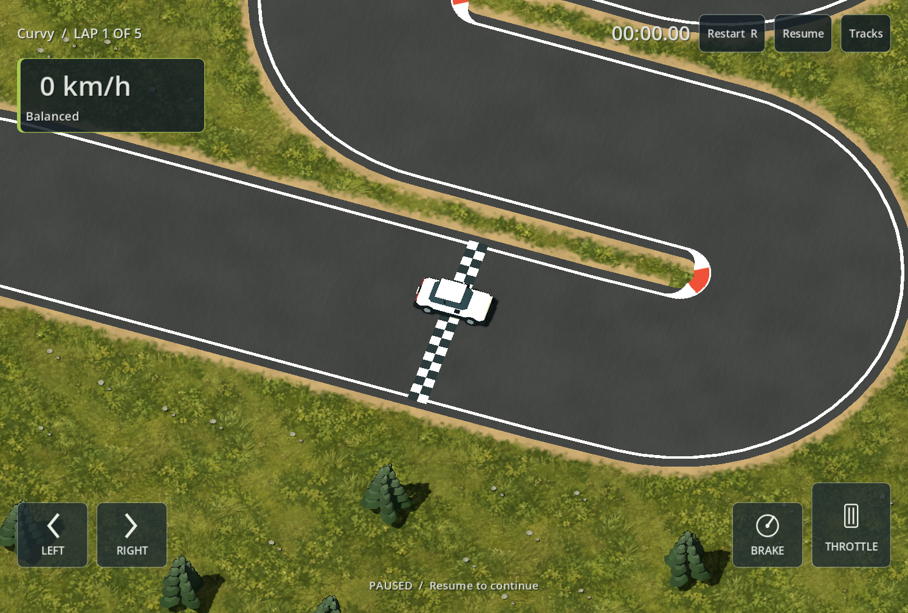
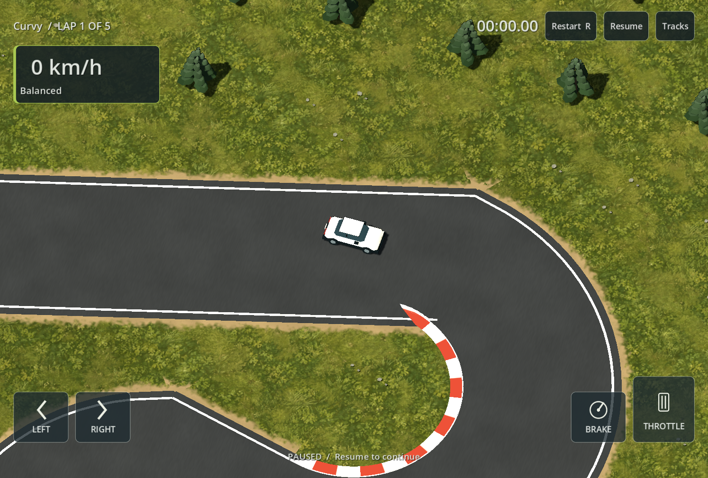
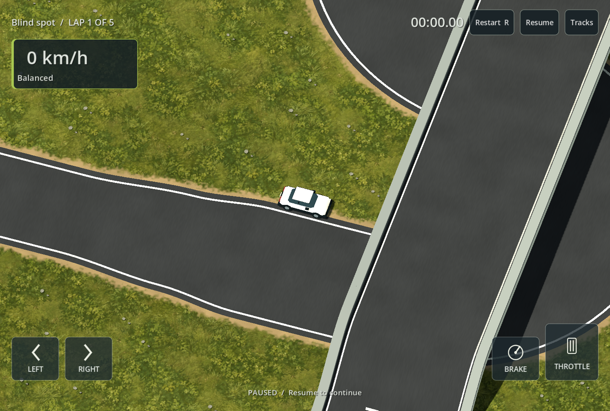

# Creator road joins and start line - 2026-09-14

Requirements: R01 / T01-T04 / V02 / V04 / V05. Owner reports broken edge markings in Curvy and Blind spot, a skewed/short start line in Curvy and abrupt width changes in Blind spot.

Connected pieces now share endpoint cross-sections, including a bounded miter at angled joins. Their widths blend to a common endpoint width using a smoothstep over up to half of each piece (normally at least 8 m). Raster road surfaces and presentation consume the same sampled width profile. Markings omit connected end caps and do not suppress each other's edges at the join; unrelated overlapping roads still mask internal markings.

The compiler projects the start onto the nearest authored road centerline and derives the timing gate direction and width from that road. Checkered paint uses that full width, including partial end squares, instead of rounding inward to whole raster cells. The independent lap route and practice-start authoring remain available. Native tracks without creator pieces retain their existing finish painting.

Compiler identity is `creator-compiler-9`; visual kit is `track-kit-13`. The default document has unchanged geometry (228 - 188 cells, 219 route samples, 8,715 road cells), but its versioned content hash changes to `9ebd4b2aa8a1166d922316f7dedc53b6c4c0a1b58e0206827f5037c7c6cda4f5`. Updated the golden assertion accordingly. Existing user files were read only and were not resaved or deleted.

Changed files: `game/editor/road_pieces.gd`, `game/editor/track_compiler.gd`, `game/track/native_track_visual.gd`, `game/tests/test_road_pieces.gd`, `game/tests/test_creator.gd`, this document, status/plan entries and the screenshots below.

## Actual checks

- `powershell -NoProfile -ExecutionPolicy Bypass -File scripts/dev.ps1 TestPieces`: 149 checks, zero failures. Added shared-width, gradual-transition, both angled marking endpoints and local-road heading checks. Five-lap witness completed with zero contacts.
- `powershell -NoProfile -ExecutionPolicy Bypass -File scripts/dev.ps1 CaptureStyle -StyleDocument <saved JSON>` ran for both actual owner documents: Curvy (`track_5765ff853b63dea5.json`) and Blind spot (`track_183e0afb5090a6eb.json`) under `%APPDATA%/Circuit01Lab/tracks`. Each produced a start view plus six route views, reported all upward road normals and confirmed presentation does not mutate native cells.
- Full `Validate`: initial native Godot parse crash (exit -1073741819); retry reached the old golden hash assertion, which was updated for the explicit compiler version change. Final result recorded below.

Reviewed Windows captures:

Remaining acceptance: owner driving/visual review and physical-phone testing. No phone/device test or Android export was performed; attachment status was not checked. The existing 0.5 m surface grid remains an approximation to visible edges. Short pieces limit transition length; extreme overlapping pieces and ambiguous multi-way endpoint joins are not exhaustively visually covered by these two tracks. No cross-device replay or phone performance claim is made.

Final validation outcome: import, script parsing and startup passed. Driving (56), native tracks (163), extra tracks (27) and creator (86) checks passed, including replay witnesses. The UI pass initially stopped because concurrent editor-style work introduced an unindexed `EditorStyle` class. Ran `scripts/dev.ps1 Import` and resumed every remaining suite using `TestEditor`, `TestFreeEditor`, `TestPieces`, `TestPractice`, `TestWorkflow`, `TestConstruction`, `TestRefinement`, `TestTyresLoad`, `TestHazards`, `TestObjects`, `TestApp`, `TestRecords`, `TestCatalog`, `TestDeleteTracks` and `TestMenus`: all passed, zero failures (39/55/149/31/94/73/29/23/141/42/84/53/18/19/11 checks respectively). The bridge witness completed five laps with zero contacts and traversed both levels. Full validation was therefore completed across the interrupted Validate run and the resumed individual actions, not claimed as one uninterrupted green invocation.

Logs: `build/road-fixes-validation.txt`, `build/road-fixes-import.txt`, and `build/road-fixes-Test*.txt`. `git diff --check` passed. Concurrent editor styling/scenery changes were excluded from this checkpoint.
