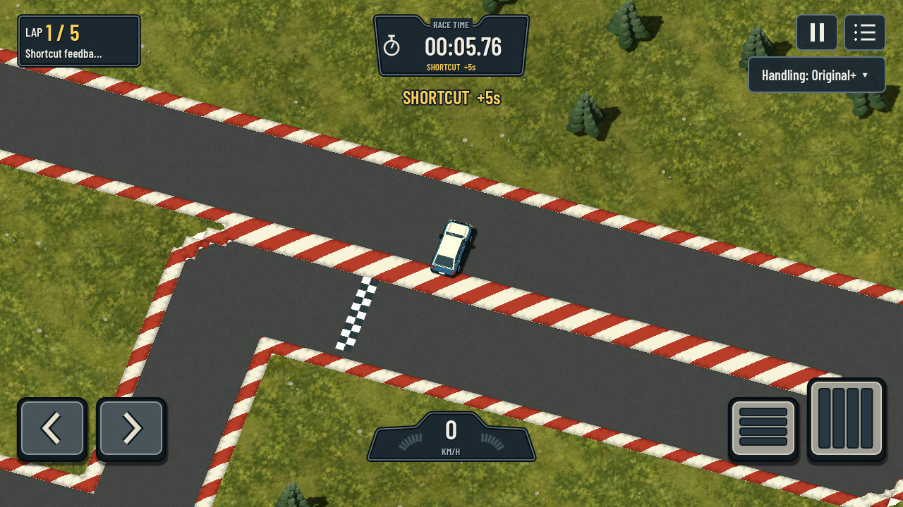

# Shortcut feedback and forgiving laps - 2026-09-16

**Superseded detector:** [Silmukka missed-cut correction, rules v6](SILMUKKA_SHORTCUTS.md). Earlier test results below are historical, not owner acceptance.

**Follow-up:** owner still reproduced outside-corner penalties. [Rules v5 correction and remaining limits](OUTER_CURVE_SHORTCUTS.md) supersede the v4 spatial-evidence behavior and acceptance claims below.

Requirements: G01 / R03 / R07 / T02 / V05. Owner rejected the previous implementation: ordinary laps were discarded and penalties arrived too late to connect them with the cut. The prior [v3 test record](ROUTE_PROGRESS_V3_REVIEW.md) is superseded and is not owner acceptance.

## Corrected behavior

- There is no mandatory dense checkpoint coverage and no finish-time shortcut decision. A normal wide exit does not leave an invisible missed checkpoint that later rejects the lap.
- Progress is projected onto route **segments**, with continuity preference scaled to representative road width. Signed progress prevents forward/reverse distance farming. Nearby hairpin legs and crossings prefer the current branch.
- Actual swept travel is compared with gained route distance. Crossed turns supply a geometric inner-line allowance (turn angle times road/kerb radius). Real distance travelled while wide/off-road is retained. Spatial evidence is also required: the allegedly skipped road must lie outside the tolerance of the car's recent actual path. This prevents a late projection catch-up at a sharp corner from becoming a penalty.
- A confirmed major bypass emits the warning in the **same simulation tick**. There is no 0.4-second confirmation timer, 2-metre rejoin requirement or delayed finish-line penalty. Sweeps are sampled at at most 0.5 m, including high-speed movement. The small tolerance is measured in metres, not replenished as a per-tick bonus.
- The existing cumulative penalty remains by the clock. A separate outlined gold **SHORTCUT +5s** notice below the clock remains visible for two simulation seconds and cannot be overwritten by normal HUD updates. A short rearm interval prevents repeated charges for one continuous cut; it never delays the first warning.
- A cut adds **one five-second time penalty**. It does not also discard the lap. Five laps still finish the race. Penalized runs remain ineligible for local PBs. Lap and total times include each penalty once.
- Forward finish-plane crossings allow 2 m of kerb/car overlap outside the stripe. A finish requires substantial signed route progress, so camping or rocking across the line cannot finish a race. Fractional finish times are retained.
- Local scoring key is `standing-5-local-v4`; earlier PB partitions remain stored. Canonical handling/vehicle physics and track-file schemas are unchanged.

## What the additional investigation found

The previous strict coverage scheme was the wrong fit for forgiving local racing. In addition, the old one-frame warning was assigned in physics and overwritten by the render HUD update. Raw projection alone also needs spatial verification: four-metre offset paths on saved sharp/overlapping routes exposed catch-up penalties even after initial synthetic tests passed. The final check compares skipped road against the recent driven polyline before issuing a penalty. Finish-width overlap and a sufficiently long diagnostic finish approach were also necessary to correctly exercise kerb finishes.

## Changed files

- `game/track/native_track.gd`: segment projection, continuity preference, turn allowances, spatial bypass proof; removed dense validation witnesses.
- `game/race/track_session.gd`: swept motion accounting, immediate detection, warning lifetime, signed lap progress, time penalties without discarded laps, finish overlap.
- `game/race/race_rules.gd`: local rules v4.
- `game/core/game.gd`, `game/ui/playground_hud.gd`: persistent, readable warning driven from session state; remove overwritten one-frame footer assignment.
- `game/tests/test_route_validation.gd`: behavioral cut/kerb/wide-line, timing, reverse and penalty tests; old delayed-warning/invalidated-lap expectations replaced by the requested contract.
- `game/tests/test_tracks.gd`: timing invariants now test actual finish crossings and stationary progress, rather than asserting an obsolete derived checkpoint counter after arbitrary warps. Zero-penalty driven laps remain mandatory.
- `game/tests/review_route_validation.gd`: read-only saved-track trajectory review; does not edit tracks or records.
- `game/tests/capture_shortcut_feedback.gd`: actual session event and HUD integration/captures.
- `scripts/dev.ps1`: `ReviewRouteValidation` and `CaptureShortcutFeedback` entry points.
- Status/plan documents and this evidence record.

## Commands and actual outcomes

All commands used `powershell -NoProfile -ExecutionPolicy Bypass -File scripts/dev.ps1` with pinned Godot 4.7.2.

| Action | Result |
| --- | --- |
| `TestRouteValidation` | 33 checks, zero failures. Inside kerbs, outside/wide off-road exits, mirrored and nonuniform routes, dirt, intersections, slow/high-speed cuts, reverse farming, stationary/start behavior, five laps, penalty accounting. |
| `TestTracks` | 167 checks, zero failures. FREEWAY, 1WAY, 66 and OFFROAD: three driven laps each, zero shortcut penalties, exact full JSON replays, existing collision/bridge checks. |
| `TestCorpus` | 793 checks, zero failures; three YLIKULKU laps, zero contacts. This is not full driven coverage of all 194 tracks. |
| `TestFreeEditor` | 55 checks, zero failures; five driven crossing-route laps and replay checks. |
| `TestPieces` | 172 checks, zero failures; five driven creator-road laps. |
| `TestRecords` | 53 checks, zero failures. |
| `TestApp` | 86 checks, zero failures, including finished results and persistent/reloaded PB presentation. |
| `CaptureShortcutFeedback` | 10 checks, zero failures. Real detector event reaches rendered HUD; notice survives updates and one second, expires at two seconds; cumulative penalty stays correct; compact placement checked. |
| `ReviewRouteValidation` | 21/21 scripted lines finish with zero penalties: centreline and +/-4 m offset lines on Blind spot, Over and under, Speedy, Curvy, Silmukka, Ajorata and Ringroad. Owner saves read only. These are geometric trajectories, not human or physics-driven laps; some offset samples are off the painted surface. |

Total across the eight automated suites/capture: **1,369 passing checks**. The saved-track review is separate diagnostic evidence. In the 24 m/s hairpin fixture the warning occurs at crossing y=6.0?6.2 m, **42?50 ms after leaving its 5 m road/kerb margin**, at 60/120/240 Hz. That is a measured fixture result, not a universal latency promise for every possible cut. Larger cuts become provable at different positions; minor deviations inside tolerance are deliberately accepted.

Working logs: `build/shortcut-v4-*.log`, `build/route-validation-tests.log`, `build/route-owner-review.log`, `build/shortcut-hud-tests.log`. Saved logs/screenshots: `docs/evidence/shortcut-v4/`. `git diff --check` passed for the changed tracked code. Full `Validate` was not repeated in this follow-up; its previous Godot parse-process crash is recorded in the superseded v3 report. One intermediate graphical capture emitted a two-object shutdown leak warning; the final 10-check capture completed without that warning.

## Visible evidence and remaining acceptance

These captures use a scripted shortcut trajectory through the actual session and rendered game, not simulated pedal input. Gameplay camera/framing is unchanged. Both images were inspected.

No physical-phone test or APK export was performed; device attachment was not enumerated. Owner driving remains required, especially kerb finishes, tight hairpins and overlapping creator roads. This is forgiving local scoring, not a competition-grade verifier: small cuts inside tolerance are legal, highly ambiguous overlapping routes remain a limitation, and the geometry check cannot identify player intent at the instant a car first leaves the road. No full-corpus human/phone/performance acceptance is claimed. Existing unrelated workspace changes were preserved; no mixed-scope commit was created.
