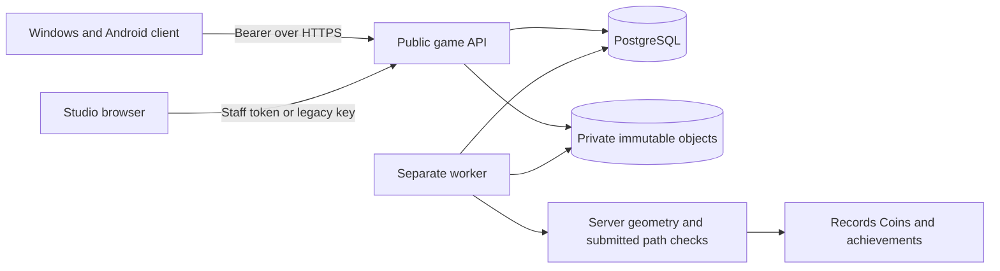

# Game client and backend security review

24 October 2026. Requirements: SEC01–SEC08, R01, Q01.

The current code has useful security controls, but I would not sign off a public competitive or monetized release yet. The most urgent new reproduction is an inexpensive denial of service against the default API process. The appearance APIs also accept Coin-priced cosmetics without checking ownership. Existing competitive-trust and administrator-access risks remain material.

This is a review of the working tree, including existing uncommitted changes. It does not establish the configuration or security of a running cloud deployment. No production exploitation, account mutation, deployment, APK export/install, or physical-device testing was performed. Phone/tablet attachment was not checked.

## Scope and evidence

The source inventory fingerprints 547 client, backend, native, deployment, schema, and tooling files, with a supplemental manifest for five core/compiler files. The route inventory contains 208 route declarations, including manually authenticated routes. Inventory is broader than line-by-line review: manual tracing concentrated on identity, administrative authority, account isolation, verification/rewards, publication, storage, external proof adapters, ingress limits, client persistence, deep links, and release configuration. Generated project build identity changed during the review; the receipt preserves inventory/completion hashes instead of treating the workspace as a frozen release artifact.

Evidence and reproducible local tools are in [the review evidence directory](evidence/security-review-2026-10-24/). The [machine-readable report](evidence/security-review-2026-10-24/report.json) records final test counts, commands, limitations, and source fingerprints. Review probes use disposable SQLite databases, fictional identities, isolated client profiles, and a loopback-only API.

The central integrity distinction is that the server owns track geometry, ticket bindings, prices, receipts, and database writes, while the client supplies the movement and incident evidence used for acceptance.

## Findings ordered by urgency

Severity describes impact and prerequisites. Configuration findings are conditional on the documented configuration being used; they are not claims about current live IAM or ingress. No critical remote code execution or unauthenticated private-data access was confirmed.

| ID | Severity | Finding | Evidence and disposition |
| --- | --- | --- | --- |
| SEC06 | High | Tiny unfinished requests exhaust the default API connection allowance | Reproduced against real local Uvicorn with the repository command's 24-connection cap; new actionable availability finding |
| SEC01 | High | Accepted paths do not establish that a physically legal race occurred | Reproduced at the real acceptance method with synthetic geometry; existing approved design limitation requiring competitive-risk treatment |
| SEC02 | High for progression integrity | Client incident flags control clean-race Coins and achievements | Same path changes from unclean to clean by editing its report; existing policy risk |
| SEC07 | High if exposed with legacy credentials | Production settings allow owner-key access without named MFA | Reproduced through HTTP with production defaults and a fictional owner key; known launch hardening gap |
| SEC03 | Medium | Both appearance write APIs accept unowned priced cosmetics | Reproduced through authenticated HTTP with zero Coins and no unlocks; new actionable enforcement gap |
| SEC04 | Medium before rewarded-ad launch | Temporary ad-preview resumes remain enabled in production mode | Reproduced with production settings; intentional bridge lacks an environment-bound retirement guard |
| SEC05 | Medium hardening | A normal game bearer can irreversibly remove an account without fresh identity proof | Reproduced through HTTP; requires possession of a valid bearer and is not an authentication bypass |
| SEC08 | Medium containment | Compose shares administrative secrets and a schema-owning database role across API and worker | Confirmed in configuration; requires a workload compromise to exploit |

### SEC06 Small unfinished requests can deny service

Sources: [request boundary](../backend/bmt_backend/middleware.py), [Docker command](../backend/Dockerfile), [Compose API](../backend/deploy/compose.yaml). Relevant code: middleware lines 429–480 and Docker `--limit-concurrency 24`.

Large uploads and discovery have receive/parse admission controls. Ordinary small control requests have a 30-second body deadline, but do not enter those receive semaphores. An unauthenticated caller can open requests to `POST /v1/auth/google/challenge`, declare a two-byte JSON body, and send only its first byte. The default authentication budget of 30 per minute permits enough simultaneous requests to fill the process allowance.

The [bounded reproduction](evidence/security-review-2026-10-24/slow_body_probe.py) held 23 such requests from one loopback address. `/healthz` returned 200 before the hold, then 503 on three probes, and 200 after disconnect. The full experiment took 8.406 seconds. It required no authentication, large payload, high request rate, or changes to application code. See [measured results](evidence/security-review-2026-10-24/slow-body.json).

This proves denial of service for one process with that command. It does not prove a complete multi-replica cloud outage: actual frontend buffering, connection limits, and scaling can change the result or shift the effect into cost growth.

**Fix:** extend receive admission to small control bodies, with per-network and total limits that leave normal requests capacity; shorten control-body deadlines; reject or avoid reading bodies on routes that do not accept them. Add appropriate connection/body controls at the real ingress. Retest real TCP traffic while ordinary sign-in, race submission, and readiness remain available.

### SEC01 Geometrically plausible paths can become verified records

Sources: [trajectory verifier](../backend/bmt_backend/trajectory_verifier.py), especially `check` at line 103; [acceptance adapter](../backend/bmt_backend/verifier.py), `verify_run` at line 364; [worker](../backend/bmt_backend/worker.py).

Acceptance checks start position, timeline, track extent, a maximum displacement, ordered gates, and lap count. It does not independently establish acceleration, steering, braking, grip, collision response, valid layer transitions, or correspondence to control inputs. `verify_run` calls the path checker; canonical physics replay is an explicitly separate diagnostic.

The local probe constructs a path that immediately travels at 60 m/s and takes instantaneous right-angle corners. It completes five laps in 879 ticks against a deliberately synthetic descriptor. Both the trajectory envelope and a legacy envelope containing only zero controls are accepted with the same time. This isolates the actual production predicate; it is not an end-to-end fabricated record against an official track or live competition.

A modified client able to construct a path satisfying the geometric checks can target records, rivalry/challenge results, and the progression derived from them. Server-owned geometry and speed bounds make fabrication harder but do not establish a legal drive. Client obfuscation or an embedded signing key would not make client-selected coordinates authoritative.

**Decision and fix:** retain the current owner-approved policy until a replacement is authorized, but explicitly accept its cheating exposure or require stronger evidence for competitive results. Options include canonical replay for sensitive submissions and independent review/holding of exceptional records. Any change needs capacity measurements and adversarial tests using real tracks and altered handling. This confirms existing [RACE-01/RACE-02](SECURITY_AAA_ACTIONS_2026_10_22.csv), rather than identifying a regression in the approved lightweight design.

### SEC02 Self-reported incidents authorize clean-race progression

Sources: [incident predicate](../backend/bmt_backend/trajectory_verifier.py), `clean_race_report` at line 13; [Coin award](../backend/bmt_backend/economy.py), lines 214–217; [achievement capture](../backend/bmt_backend/achievements.py), lines 170 onward; worker line 310.

Submitting the exact accepted path with an added incident report declaring zero collisions and no off-track activity changes `incident_free` from false to true. There is no independent collision/off-track check. The worker passes that value to reward capture; the economy adds **200 Coins** for Clean race and achievements advance clean counters/streaks.

The amount and ledger remain server-owned and idempotent. The weakness is the truth of the qualifying event: a modified client can make every accepted race claim the bonus. The review reproduced the predicate change and traced its consumers; it did not mint rewards in a live account.

**Fix:** independently verify the incident conditions, or change which progression may rely on these reports under an explicit policy. Treat anomaly detection as additional protection, not proof that an individual incident report is true. Existing [RACE-04](SECURITY_AAA_ACTIONS_2026_10_22.csv) remains open.

### SEC07 Legacy owner keys bypass the named MFA path

Sources: [administrative access](../backend/bmt_backend/admin.py), lines 31–38; [settings](../backend/bmt_backend/config.py), lines 10–13; [named staff access](../backend/bmt_backend/studio_access.py); [public ingress plan](../backend/deploy/gcp/staging.py).

`studio_legacy_keys_enabled` defaults to true, including in production. `access` returns owner/analyst directly for matching configured bearer keys before the named staff and MFA checks. A local production-mode HTTP probe received owner access with a fictional static key while `studio_staff_require_mfa` was true. Anonymous and game-token controls correctly received 401.

This is a documented alternative authentication path, not evidence that MFA-protected Google tokens are forgeable. Its risk is that possession of a reusable key confers privileged access without a named login, expiry, recent authentication, or person-specific audit identity. The same API includes public game routes and administrative routes. The repository does not establish a separately enforced administrative ingress boundary.

**Fix:** prove named staff sign-in/MFA and revocation end to end, retire legacy keys for production, and enforce a dedicated administrative boundary that cannot be bypassed using the default service URL. Preserve game API access while separating administrative ingress. Map privileged changes to individual actors. Existing ADM-01/02/03 apply. Actual live key configuration, access policies, and MFA enrollment were not inspected.

### SEC03 Cosmetic ownership is enforced by the client UI, not both write APIs

Sources: [private appearance write](../backend/bmt_backend/appearance_routes.py), line 42; [Rivalry appearance write](../backend/bmt_backend/rivalry.py), line 59; [appearance validation](../backend/bmt_backend/vehicle_appearance.py); [prices and ownership](../backend/bmt_backend/economy.py); [client ownership gate](../game/backend/cosmetic_economy.gd).

Both routes validate catalog membership and supported vehicle/part combinations. Neither checks `CosmeticUnlock` before storing the submitted design. A fresh authenticated account with zero Coins and an empty unlock list successfully saved Compact `body=wide`, which costs 750 Coins. The account read the part back from `/v1/me/appearances`; balance and unlocks remained unchanged. The probe succeeds through both `/v1/me/appearances` and `/v1/rivalry/appearance`.

The synced design is consumed by the client and shared Rivalry presentation, allowing a modified caller to equip a priced item without buying it. It does not create a cash purchase, give Coins, or grant a store entitlement. Unknown IDs and cross-account reads still fail correctly.

**Fix:** centralize server-side appearance authorization for both endpoints. Permit stock/free items and authoritative account unlocks. Preserve approved historical cosmetics using an explicit grandfathering policy; the current client-local `cosmetic_legacy` list is not independent evidence of ownership. Test both writes, restore onto another client, stale-write handling, and legacy acceptance.

### SEC04 Temporary preview resumes have no production-mode fence

Sources: [resume policy](../backend/bmt_backend/resumes.py), lines 22, 48, and 188; [provider adapters](../backend/bmt_backend/provider_proofs.py); [AdMob build isolation](../native/admob/android.gradle).

`TEMPORARY_AD_RESUMES=True` is unconditional. When paid/ad-free/banked/daily sources do not apply, the server authorizes `ad_preview` without provider proof. The local production-mode probe consumed the daily allowance and then authorized additional resumes, still within the three-per-race limit, with ads unavailable and no banked balance.

This bridge was explicitly authorized, does not claim a watched ad, and does not mint banked credits. It becomes a launch problem if a production paid/rewarded-ad policy assumes those additional uses require a verified ad. The native test-ad SDK is debug-only; provider-proof utilities do not constitute a deployed production fulfillment pipeline.

**Fix:** make the bridge an explicit environment/policy setting with a production retirement guard. Preserve intentionally free Compact Circuit resumes and any other owner-approved free allowances. Keep real ad rewards account-bound, signature-verified, and transaction-deduplicated before enabling them. PAY-04/05 remain acceptance gates.

### SEC05 Account removal has no recent-authentication step

Source: [account deletion](../backend/bmt_backend/privacy.py), line 124.

The game deletion endpoint accepts a normal valid access bearer plus the literal confirmation and a new operation UUID. It does not require a fresh Google challenge or an action-bound reauthentication proof. The local probe removed its own fictional account and the old bearer then received 401.

An attacker who steals a usable bearer can therefore turn temporary access into permanent account loss. Ordinary access expires after 900 seconds by default, and encrypted storage, TLS, revocation, and explicit UI confirmation reduce exposure. This is defense in depth for a sensitive irreversible operation, not a finding that anonymous callers can delete accounts.

**Fix:** consider a short-lived, action-bound fresh-identity proof for new deletion requests, while retaining the existing operation-bound recovery receipt after deletion and revocation. Verify it against the intended Google account and test network-loss recovery. A confirmation string sent by the caller does not prove fresh identity.

### SEC08 API and worker authority is insufficiently separated in Compose

Sources: [shared runtime environment](../backend/deploy/compose.yaml), lines 23–29 and worker environment inheritance; [database role setup](../backend/deploy/init-db.sh), lines 5–8; [administrative audit table](../backend/bmt_backend/admin_models.py).

Compose passes the same database credentials and configured administrator keys to API and worker via the shared environment. The application role owns the public schema and also runs migrations. A compromised worker would therefore inherit administrative secrets and broad database authority beyond processing its queue; audit/grant integrity would depend on the compromised application boundary.

No worker compromise, SQL injection, or exposed database was demonstrated. This is a containment weakness with explicit compromise prerequisites. The GCP plan separates migrator from runtime identities but still uses one runtime service account for API and worker; live permissions require a separate check.

**Fix:** define per-workload secrets and database grants, reserve DDL/migration ownership for a separate role, remove administrator credentials from workers, and protect privileged audit copies independently. Test actual permission denials, not only configuration names. Existing IAM-02 and ADM-05 apply.

## Controls that reduce risk

| Boundary | Evidence from current source and local checks | Remaining qualification |
| --- | --- | --- |
| Google sign-in | Signature/issuer/audience validation, authorized presenter checks, bounded provider timeout, server nonce, one-use challenge | No real provider/account interaction in this review |
| Game sessions | Random credentials stored as hashes; short access lifetime; rotating refresh families; replay revocation; operation-bound lost-reply recovery; logout/account fences | Full PostgreSQL concurrency and native secure-store acceptance remain |
| Client transmission | HTTPS except explicit loopback URLs; redirect forwarding disabled; request/response size and time limits; account-generation fences | No packaged release TLS or hostile-network test |
| Client persistence | DPAPI on Windows; Android non-exportable AES-GCM key with context binding; no plaintext fallback | Windows vault was registered but could not seal a fictional value in this sandbox; Android was source-reviewed only |
| Request parsing | Duplicate keys, nonfinite numbers, invalid Unicode, excess nesting, compressed oversize bodies rejected; upload authentication precedes large-body receipt | Small control-body receive admission has SEC06 |
| Resource protection | Bounded database pools/timeouts, account/write budgets, queue slots, worker leases, publication evidence quota, additional discovery actor/network caps | No distributed or sustained cloud-abuse certification |
| Publication/storage | Explicit publication intent; owner and contract checks; content-addressed keys; bounded decompression; SHA256 integrity; atomic publication and pins | Native compiler/engine attack surface was not fuzzed; backups/live bucket permissions not inspected |
| Progression/purchases | Server prices and wallet writes; permanent transaction identities; replay-safe grants; public store fulfillment unavailable until configured | SEC01–04 constrain integrity; sandbox Play/refund/SSV workflows were not exercised |
| Account/content isolation | Owner checks on private resources; private blocks/reports; generation fences; publication and deletion recovery | Client draft-browser assertions failed and require follow-up before privacy acceptance |
| Browser/native surfaces | Studio HTML escaping and CSP; in-tab credentials; no general UGC scripts/images; UUID-based deep links; read-only private share provider and canonical cache paths | No dynamic Studio XSS test, APK manifest inspection, or native memory-safety fuzzing |
| Deployment inputs | Python and engine pins, hashed wheels, nonroot container, read-only Compose filesystem, capability dropping, private/loopback database/API binding | Actual cloud drift, IAM, edge policy, image OS CVEs, and signing pipeline remain unverified |

The route scan flagged two administrative publication endpoints without declarative access dependencies. Manual inspection found an explicit `access(request)` call in both, and HTTP probes rejected anonymous and game credentials. They are not reported as authorization bypasses. The scan also distinguishes manual bearer/account-deletion checks and dedicated monitor/development credentials from public routes.

## Secrets and dependency review

The known-format credential scan inspected 20,300 current Git-tracked text files of at most 2 MB each. Its two candidates are the published AWS signing example in a test and a historical patch containing that same example. A supplemental literal-credential scan inspected 18,042 eligible files and found no high-entropy literals matching its selected token/password fields. Neither scan emits credential values.

These checks do not prove absence of secrets: ignored local files, oversized/binary files, complete Git history, exported APKs, external logs, and provider-side secret access were outside this scan. They do not establish that any real credential remains unexposed elsewhere.

The inventory records 46 locked Python packages and local installed versions. `pip check` reported no broken requirements. Hash pinning and dependency consistency are useful supply-chain controls but do not establish absence of vulnerabilities. For example, the locked h11 0.16.0 is the patched release for [the maintainer's chunked-framing advisory](https://github.com/python-hyper/h11/security/advisories/GHSA-vqfr-h8mv-ghfj); this is one advisory comparison, not a complete scan. [Starlette's maintainer advisories](https://github.com/Kludex/starlette/security/advisories) likewise require exact-version and component-reachability assessment.

A full public OSV query of the locked inventory is pending approval. The sandbox network attempt failed, and automatic approval review rejected the subsequent export of package names/versions as potentially sensitive. No source code or player data was submitted. No clean dependency-CVE result is claimed. Container OS, Android dependency graph, and native binary scanning also remain open under BUILD-01/02/04.

## Validation and unresolved checks

The final backend selection produced **420 passed, 2 failed, 10 skipped, and 190 deselected**. The 16 bespoke probes passed; a passing finding probe confirms the weakness described above. Deployment configuration checks passed 46 tests. The real TCP availability reproduction passed its before/during/after assertions. See [report.json](evidence/security-review-2026-10-24/report.json) and the XML/log artifacts for exact identities and commands.

The two backend failures are `test_canonical_three_rewinds_keep_original_verified_time`, where the verifier refused engine diagnostics, and `test_additive_attempt_migration_preserves_existing_challenges[sqlite]`, whose historical downgrade hit the intentional 0054 guard requiring creator achievement events to drain. Neither was converted to a pass. The latter protects pending effects; its old downgrade fixture does not establish a current authorization weakness.

Initial harness runs are retained: one invocation missed `PYTHONPATH`, one lacked the parent directory for pytest's explicit base directory, and a later broad run encountered PostgreSQL-parametrized fixtures despite marker filtering. The isolated diagnostic confirmed connection timeout to the configured local PostgreSQL service at port 55439. The final SQLite selection additionally excludes those parameter IDs; it does not substitute for PostgreSQL locking evidence.

The native checks used the exact pinned Godot 4.7.2 engine and isolated application-data roots. Session rotation produced 17 checks/12 failures; exception recovery 28/2; ghost response bounds 20/0; communication follow-up 37/6; and draft privacy 17/3. The medium-communication test failed protected-store assertions, hit a fixture bounds error, and reached its deadline. The account-privacy test hit a missing `request_id` after unsuccessful persistence and timed out; the first native runner also had a timeout-output handling error, which was corrected for subsequent runs. A dedicated probe confirmed the secure-store class was present but sealing returned zero bytes. Root certificate-store access also failed in the sandbox.

Those secure-store symptoms constrain native validation. They do not prove plaintext fallback or a shipping cryptographic weakness. The draft-browser and publication-retry assertions are retained as unresolved; the underlying draft-storage isolation assertions passed, but this does not establish why browser assertions failed or certify the full UI. No assertion was weakened and no runtime code was edited to make a test pass.

Before a production decision, complete the skipped PostgreSQL race/locking cases, secure-store and release-client workflows outside these sandbox restrictions, and the failed backend/client assertions listed in the evidence. Verify live IAM, administrative ingress, database/object/backup access, image/artifact contents, and dependency CVEs against the actual release. Update the privacy disclosure to cover the newer account-synced Garage appearance flow and replace the developer/contact placeholders. Real store/ad/consent and reversal acceptance remain separate launch gates.

## Recommended work order

1. Fix small control-body admission and verify real request availability under the bounded slow-body reproduction.
2. Enforce cosmetic authorization in both appearance write paths, with an explicit legacy policy.
3. Decide and implement the competitive path/incident trust policy before treating records and clean-race progression as independently verified.
4. Complete named administrative access, retire production legacy keys, and establish workload/database privilege separation.
5. Fence temporary ad-preview policy, evaluate deletion reauthentication, and finish the release/cloud/provider validation gates.

This review changes documentation and reproduction tools only. It implements no security remediation and authorizes no rollout. Existing working-tree changes remain separate from the review checkpoint.
