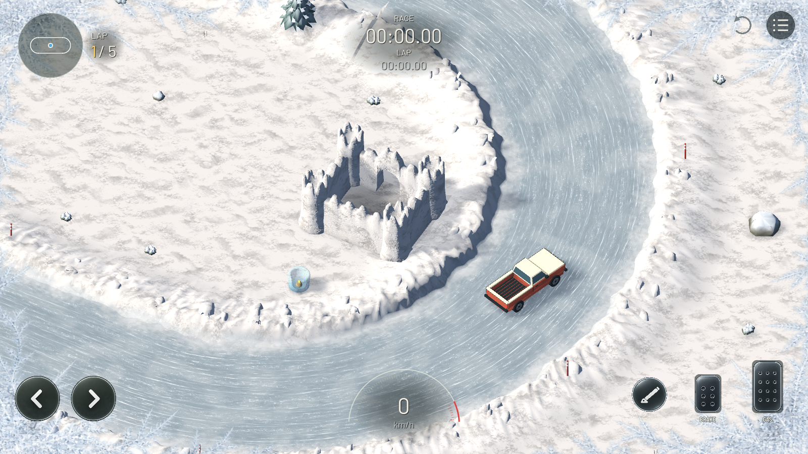
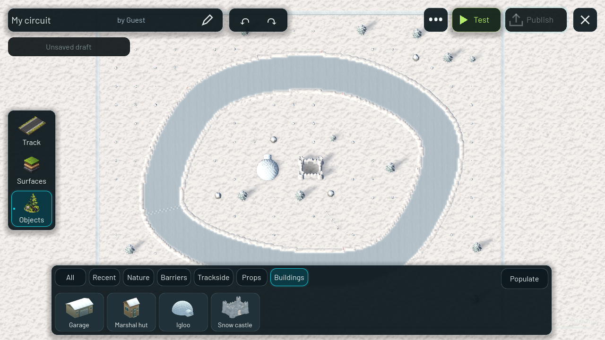

# Snow castle world fit — 2026-10-19

The owner's race screenshot shows the previous castle reading as a bright, regular masonry model against weathered snow. This correction changes the castle's construction language rather than adding more small details. SCF01 replaces separate brick courses, moulded cornices, narrow block crenellations, windows and crest with a continuous hand-packed snow fort. SCF02 matches the surrounding Winter snow finish. SCF03 preserves original placements, canonical contacts, other craft, bounded resources and native review. This supersedes the castle appearance in WA02, retaining the igloo and other WA contracts.

Four slightly uneven, battered turrets now grow from wind-packed feet. Broad rounded crests are part of the turret and curtain-wall surfaces; they are not small boxes perched on cylinders. Soft packing bulges and centimetre-scale continuous deformation break the manufactured edges without open joints. The real arched entrance, open court and original object size remain. The court and threshold use shallow textured snow surfaces rather than a flat slab. Ten connected mesh masses replace 205 separate masonry pieces.

The castle uses the exact existing `winter_snow_v1.png` texture and the banks' neutral value treatment. Three mipmapped triplanar samples carry that artwork around the curved walls and over their crests. Filtered surface relief and matte shading replace the old blue-white pigment. Lower packing is slightly subdued. A castle-only vertex tag selects this finish in the existing opaque Winter craft shader. The igloo, snowman, snow lantern and ice lantern retain every original mesh channel; the igloo/snowman/snow lantern also pass strict native original-shader pixel comparisons and repeated controls in both renderers. The ice lantern retains its separate unchanged ice shader.

The original draw group, one mesh surface, contact data, 7.4×6.4 m selection footprint, scale/rotation/position handling, track schema/compiler identity, physics, gates, records and saves remain. The arch is a visual opening; cars retain the original solid building contacts. The existing 32 MiB prop / 24 MiB thumbnail / 64 MiB world budgets and upload limits remain. The existing resident snow tile gains one sampler binding on the shared shader; it is sampled only by castle-tagged fragments. No new texture asset, texture allocation, material pass, light, dependency or runtime service is introduced. This is not a measured performance claim. The castle drops from 9,890 to 7,950 triangles, inside the unchanged <10,000 ceiling. `authored-props-14-sculpted-snow-fort` fences existing model, finished-world and thumbnail keys.

[Actual before/after race and studio review](evidence/snow-castle-fit-2026-10-19/review.html) uses the same local native Winter circuit, car, camera and environment for both versions. Only the castle mesh/material is exchanged. The owner's screenshot is visual evidence, not a shipping asset; no screenshot pixels were copied into the model or material. Native captures are unretouched.

Runtime files: new `game/track/prop_snow_castle.gd` (+ UID); `game/track/prop_winter_craft.gd` delegates only the castle construction and binds the existing texture; `game/track/winter_craft_snow.gdshader` adds the castle-only finish; `game/track/creator_prop_visual.gd` changes only the presentation version. New focused test: `game/tests/test_snow_castle_fit.gd` (+ UID). Documentation: this file, `AGENTS.md`, `DEVELOPMENT_STATUS.md`, `docs/PHASE_0_PLAN.md`, `licenses/ASSETS.md`, and the evidence review/report/patch. Unrelated workspace changes and the original main Git index are preserved.

Actual commands use the pinned Godot 4.7.2 through `powershell -NoProfile -ExecutionPolicy Bypass -File scripts/dev.ps1`:

| Arguments | Actual outcome |
|---|---|
| `-Action TestScript -ScriptPath res://tests/test_snow_castle_fit.gd -TestArgument '--original' -CommandTimeoutSeconds 150` | Preserved pre-correction castle: 10 checks, two failures for separate masonry masses and the absent world-snow finish. |
| `-Action TestScript -ScriptPath res://tests/test_snow_castle_fit.gd -Graphical -RenderingMethod gl_compatibility -CommandTimeoutSeconds 240` | Final 35 checks, zero failures, including actual race before/after, unchanged track/car state, surface count and strict repeated original/candidate pixel controls for untouched craft. |
| Same focused command with `-RenderingMethod mobile -RenderingDriver vulkan` | Final 35 checks, zero failures on desktop RTX 3090. This is not Android execution. |
| `-Action TestScript -ScriptPath res://tests/test_winter_architecture.gd -Graphical -RenderingMethod gl_compatibility -TestArgument '--capture-to=res://../docs/evidence/snow-castle-fit-2026-10-19/after' -CommandTimeoutSeconds 180` | All original 57 assertions pass, including geometry/normals/winding, real entrance/court, unchanged other craft and actual editor preparation/saved placements. Earlier headless run: 46 checks, zero failures. No existing assertion changed. |
| `-Action TestScript -ScriptPath res://tests/test_winter_craft.gd -CommandTimeoutSeconds 150` | 595 checks, zero failures, including canonical contacts, saves/JSON, destruction/lifetime/rewind and all five driven replay fixtures. |
| `-Action TestScript -ScriptPath res://tests/test_biome_object_kits.gd -CommandTimeoutSeconds 180` | 983 checks, zero failures. |
| `-Action TestScript -ScriptPath res://tests/test_prepared_race_load.gd -CommandTimeoutSeconds 180` | 85 checks, zero failures. |
| `-Action Import -CommandTimeoutSeconds 240` | Completed; new native resource UIDs registered. |
| `-Action TestScript -ScriptPath res://tests/test_script_parse.gd -CommandTimeoutSeconds 180` | 900 scripts, zero failures. |

Tests were not weakened or removed. Initial corrections are retained: the first shell replacement did not connect the new builder, which the unchanged geometry count exposed; the explicit stdin edit connected it. One gate-jamb triangle disagreed with its smoothed normal; the exposed cut now retains its own smoothing group. The pixel fixture initially assumed a breakable root was a MeshInstance3D; it now selects its actual DamagePhase0 mesh. An initial Mobile igloo pixel comparison failed; an unchanged rerun passed, then the final fixture retained that exact assertion and added two original/candidate repeat controls per craft. All final native controls pass. The initial tiny crown plateaus were broadened after visual review. The race fixture's rock was moved off the road and its paused presentation retained the actual canonical car pose. These are fixture/art corrections, not gameplay changes.

Exact receipts, copied logs, source/capture hashes and the isolated task-only Git checkpoint are in [report.json](evidence/snow-castle-fit-2026-10-19/report.json). Remaining acceptance is the owner's judgement of style in the Winter world and physical-device appearance, sustained frame pacing, memory and thermals. No phone attachment check or device test, APK/export/install, backend/account mutation or deployment was performed.
