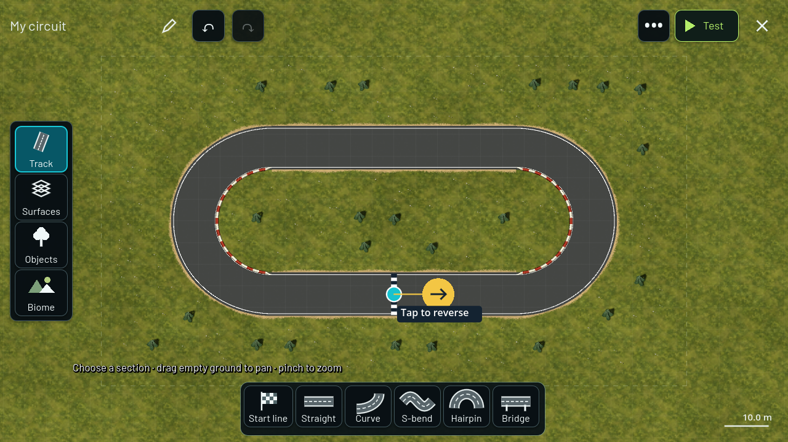
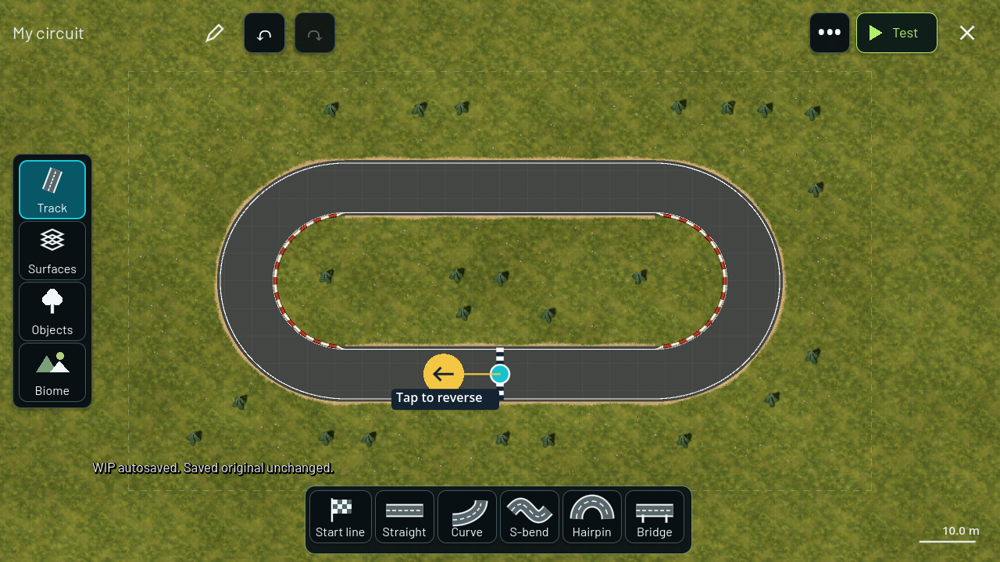

# Start line directly on the track

2026-09-17. Owner-requested follow-up to automatic waypoints. Requirements: R01, T01-T04, V03/V05; R03/R07 for route direction and replay checks.

The Waypoints menu is removed. Track contains Start line: tap a road to place it, drag its checkered stripe to move it, and tap its gold arrow to reverse the driving direction. Placement snaps to the road. Direction changes and moves are undoable and autosaved. Keyboard 4 selects start placement. Test starts at the placed line in the chosen direction.

Connected road pieces generate the lap route automatically during edits and explicit Save. Incomplete road chains retain the previous route for untimed practice. There is no manual route-generation menu. Existing documents without a start line retain their previous start behavior; the old practice_start field remains readable as a fallback. No player files are deleted.

## Content contract and files

The optional creator-track-v5 start_line pose stores position and map heading. Compiler 12 rotates the route to the projected start position, reverses its order when requested, and derives spawn, finish and checkpoints consistently. Road surfaces are unchanged by reversing. Compiler versioning changes content identity; the starter resource and creator golden were regenerated. Default golden: 6f72cec60c03e822eb0bd418715fd01b1e0ab6bdc32d35b475f5d3a2efd7eac6.

Runtime files: game/editor/start_line.gd (and UID), editor_canvas.gd, track_document.gd, track_compiler.gd; game/core/app.gd; game/resources/tracks/starter_circuit.json. Contract: docs/schemas/creator-track-v5.schema.json. Validation: scripts/dev.ps1; game/tests/test_start_line.gd (and UID), test_app.gd, test_creator.gd, test_editor_workflow.gd and test_editor_retirement.gd. Documentation: this file, DEVELOPMENT_STATUS.md, docs/PHASE_0_PLAN.md and AGENTS.md.

## Actual validation

Commands used the pinned engine through `powershell -NoProfile -ExecutionPolicy Bypass -File scripts/dev.ps1 ACTION`:

| Action | Result |
| --- | --- |
| Import | Passed; Android build-tools directory warning |
| GenerateStarter | Regenerated compiler-12 starter |
| CaptureStartLine | 29 checks passed; graphical captures saved |
| TestCreator | 86 checks passed |
| TestApp | 86 checks passed |
| TestEditorRetirement | 24 checks passed |
| TestWorkflow | 166 checks passed |
| TestPieces | 172 checks passed |
| TestFreeEditor | 43 checks passed |
| TestRefinement | 32 checks passed |
| TestEditor | 35 checks passed |

673 checks passed across the listed test runs. Start-line coverage includes real touch placement, invalid poses, canceled direction taps, reverse direction, drag, undo/redo, autosave, content identity and JSON roundtrip. Five laps in each direction finish with zero contacts and zero shortcut penalties; both input recordings replay to exactly matching snapshots. The saved-track refresh regression passes after explicit Save was connected to automatic route generation.

Initial creator golden and menu assertions failed because they described compiler 11 and the removed menu; they were updated to the requested contract and rerun. No physics invariant was weakened. Full Validate and Android export were not run for this slice. No phone test was performed; on-device touch usability and owner visual acceptance remain pending.

## Visual evidence

Desktop captures were inspected:

Logs are retained in evidence/start-line/.
