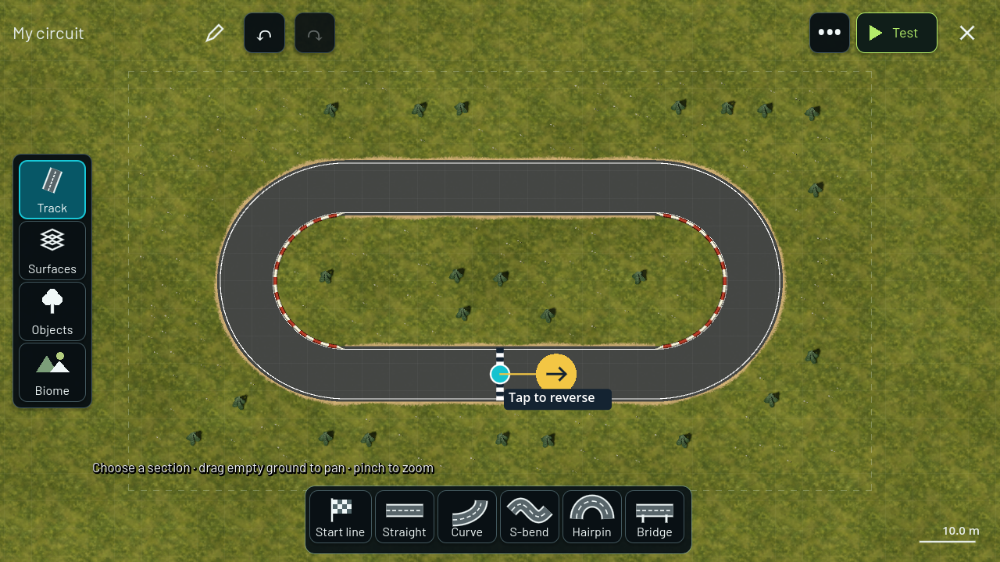
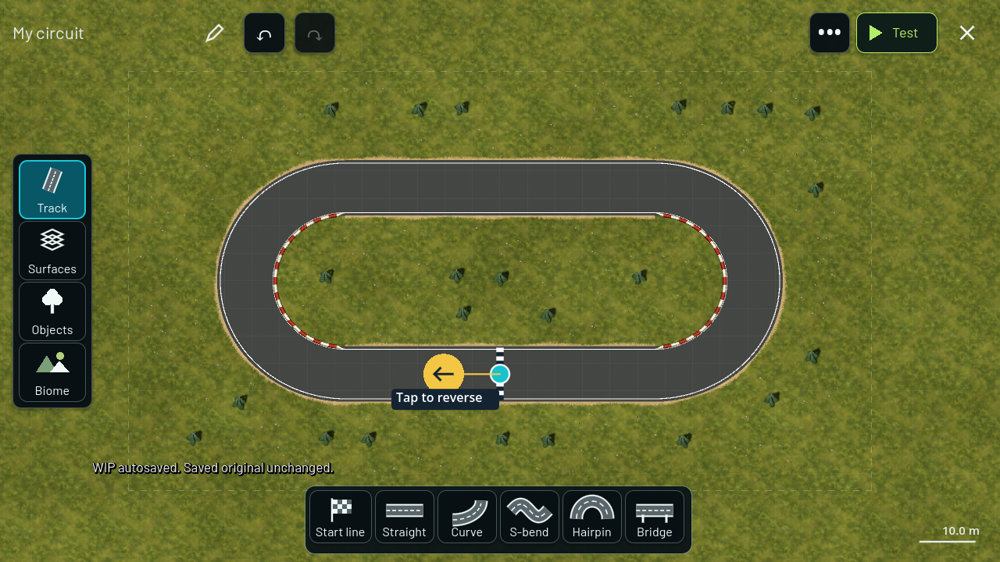

# Start line directly on the track

2026-09-17. Owner-requested follow-up to automatic waypoints. Requirements: R01, T01-T04, V03/V05; R03/R07 for route direction and replay checks.

The Waypoints menu is removed. Track contains Start line: tap a road to place it, drag its checkered stripe to move it, and tap its gold arrow to reverse the driving direction. Placement snaps to the road. Direction changes and moves are undoable and autosaved. Keyboard 4 selects start placement. Test starts at the placed line in the chosen direction.

Connected road pieces generate the lap route automatically during edits and explicit Save. Incomplete road chains retain the previous route for untimed practice. There is no manual route-generation menu. Existing documents without a start line retain their previous start behavior; the old practice_start field remains readable as a fallback. No player files are deleted.

## Content contract and files

The optional creator-track-v5 start_line pose stores position and map heading. Compiler 12 rotates the route to the projected start position, reverses its order when requested, and derives spawn, finish and checkpoints consistently. Road surfaces are unchanged by reversing. Compiler versioning changes content identity; the starter resource and creator golden were regenerated. Default golden: 6f72cec60c03e822eb0bd418715fd01b1e0ab6bdc32d35b475f5d3a2efd7eac6.

Runtime files: game/editor/start_line.gd (and UID), editor_canvas.gd, track_document.gd, track_compiler.gd; game/core/app.gd; game/resources/tracks/starter_circuit.json. Contract: docs/schemas/creator-track-v5.schema.json. Validation: scripts/dev.ps1; game/tests/test_start_line.gd (and UID), test_app.gd, test_creator.gd, test_editor_workflow.gd and test_editor_retirement.gd. Documentation: this file, DEVELOPMENT_STATUS.md, docs/PHASE_0_PLAN.md and AGENTS.md.

## Actual validation

Commands used the pinned engine through `powershell -NoProfile -ExecutionPolicy Bypass -File scripts/dev.ps1 ACTION`:

| Action | Result |
| --- | --- |
| Import | Passed; Android build-tools directory warning |
| GenerateStarter | Regenerated compiler-12 starter |
| CaptureStartLine | 29 checks passed; graphical captures saved |
| TestCreator | 86 checks passed |
| TestApp | 86 checks passed |
| TestEditorRetirement | 24 checks passed |
| TestWorkflow | 166 checks passed |
| TestPieces | 172 checks passed |
| TestFreeEditor | 43 checks passed |
| TestRefinement | 32 checks passed |
| TestEditor | 35 checks passed |

673 checks passed across the listed test runs. Start-line coverage includes real touch placement, invalid poses, canceled direction taps, reverse direction, drag, undo/redo, autosave, content identity and JSON roundtrip. Five laps in each direction finish with zero contacts and zero shortcut penalties; both input recordings replay to exactly matching snapshots. The saved-track refresh regression passes after explicit Save was connected to automatic route generation.

Initial creator golden and menu assertions failed because they described compiler 11 and the removed menu; they were updated to the requested contract and rerun. No physics invariant was weakened. Full Validate and Android export were not run for this slice. No phone test was performed; on-device touch usability and owner visual acceptance remain pending.

## Visual evidence

Desktop captures were inspected:





Logs are retained in evidence/start-line/.

## Empty new-track editor correction (2026-10-22)

Requirements ESL01/R01/Q01: opening a new track must show bare editable terrain without a starting line. The compiler retains an internal fallback route for practice, and the shared renderer previously painted its finish onto the grass. Editor previews of freeform drafts now omit that fallback until the author places a `start_line`. Placed lines, existing layouts, base-track remixes and race rendering keep their existing behavior. No saved document or canonical race data changes.

Changed runtime: `game/track/native_track_visual.gd`. The existing `game/tests/test_start_line.gd` fixture now waits for app startup and editor preparation, and flushes the existing asynchronous draft writer before checking autosave. Its original assertions remain. This document and [the evidence directory](evidence/editor-start-line-2026-10-22/) record the change.

The original renderer reproduces 11 failures in 39 focused checks: blank and incomplete-road previews in all five biomes, plus the actual new editor. Final Compatibility and desktop Mobile runs each pass all 39 checks. Both native screenshots were inspected:

- [Original blank editor](evidence/editor-start-line-2026-10-22/before/blank-editor.png)
- [Corrected Compatibility editor](evidence/editor-start-line-2026-10-22/final-gl_compatibility/blank-editor.png)
- [Corrected desktop Mobile editor](evidence/editor-start-line-2026-10-22/final-mobile/blank-editor.png)

Final existing regressions: start-line 27 checks, editor workflow 252 checks and whole-project parser 919 scripts, all passing. Scoped `git diff --check` passes.

Actual repository-root commands used the pinned Godot 4.7.2 executable, with a separate workspace `APPDATA` profile for each capture and regression run:

```powershell
$env:APPDATA = Join-Path (Get-Location) 'build/editor-start-line/final-gl-profile'
& 'C:/apps/Godot 4.7.2/Godot_v4.7.2-stable_win64_console.exe' --path game --rendering-method gl_compatibility --rendering-driver opengl3 --script '../build/editor-start-line/probe.gd' -- --evidence=res://../docs/evidence/editor-start-line-2026-10-22/final-gl_compatibility

$env:APPDATA = Join-Path (Get-Location) 'build/editor-start-line/final-mobile-profile'
& 'C:/apps/Godot 4.7.2/Godot_v4.7.2-stable_win64_console.exe' --path game --rendering-method mobile --rendering-driver vulkan --script '../build/editor-start-line/probe.gd' -- --evidence=res://../docs/evidence/editor-start-line-2026-10-22/final-mobile

$env:APPDATA = Join-Path (Get-Location) 'build/editor-start-line/regression-profile-ready'
foreach ($suite in @('test_start_line','test_editor_workflow','test_script_parse')) {
    powershell -NoProfile -ExecutionPolicy Bypass -File scripts/dev.ps1 -Action TestScript -ScriptPath ('res://tests/'+$suite+'.gd') -CommandTimeoutSeconds 180
    if ($LASTEXITCODE) { exit $LASTEXITCODE }
}
git diff --check -- game/track/native_track_visual.gd game/tests/test_start_line.gd docs/START_LINE_EDITOR.md
```

The retained [probe](evidence/editor-start-line-2026-10-22/probe.gd) can be copied back to `build/editor-start-line/probe.gd` to repeat these captures. Initial sandbox certificate/path errors, an early capture attempted before app startup, and the three existing start-line fixture timing corrections are retained in the evidence logs. No runtime invariant or assertion was weakened. The task-only source patch is [source-checkpoint.patch](evidence/editor-start-line-2026-10-22/source-checkpoint.patch); concurrent workspace changes are preserved.

Restart/update the local client to load the fix; owner acceptance remains. No phone attachment check or physical-device test, APK/export/install, backend/account mutation or deployment was performed.
