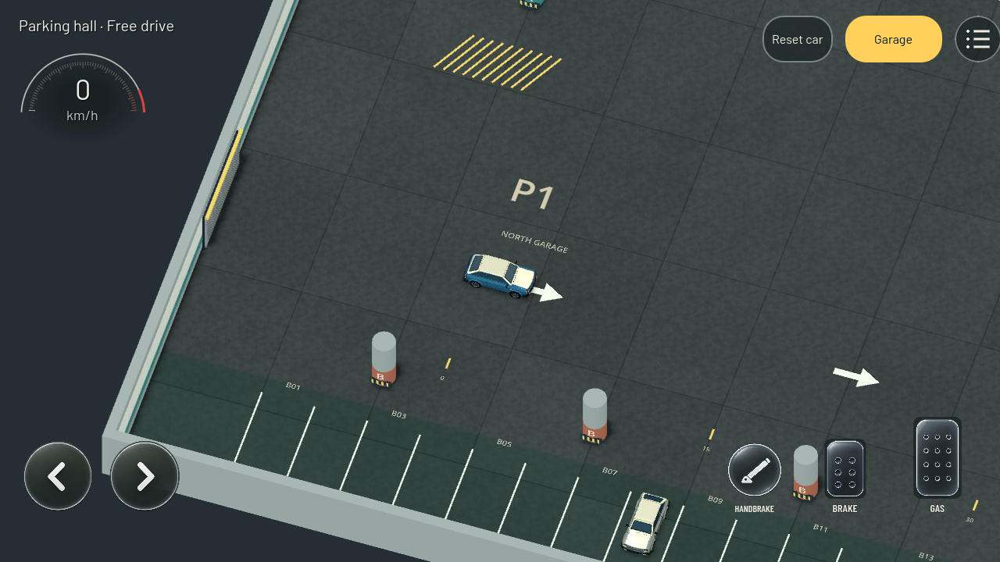
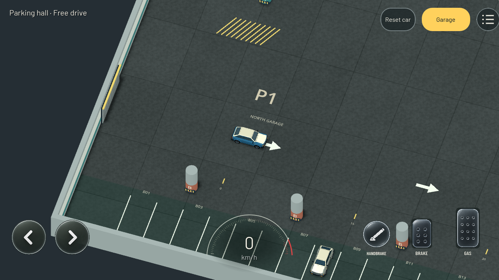

# Test-drive speedometer placement — 2026-10-25

TDS01/R01/Q01: the Garage parking-hall test drive now uses the race speedometer's bottom-center anchors, offsets, 228 × 114 logical-unit panel and 44-unit number. The free-drive-only upper-left placement and smaller number are removed in `game/ui/playground_hud.gd`.

The runtime change removes six layout-override lines and replaces one label-size expression. Existing race placement, speed calculation, controls, editor-practice visibility and driving behavior remain. `game/tests/capture_test_drive_speedometer.gd` is a diagnostic capture helper using the actual race and parking-hall scenes; it records native control rectangles and screenshots without changing runtime behavior. The evidence runner and task-only patch are under `docs/evidence/test-drive-speedometer-2026-10-25/`.

The real scenes were captured at 960 × 540, 1280 × 720, 1280 × 914 and 1920 × 864 on Compatibility/OpenGL and desktop Mobile/Vulkan. Both modes have identical panel rectangles and font sizes at every size, remain visible and avoid all driving touch zones. Race measurements also match the task-start race measurements exactly. At 1280 × 720 the shared rectangle is `(526, 564, 228, 114)`; the old test-drive rectangle was `(24, 62, 164, 102)` with a 36-unit number.





Actual commands, run metadata, native measurements, source hashes and the scoped patch are recorded in [report.json](evidence/test-drive-speedometer-2026-10-25/report.json). The final commands use the pinned 4.7.2 engine through `scripts/dev.ps1` with isolated APPDATA:

```powershell
powershell -NoProfile -ExecutionPolicy Bypass -File docs/evidence/test-drive-speedometer-2026-10-25/run.ps1 -Script capture_test_drive_speedometer -Mode gl_compatibility
powershell -NoProfile -ExecutionPolicy Bypass -File docs/evidence/test-drive-speedometer-2026-10-25/run.ps1 -Script capture_test_drive_speedometer -Mode mobile
powershell -NoProfile -ExecutionPolicy Bypass -File docs/evidence/test-drive-speedometer-2026-10-25/run.ps1 -Script test_bridge_hud -Mode headless
powershell -NoProfile -ExecutionPolicy Bypass -File docs/evidence/test-drive-speedometer-2026-10-25/run.ps1 -Script test_script_parse -Mode headless
```

Each final native capture run completed with eight layout samples and exit 0. Parser: 1,201 scripts, zero failures. The existing bridge/HUD suite completed 142 checks with two bridge-material failures, both before its HUD scene reviews; its layout and simulation-state checks passed. No assertions were changed. The task-start Garage suite stopped at `test_parking_hall.gd:145` because the current menu has no expected Test drive button in one section, before entering the driving scene. That suite is not reported as passing.

The first runner invocation was blocked by PowerShell execution policy. A subsequent sandboxed engine startup could not read the Windows certificate store and was interrupted; its log is retained. Native runs succeeded with reviewed escalation. Native scene construction produced hitch diagnostics; these captures are placement evidence, not performance measurements.

Reload and owner/device appearance acceptance remain. No device attachment check or device test was performed. No APK, deployment or owner-process restart was performed. Concurrent workspace changes are preserved; the checkpoint is a reviewable patch, with no staging or commit.
