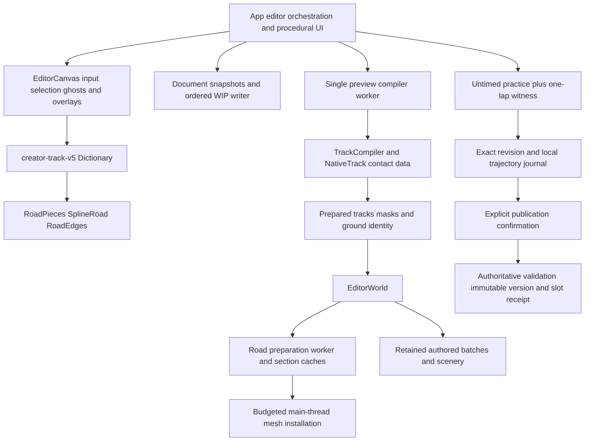

# Beat My Track track editor performance and usability audit

23 October 2026. Investigation only. No runtime implementation, canonical rules, saved formats, account data, backend services or deployment was changed by this audit.

## A Executive assessment

The modular editor has a sound core: bounded plain authoring data, shared deterministic road/contact construction, automatic routing, background preview compilation, revision fences, atomic local recovery, and publication tied to an exact completed creator lap. Preserve those systems. A replacement editor architecture is unnecessary.

The editor is **not yet demonstrated ready for consistently fluid 60 FPS editing on the OnePlus Nord 2 5G**. Local desktop execution exposes substantial preparation delays, expensive handle drawing, high scene detail, and a slow return from practice. A small scene-node count and a fast input handler do not establish responsiveness: the 96-piece fixture took about 9 seconds to finish its detailed preview after a road edit, while the input handler itself returned quickly. Ordinary object dragging updates its outline before its 3D model follows.

The interface gives the canvas substantial room and keeps useful controls contextual. Beginner success is less secure. Ghost confirmation, closing the circuit, placing a start line, completing the qualifying lap, and the distinction between WIP recovery and explicit Save require discovery. Many instructions are assigned to a normally hidden status label. A skilled creator could construct a simple circuit quickly, but there is no observed novice study supporting the requested 1–2 minute target.

The five highest-value improvements, in priority order, are:

1. Keep immediate previews cheap and finish only affected detailed geometry. Existing section reuse should become effective at the supported maximum, with a bounded path for initial drawing and installation.
2. Reuse the exact prepared track and retain the editor view across practice. Remove repeated synchronous compiles from the Test action.
3. Make the selected object visibly follow the finger, and prepare selected-road handles once per revision/view change. These are direct improvements to touch confidence and dragging cost.
4. Make the first closed lap and its start line easy to discover: a compact optional modular oval starter, visible connection feedback, and actionable readiness in the existing issue/Test area.
5. Govern editor memory and detail together. Byte-bound history and aggregate cache pressure, and use cheaper cosmetic representations while manipulating dense scenes.

No Critical track-corruption or public-score contamination defect was confirmed. The Winter object rendering equivalence failure is a real unresolved regression finding; it must be understood before further batching changes.

### Evidence and scope

- Current source was traced through `game/editor`, `game/core/app.gd`, `game/core/game.gd`, native track/render/contact helpers, persistence, draft browsing, creator proof, publication UI/client, and the backend publication boundary.
- New executable audit probes, numeric results, native screenshots and existing regression logs are in [the evidence directory](evidence/track-editor-audit-2026-10-23/). The probes are instrumentation outside the game implementation.
- [Source hashes](evidence/track-editor-audit-2026-10-23/source-manifest.json) and [retained reviewed sources](evidence/track-editor-audit-2026-10-23/reviewed-source/) identify the reviewed code. Function names are the primary anchors; app line numbers below refer to that retained copy.
- The workspace was already dirty and continued receiving unrelated changes. Later concurrent work also changed paint-exclusion reuse/cancellation in `track_compiler.gd`, `native_track.gd`, `road_kerbs.gd`, and `prepared_track_cache.gd`. Main benchmark results precede those edits; the follow-up interaction probe and final publication check ran afterward. The later changes do not establish a new complete performance baseline. This audit did not implement them.
- All new measurements are Windows desktop debug-engine measurements, using pinned Godot **4.7.2.stable.official.ed1daf0bf**, the native geometry extension, an i7-11700K and RTX 3090. Graphical results use Compatibility at 1280×720 unless identified otherwise. The host was shared; numbers are diagnostic observations, not isolated hardware certification.
- No phone attachment check, physical-device profiling, APK build/install, 20–30 minute soak, human usability study, live publication or account/backend mutation was performed.

## B Architecture and execution paths

### System map



| System | Actual organization and responsibility | Assessment |
| --- | --- | --- |
| App scene | `core/app.tscn` is essentially one scripted Node. `app.gd::_editor` constructs the world, full-screen canvas, overlay, header/history, three-category rail, contextual palette, surface toolbar, object browser and panels. | Clear visual layering; orchestration is concentrated in a script of over 5,000 lines containing many unrelated product systems. |
| Authoring data | `track_document.gd`: bounded `creator-track-v5` Dictionary. Independent `pieces`, route helper fields, optional legacy layout/base, ordered paint, objects, start line and scenery suppression. | Rendering and mutable game nodes are excluded from saved data. Multiple representations require explicit ownership and invalidation. |
| Piece geometry | `road_pieces.gd`, `spline_road.gd`, `road_edges.gd`, `spline_borders.gd`: seven piece types, endpoint topology, sampled widths, joins, outlines and sweeps. | Shared canonical geometry is valuable. Piece-specific conditionals are distributed across factory, validation, handles, preview, compiler, rendering, icons and schema. |
| Input and selection | `editor_canvas.gd` owns mouse/touch routing, gestures, ghosts, selected indices, handles, painting and object runs. Ground projection is arithmetic through `to_world`/`to_screen`. | No continuous physics raycasts or physics simulation in this canvas. Many mutually dependent flags and index-based selections complicate extensions. |
| Preview compilation | `app.gd::_queue_editor_preview`, `_compile_editor_preview`, `_process`: one worker, cancellation, copied input, newest-document check, completed-result application deferred while a pointer is active. | Good protection against rebuilding under a finger and accepting obsolete results. Full-document equality/copies remain common. |
| Native representation | `track_compiler.gd::compile` creates 0.5 m cells, deck, surfaces, route/finish/checkpoints, scenery and `NativeTrack`. `NativeTrack.from_data` builds contact helpers including kerbs and snow banks. | Deterministic and shared with racing. Cell-based collision is not a Godot StaticBody mesh reconstructed for every pointer move. |
| Detailed presentation | `editor_world.gd`, `native_track_visual.gd`, `road_preparation.gd`, `road_piece_work.gd`, `road_sections.gd`. Worker CPU preparation, region/section caches, tile streams, main-thread uploads. | Already partly incremental. Topology, outlines, kerbs, unions, assembly and complete scene replacement still impose global work. |
| Objects | `creator_catalog.gd`, `creator_objects.gd`, prop kit helpers and `placed_object_batches.gd`. Four-object baked groups, spatial groups, retained source models, individual soft/hazard objects, instanced tyres/shadows. | Efficient node counts and good reuse. Detailed triangle count and aggregate preparation remain significant. |
| Surfaces | `surface_paint.gd` produces the same contours for preview and compiler. Free/Line/Area modes, ordered stamps, road protection, masks. | Good shared semantics. A brush stroke is an authoring operation; compiled regions are not independently selectable editor entities. |
| Population | `object_population.gd`, panel/job: coarse protected-road mask, distance transform, bounded spaced sampling, one undoable application. | Appropriate bounded approach and useful experienced-creator tool. Keep it optional. |
| Persistence | `track_library.gd`, `document_encoding.gd`, `document_read_cache.gd`, `write_queue.gd`: compact validated encoding, digest caches, temporary/backup writes, verification, recovery and ordered coalescing. | Strong recovery design; foreground paths still do synchronous validation, hashing and I/O. |
| Workflow | `draft_browser.gd`, `track_lifecycle.gd`, publication dialog, practice witness and proof. | Strong revision/account/receipt fences. UI readiness should explain them more directly. |

### What actually happens for each interaction

| Operation | During interaction | On completion and dependent work |
| --- | --- | --- |
| Select a road | `_begin_road` scans samples, prioritizes selected/latest pieces and checks handles. Selection rebuilds contextual controls. | No compile for selection alone. Next redraw draws handles and any pending geometry. |
| Drag a road body | `_move_road` validates the changed piece, copies the piece array for bridge validation, optionally rebuilds topology for snapping, mutates one piece and queues a 2D overlay redraw. | `edit_finished → _save_draft(true)`: automatic route attempt, validation, WIP save/enqueue, background compile, then ground/road presentation refresh. |
| Change width or curve shape | Same deferred compiler strategy, plus attachment queries, geometry-anchor calculations and repeated handle-layout work. | Endpoint widths also influence joined neighbours. Locality must include those dependencies. |
| Move a connected section | Whole-piece body movement moves only that piece. Parameter editing preserves one uniquely attached endpoint; two attached ends do not create a movable chain. | Open ends are reported; no connected-group transformation tool was found. |
| Add/remove a piece | Ghost creation/confirmation or selected-piece removal; meaningful committed actions record one document snapshot. | Route/topology changes, compile and detailed presentation. Adding a piece returns to the palette rather than continuing an extension tool. |
| Move an object | `_move` updates snapped authored position and the selected outline. The `document_changed` connection only redraws and disables dependent actions. | `preview_objects` and compilation follow release. The 3D object does not track the finger continuously. |
| Place/rotate/resize object | Authored data changes immediately; selected model can be warmed in a worker. | Retained batches update changed objects/groups; ground/cover/scenery may also change when their actual dependencies change. |
| Draw an object run | `_object_run` reuses prepared paths, but fits a whole preview run repeatedly; free curves smooth and rebuild their preview sequence. | All produced objects are committed as one undo step, bounded by remaining capacity. |
| Paint | Free stroke appends points after 0.5 m movement, up to 512; Line/Area uses editable temporary points. Canvas draws the brush/contour. | Confirmation commits one stroke; ordered raster, masks, contacts and ground presentation update. Area contours are triangulated in preview/confirmation. |
| Change biome | There is no normal in-editor biome-switch action. `_select_creation_biome` selects it before opening; `_set_document_value` rejects `theme`/`biome`. | The biome benchmarks below measure opening a document with a chosen theme, not a measured theme-switch UI. |
| Undo/redo | Exchanges full document snapshots, cancels active gesture, clears selection/ghost and retains current viewport/camera. | `_save_draft(true)` and latest preview update; exact cached revisions can restore quickly. |
| Pan/zoom | Arithmetic projection, canvas redraw, changed-camera check in `EditorWorld::_process`. | SubViewport is requested once, not continuously redrawn at idle. No canonical regeneration is required. |
| Open controls/switch tools | `_build_editor_tools` frees/recreates contextual control trees, validates access and refreshes save state. Tool-specific previews are stashed/restored. | It does not rebuild all object thumbnails on unchanged selection, and does not itself need geometry compilation. |

`EditorCanvas` has no continuous `_process`/`_physics_process` editing loop. `EditorWorld::_process` checks view changes. Thumbnail processes are visibility/cache gated and serialize cold preview baking. The larger frame costs arise in event-driven draw/preparation/installation work, rather than a single obvious runaway polling loop.

### Incrementality and complexity

Modifying one road **does not always recompute every road mesh from scratch**. The existing preparation regression widens one piece in a four-piece scene: three dependent pieces rebuild and the distant fourth reuses its work. Pine reused 12/22 finished mesh sections; Desert 27/45. That is confirmed by the current regression run, not just comments.

However, a changed ground identity can still construct and swap a complete `NativeTrackVisual`. `TrackCompiler` has a full-piece-array section key and a full-raster key. A road or paint change misses those keys. `road_piece_work.gd::prepare` scans all outlines to find nearby dependencies. Prepared pieces are replayed into aggregate streams, and final streams are split/hashed again. New visuals borrow equal GPU meshes, but still create presentation nodes and bind current materials/masks.

The 32 MiB shared road CPU/GPU allowance matters: the large fixture's accounted GPU road streams were 32,774,720 bytes, leaving very little space for reusable intermediate work. At initial completion its recorded section-cache bytes were zero. This supports a cache-pressure explanation for weak large-scene reuse, but a per-stage hit/miss trace is needed to attribute every second of its 9-second rebuild.

Let P be pieces, S total sampled road points, G grid cells, O objects, M baked mesh components and C contour corners:

| Path | Scaling and risk |
| --- | --- |
| Selection | Road scan O(S), objects O(O) with footprint tests. Acceptable bounded counts, but repeated sampling allocates. No selection spatial index. |
| Endpoint preparation | Near-linear in ordinary separated buckets; crowded endpoints create O(P²) candidate/match work. Normal 96-piece median about 1.1 ms; all-coincident 96-piece median 14.33 ms in the detail probe. |
| Connected route | Visits pieces once, but `index not in visited` is Array membership, making that part O(P²). At P≤96 this is secondary to geometry generation. |
| Section dependency lookup | All-outline scans per piece: O(P²) broad-phase work before clipping costs. Dense overlapping pieces increase actual polygon work as well. |
| Object grouping | `_prepare_baked_groups` compares overlapping component pairs and shared vertices. Quadratic pair checks, plus clustering/vertex work. Spatial group labels do not eliminate this global planning pass. |
| Spline contours | Repeated polygon unions/clips; `SplineBorders.rounded` includes corner-pair scans O(C²). Sweep complexity matters more than five stored interpolation points. |
| Raster | Grid initialization/encoding O(G); road/paint work follows bounded segment/region cell areas. Adding one far-away object or wide stroke can enlarge G, changing many derived resources. |
| Validation/history | Validation revisits pieces, sampled lengths, route and paint points. Gesture start and history deep copies scale with the entire document, including unchanged paint. |
| Local draft browser | Background scan/summaries and revision fences are good. Total scan remains proportional to local drafts and their bytes; visible pagination does not make storage discovery constant-time. |

Existing limits are meaningful guardrails: 96 pieces, 96 placed objects, 16 bridges, 4–96 route helper points, 4,000 m aggregate authored road, 40–1,600 m lap, 256 strokes, 512 points/stroke, 16,384 paint points total, 512 KiB compact JSON. Piece widths are 6–20 m; bridge minimum length is 24 m. Keep these limits until device tests justify changes. They are insufficient as performance guarantees: four long/decorated pieces can cost more than many short pieces, and 96 complex props can approach a million rendered primitives.

### Memory and lifecycle assessment

Individual cache budgets exist and should remain: compiled previews 16 MiB, prepared native snapshots 16 MiB plus an 8 MiB auxiliary ceiling, detached editor visuals 32 MiB/two scenes, shared road preparation/GPU accounting 32 MiB, authored prop source cache 32 MiB, per-batch models 16 MiB, thumbnails 24 MiB/48 images, document read cache 32 MiB, encoding cache 4 MiB, canvas geometry 4 MiB, roadside boundaries 8 MiB, and prepared race worlds 64 MiB. Shader variants are also bounded to 64 entries.

Do not sum these as measured RSS: some reference the same resources, several are per-instance, active scenes/transient replacements can remain outside the cache ceilings, and GPU/driver memory is separate. No combined Android memory-pressure policy was found.

Forty deep copies of the maximum-paint fixture increased Godot static allocation by **110.59 MiB**, despite each snapshot encoding to only 483,208 binary bytes. This is an actual isolated allocation delta. The existing 40-step cap bounds count, not heap size.

The graphical main run recorded a **427.24 MiB Godot static-allocation peak**. Its large prepared editor used roughly 327 MiB of renderer-reported video allocation; those counters cover the process, including shared resources, not just the one editor viewport. They are not Android PSS or an aggregate peak across both counters.

Three practice returns settled to nearly equal static allocation, with 1,814 total nodes and zero orphan nodes. Video allocation rose between the first and second return, then repeated the same value on the third, consistent with retained caches. The final app cleanup reached eight nodes and zero orphans. This does not demonstrate a 30-minute leak-free session. The main graphical process also logged four ObjectDB instances/one resource at shutdown; the later interaction and biome probes did not repeat that shutdown warning. Ownership needs a verbose, stable-build soak before assigning a leak cause.

## B Architecture and performance findings

Benefits below are targets or eliminated work unless explicitly measured. Effort is relative engineering effort, not a delivery-time estimate.

| ID and priority | Component and finding | Evidence and impact | Recommendation and expected benefit | Effort and confidence |
| --- | --- | --- | --- | --- |
| T01 High | Detailed preview still has expensive global work after local road edits. | `track_compiler.gd::compile:44`, `editor_world.gd::_build_track:197`, `road_piece_work.gd::prepare:5`, `native_track_visual.gd::_build_creator_roads:477`. Main graphical body/width edits settled in 8.73/9.65 s. | Retain the current visual and replace dependency-affected sections/ground tiles. Reuse sampled pieces, contact regions and prepared streams by immutable revision. Preserve ordered clipping/decorations and exact contact output. Target <150 ms ordinary settled detail; no supported speedup multiplier yet. | High; Confirmed path and delay. |
| T02 High | Test starts repeat synchronous compilation; returning reconstructs the editor. | Retained `app.gd::_test_document:3356`, `_save_draft`, `_prepare_creator_test:4668`; `track_lifecycle.gd::prepare_test:554`; `_start_race:3603`, `_leave_race:3845`. Test path invokes compiler-backed work in save, prepare_test and again for the race. Returns took ~4.24 s. | Pass one exact immutable prepared track through test validation/start, checking document/build/vehicle identity. Suspend and resume the editor world and contextual state. Target <500 ms warm start and <100 ms editable return; cold work remains separately budgeted. | Medium–High; Confirmed. |
| T03 High | Repeated selected-road handle construction consumes the interaction budget. | `editor_canvas.gd::_draw_piece:967`, `_geometry_handle:1122`, `geometry_controls:1125`, `_geometry_anchor:1161`, `_move_road:861`; `attached_end` rebuilds topology. One curve control-layout call median 3.754 ms and hairpin 2.041 ms; `_draw_piece` asks for the entire layout once for each handle. | Prepare one layout and attachment result per selected piece/view revision; pass it to drawing/hit tests. Cache world geometry separately from screen placement. Avoid copying all pieces just to validate a non-bridge edit when no bridge dependency changes. Removes repeated layout/topology work; verify resulting frame reduction. | Low–Medium; Confirmed duplication and measured cost. |
| T04 High | Dense editing renders race-quality geometry and shadows. | `editor_world.gd::_ready:40`; `native_track_visual.gd::build:143`; `placed_object_batches.gd::refresh:23`. 96 pieces/95 containers: 815 viewport draw calls, 979,256 primitives. | Keep accurate road edges/contacts; show cheaper cosmetic props/cover and limited shadows while manipulating or at overview zoom. Reuse original full geometry after settling. Budget detail by visible work, not node count. | Medium; Confirmed cost, phone benefit unmeasured. |
| T05 High | History uses large uncompressed full-document copies. | `app.gd::_remember:3221`, `_undo/_redo`; detail probe: 40 maximum-paint copies add 110.59 MiB. | Add a shared history byte allowance; use small domain commands or immutable chunk sharing for unchanged arrays, with checkpoints where useful. Preserve one gesture/one undo. Potential saving is most of that observed duplication, conditional on representation. | Medium–High; Confirmed. |
| T06 Medium | Gesture setup copies the complete document even for navigation/selection. | `editor_canvas.gd::_begin:288`, `_rollback_navigation_edit:276`. Maximum-paint begin/cancel probe median 14.118 ms. | Create rollback snapshots lazily when an edit actually starts; copy only touched authoring fields. Keep second-finger rollback and history restoration exact. Removes full-document setup cost from harmless touches. | Medium; Confirmed. |
| T07 Medium | Non-gesture commits still perform foreground saving, validation and workflow reads. | `app.gd::_save_draft:3295`: deferred writer requires an active pointer. `_change_piece`, delete, undo and redo normally have none. `ready_to_publish → status_for` reads a journal. Width button ~21.56 ms median; undo/redo ~24.16/28.06 ms. | Use one ordered writer for ordinary editor actions with explicit pending/durable state, coalesced revision-derived validation and compact workflow presentation. Still flush required writes on explicit Save/test/navigation/background. | Medium; Confirmed scheduling and measured handlers. |
| T08 High | Initial rendering preparation can block for seconds. | `material_preparation.gd::warm/draw`, `EditorWorld::_prepare_editing`, `_build_track`, `NativeTrackVisual::_budget_install:882`. First main graphical editor recorded a 12.00 s interval; biome first-use maxima 10.27–12.58 s. | Instrument cold shader/material/upload stages; remove unnecessary representative work, prepare reusable pipelines once per renderer/biome and put strict limits on individual install units. Keep a lightweight map navigable where safe. Four-ms cooperative checks are not a hard driver-call bound. | Medium–High; Confirmed stalls; attribution to individual stages is a Strong indication. |
| T09 Medium | Several bounded operations degrade quadratically in dense geometry. | Endpoint buckets, section-outline scans, `SplineBorders.rounded:94`, `placed_object_batches.gd::_prepare_baked_groups:256`. Crowded 96-piece topology median 14.33 ms. | Use cached endpoint neighbourhoods and spatial broad phases for actual dependency queries; do not add a general graph framework solely for the small visited list. Benchmark overlapping curves and props separately. | Medium; Confirmed algorithms, device impact unmeasured. |
| T10 Medium | Cache ceilings do not govern combined residency or active replacements. | Budgets listed above; `_build_track` retains old + new scene and can cache the old one; road streams almost consume their shared 32 MiB allowance. | Add telemetry for unique resources, active/transient/cache/history bytes and pressure-triggered trimming. Reserve space for intermediates or avoid storing both aggregate copies. Validate quality/reuse under pressure rather than simply increasing caps. | Medium; Confirmed architecture; Android failure threshold is a Hypothesis. |
| T11 High | Winter grouped object rendering fails exact parity. | Existing `test_editor_incremental_objects`: 47 checks/1 failure. Diagnostic checks 61 single objects exactly; grouping all 61 fails, and grouping only 30 Winter-available objects also fails. `placed_object_batches.gd::_prepare_baked_groups` handles shared normals/order/material groups. | Isolate the first differing grouped stream/material and compare rendered pixels. Preserve Winter craft finish, shared normals, ordering and pigments. Do not relax the assertion to bless a batching change. This is a confirmed equivalence gap, not proof of canonical collision corruption. | Medium; Confirmed grouped mismatch; visual severity/cause unmeasured. |
| T12 Medium | Editor orchestration and tool state are difficult to extend safely. | `app.gd::_editor/_build_editor_tools/_save_draft` spans UI, history, storage, compile and workflow. Canvas combines many flags and selected array indices; repeated piece/catalog/schema switches. | Extract an editor session coordinator, explicit gesture/tool state and revisioned derived-state ownership. A small piece descriptor should supply labels/defaults/handle metadata, while canonical geometry stays explicit and versioned. | Medium–High; Strong indication of maintenance cost. |
| T13 Medium | Optional prop warm-up crosses the intended CPU/GPU preparation boundary. | `CreatorPropVisual.warm:15 → append → PropGeometry.finish:16 → SurfaceTool.commit`; it runs through `EditorWorld::_warm_selected_prop` in a worker and can also call mesh readback. | Retain CPU arrays in worker caches; publish ArrayMesh/material resources through the controlled installation path. Audit shared resource mutation and lock duration before adding worker concurrency. Avoid unqualified claims that all preparation is CPU-only. | Medium; Confirmed calls; platform stall/crash risk is a Hypothesis. |
| T14 Medium | Validation coverage includes outdated assumptions and incomplete release gates. | `test_road_pieces`: 377 checks/24 failures. Its visual inspection keys on original shader paths/old raised-road geometry. Diagnostic shows specialized shaders and `raised_asphalt.gdshader`; original assertion results remain failures. | Classify each failed invariant using current semantic material roles and actual geometry, then repair either implementation or fixture with evidence. Keep exact canonical and visual checks independent. | Low–Medium; Confirmed failing checks; fixture obsolescence is a Strong indication. |
| T15 Low | Supported formats and complexity budgets need explicit compatibility policy. | `TrackDocument.validate:40` accepts v5, legacy `coast` theme alias, bounded fields; earlier schemas exist in docs but no general older-schema migration path here. | Keep existing v5/published compiler identities. For older imports, offer explicit non-destructive conversion only where exact semantics are defined. Add generated vertices/cells/bytes to diagnostic budgets before considering higher piece quotas. | Medium; Confirmed current support; future need depends on saved corpus. |

The worker recommendations follow Godot's distinction between plain data work, shared resources, and the active scene tree. The current model of preparing CPU data then publishing controlled scene changes should remain the default. [Godot thread safety guidance](https://docs.godotengine.org/en/stable/tutorials/performance/thread_safe_apis.html).

## C Usability findings

These are heuristic findings backed by implementation and native screenshots, not observed player behaviour. Benefits describe intended outcomes.

| ID and priority | Workflow and player goal | Problem and evidence | Precise interaction improvement and benefit | Effort |
| --- | --- | --- | --- | --- |
| U01 High | Build the first playable lap. | Blank creation exposes eight road/start choices; default instructions live in a hidden `editor_status`. Ghost confirmation, loop closure and start line are separate discoveries. | Offer a small dismissible choice of Blank or a modular oval on first entry. For Blank, one temporary on-canvas cue points to the open end/confirm action. Stop showing it once completed. Preserves a large canvas while reducing initial search. | Medium |
| U02 High | Move an object precisely. | The outline moves but the model stays at its previous position until release. Measured authored position changed from [-42,-26] to [-28,-26] while native preview retained the old position. | Lift the selected prop into one temporary transformable visual, or a faithful low-cost proxy; suppress its original batch instance. Move it immediately, then rebake affected groups on release. | Medium |
| U03 High | Understand why testing/publishing is unavailable. | Most disabled-action explanations are tooltips; normal status text is hidden. Open ends permit local practice, while publication needs a closed lap/start line/qualifying lap. | Use the existing Test/issue area for one actionable reason: Confirm section, Connect ends, Place start line, or Complete a lap. Tapping it focuses that task. Clearly distinguish Try driving from Ready to publish. | Low–Medium |
| U04 High | Edit a connected corner without surprises. | One attached endpoint is preserved; body moves and edits to a doubly attached piece can detach neighbours. No group movement. | Before movement, show attached ends and the affected preview, including any connections that will open. Offer Move connected only as a contextual alternative, applying one rigid transform/undo. | Medium–High |
| U05 Medium | Find and use road parameters. | Ordinary-piece handles are mostly small glyphs without value captions; some advanced concepts appear as Spline/Curvature. | Keep the handle approach. On selection/drag show one short nearby label and current value, such as Width 8 m or Bend, with the movement axis. Advanced point editing stays behind a contextual choice. | Low–Medium |
| U06 Medium | Select overlapping content. | Roads have Layer/Tab cycling; objects select the most recent hit and have no equivalent overlap cycling. A broad 30-unit centre hit can choose another nearby prop. | Prefer actual footprint hits, then nearest screen-space candidate. Repeated tap on the selected overlap or one contextual layer action cycles candidates with a clear highlight. | Medium |
| U07 Medium | Paint terrain while navigating. | One finger paints in free mode; two fingers navigate; Pan lives in options. Gesture thresholds differ across modes. | Retain two-finger navigation and its rollback. Show the active brush footprint before commit and one first-use gesture hint. Calibrate a consistent touch slop distinct from mouse slop on the reference phone. | Low–Medium |
| U08 Medium | Adjust content near screen edges. | Geometry controls avoid other handles but not the viewport/rail/header/palette. No edge auto-pan in manipulation. | Clamp or reposition handles into usable screen space with a leader line, and provide slow bounded edge pan after a short hold outside the inner editing area. | Medium |
| U09 Medium | Find object variants and run modes. | `_activate_asset` opens options only when an already-selected asset is tapped again. Tooltips explain this, but touch users do not hover. | On the selected card show a small visible variants/options affordance using its existing area. Keep the existing optional Single/Line/Curve/Road edge modes; do not add a permanent inspector. | Low |
| U10 Medium | Revise earlier surface work. | Confirmed strokes have no selection/edit/remove action except history or Clear map. Long sessions can outlive 40 undo steps. | Add a contextual surface-edit mode that selects a committed stroke/region, previews its extent and changes/removes it as one command. Keep ordinary painting as the default. | Medium–High |
| U11 Medium | Trust recovery and leave the editor. | Draft/Unsaved draft/WIP recovery saved/Saved on device/Preview pending are separate states; explicit saved-original semantics appear in Help/tooltips. | Present one concise save status with pending/error affordances. Keep the robust recovery/original storage internally, and make exit choices describe Keep changes / Discard preview / Continue editing. Preserve retry on save failure. | Medium |
| U12 Medium | Use small landscape displays comfortably. | Primary buttons are 52 units, palette 68 and rail 76; many object categories/options are 38 high and brush +/- are 36 wide. Native 844×390 capture visibly shrinks labels; logical viewport becomes 1558×720. | Verify physical targets/readability against density and safe area, not logical rectangles alone. Enlarge effective option hit areas and scale key text without expanding every panel. | Low–Medium |
| U13 Medium | Change biome or road surface. | Biome is chosen before editing; no in-editor switch. Terrain materials do not constitute a selectable asphalt/dirt road-section finish tool. | If supported, place biome/global road finish in Map settings with staged preview/apply and one undo. Explain incompatible object availability without deleting objects. Do not silently repaint published/saved canonical content. | Medium |
| U14 Low | Extend or replace road pieces quickly. | Each committed piece returns to the palette. Changing type requires deletion/replacement; no extension continuation or type-preserving replacement was found. | Add optional repeated extension from the selected open end; retain explicit accept/cancel and easy access to the palette. Type replacement should preview attachment/bounds and be one undoable action. | Medium |

Native views: [1280 road workspace](evidence/track-editor-audit-2026-10-23/gl_compatibility-road-1280.png), [844 object workspace](evidence/track-editor-audit-2026-10-23/gl_compatibility-objects-844.png), [selected outline during object movement](evidence/track-editor-audit-2026-10-23/interactions-object-during-drag.png). No persistent header/palette button overlap was found in the settled captured layouts. Early headless layout samples queried containers before layout and are excluded from that conclusion.

## D Workflow and representative tasks

### Current workflow

| Stage | Actual transition | Friction and what should remain |
| --- | --- | --- |
| Create | Create area → choose biome → Create track → blank terrain. | Keep local/offline drafting and the full-screen map. Actual rail is Track/Surfaces/Objects; BIOME is not a fourth editor rail destination. |
| Build | Choose piece → manipulate ghost → tap on-piece check → repeat. Next ghost defaults to the last piece's end pose/width. | Useful automatic continuation pose; repeated palette selection and unlabeled handles add discovery cost. |
| Close | Bring endpoints within snapping range; exact topology joins require 0.15 m. Connect repairs a nearby selected open end. | Snap distance is 8 m, so preview the target before committing a large jump. Open-end issues can focus the exact piece/endpoint. |
| Start | Choose Start line and tap road; direction is adjustable on the placed object. | Keep automatic routes/checkpoints and direct start controls; do not reintroduce manual racing-line authoring. |
| Test | Confirm/cancel all pending tools → WIP save → local test preparation → compile → covered race preparation → untimed practice. | Practice can inspect unfinished geometry. A qualifying test requires one ordered human-driven lap; AI practice cannot qualify. |
| Return | Edit here returns to creation and centres near the car. Editor view fields/history survive, but the editor world/UI are reconstructed. | Preserve position/history/tool settings; retain the actual world to make this loop fast. |
| Publish | Exact completed revision enables Publish → sign-in if needed → immutable-track confirmation → consent/slot checks → durable request → server verification/receipt. | Keep explicit confirmation, immutable version, exact proof and account/late-result fences. Timeout does not imply the durable publication was cancelled. |

Recommended simplification: Create a modular loop → show open ends until closed → offer start-line placement in that same context → Try driving → return directly to the same view → show Ready to publish after a qualifying lap → explicit Publish confirmation. Surface/objects remain optional, and advanced road tools remain contextual.

### Task analysis

Interaction counts below are **lower-bound heuristic action counts**, not recorded user runs. A tap, drag or menu choice counts as one action; a drive/lap is separate. They exclude camera repositioning, corrections, sign-in and network retries.

| Task | Existing minimum sequence and count | Discoverability/errors/feedback | Desired validation |
| --- | --- | --- | --- |
| 1 Simple oval | Four pieces: select+confirm each = 8; optional position drag +1; start-line tool+tap =2; Test=1. Approximately 11–12 after entering editor, before driving. | Default straights and hairpins can form a modular oval; novice must discover confirmation, alternating types and start line. | Unassisted playable oval and practice start ≤120 s for at least 80% of first-time participants; aspirational acceptance target. |
| 2 Technical corners | k pieces need at least 2k actions, plus one or more shape/flip drags per changed corner. | Handles and endpoint anchoring are powerful but not self-explanatory; modifying a closed loop opens connections. | Observe intended-vs-actual shape, corrections and accidental detachment; no time claim yet. |
| 3 Add bridge | Choose Bridge, position/resize, confirm: ≥3; more actions to attach both approaches. | Automatic ramps are good. Map projection obscures which crossing is above; invalid-height errors are transient. | Build a drivable overpass without coaching, verify approach heights and Layer selection. |
| 4 Change width | Select piece + width drag =2. | Immediate overlay; neighbour mouth blending is automatic but full detail is delayed. Numeric value feedback is weak. | Correct desired width within 15 s, one undo step, joined mouth unchanged where intended. |
| 5 Place roadside objects | Objects category + card + placement =3 for first object; later repeated taps place more. Runs need options selection and path gesture. | Repeat-tap options discovery and selection-vs-placement can surprise. | Place five items and one road-edge run; record mistaken edits and search time. |
| 6 Different surface | Surfaces + material + brush gesture =3; Area adds mode/points/confirm. | Terrain surface and road finish are different capabilities. Existing road finish is not directly exposed in this workflow. | Ask for both tasks separately; test road protection and successful correction. |
| 7 Correct invalid circuit | Issue focus + endpoint/body correction =≥2; Connect may be another action. | Good actionable issue centring; players must distinguish open ends from a valid crossing and pending-preview state. | One error at a time; measure time to repair without rebuilding unrelated sections. |
| 8 Test and adjust corner | Test + drive + Edit here + select + drag + Test: ≥5 UI actions plus driving. | Loop cost includes repeated preparation even without major changes. | Measure warm end-to-end transitions and retained view/history. |
| 9 Undo accident | Undo=1; Redo=1. | Readily accessible. Platform cancellations may commit the partial gesture, while a second finger rolls it back. | Predictable grouping and exact restoration after both paths. |
| 10 Finish/publish | After a qualifying lap, Publish+confirm=2; name/consent/account/slot steps vary. | No hover explanation on phone for a disabled Publish; completed local proof is revision-specific. | Staging-only publication with clear remaining requirement and exactly one slot consumption. |

Beginner evaluation should include at least 8–12 people unfamiliar with the game and 4–6 experienced creators. Give task goals, not tool instructions. Record time, taps/drags, wrong-tool actions, accidental edits, assistance, completion and confidence in Undo. Separate first attempt from learned repeat. A 30-minute refinement task should include repairing a prior surface and a connected corner; successful completion matters more than adding features.

## E Performance evidence and proposed budgets

### Method and fixtures

[Main graphical data](evidence/track-editor-audit-2026-10-23/results-gl_compatibility.json), [headless data](evidence/track-editor-audit-2026-10-23/results-headless.json), [detail/biome data](evidence/track-editor-audit-2026-10-23/results-gl_compatibility-detail.json), and [follow-up interaction data](evidence/track-editor-audit-2026-10-23/results-interactions.json) contain samples/statistics.

| Fixture | Complexity | What it isolates |
| --- | --- | --- |
| Small | 4 pieces, 0 authored props, 8 m road width, roughly 414 m oval. | Few pieces does not mean short/cheap geometry. |
| Medium | 24 pieces, 24 containers, essentially the same oval. | More authoring units and prop detail. |
| Stress | 96 pieces, 95 containers, essentially the same oval. | Supported piece limit and nearly full prop capacity, not the 4,000 m maximum. |
| Paint stress | 96-piece oval plus 32×512-point strokes; 252,199 compact JSON bytes. | Maximum paint-point validation, persistence, snapshots and compile. |
| Biome fixture | 4 pieces, no authored props, roughly 181 m oval, each of five themes. | Biome opening/preparation and pan rendering. It does not measure an existing biome-switch UI. |
| Adversarial topology | 96 pieces with coincident endpoints. | Quadratic endpoint crowding, not a typical playable circuit. |

Microbenchmarks use 3–21 calls as recorded. Interaction/pan distributions use 120 samples. Preparation records every observed process-frame wait until compiler/world completion; that completion does not independently certify durable writer completion. Small-sample P95/P99 often equal the maximum and are not population-tail estimates.

`elapsed_ms` is wall-clock operation/preparation duration, not CPU-only time. SubViewport CPU/GPU timings cover its 3D rendering only, excluding the main UI/canvas and driver presentation. `input_cycle` in the follow-up probe covers handler plus the following process-frame wait; it is not touch-to-photon latency. Initial main-run drag `frame_intervals` exclude handler time and must not be presented as full frame times. The audit does not infer Android FPS by scaling RTX timings. These measurement distinctions follow [Godot's performance measurement guidance](https://docs.godotengine.org/en/stable/tutorials/performance/general_optimization.html).

### Observed desktop results

| Operation | Measured result | Interpretation |
| --- | --- | --- |
| Open small/medium/stress handler | 31.56 / 41.74 / 44.25 ms | UI setup cost before preparation. |
| Detailed small/medium/stress opening | 20.66 / 4.90 / 8.64 s | First small opening includes cold first-use work. Largest observed opening interval 12.00 s. |
| Pan small, mean/P95/P99 | 9.29 / 19.52 / 21.25 ms | 120 process cycles; 171 viewport draws, 286,001 primitives. |
| Pan medium, mean/P95/P99 | 8.88 / 12.45 / 14.98 ms | 337 draws, 463,219 primitives. |
| Pan stress, mean/P95/P99 | 10.18 / 21.52 / 35.59 ms | 815 draws, 979,256 primitives. |
| Stress 3D render CPU/GPU median | 1.91 / 2.39 ms | SubViewport only; low medians do not remove tail spikes or main-thread stalls. |
| Road body drag handler mean/P95/P99 | 0.127 / 0.324 / 0.489 ms | Follow-up; no compiler active during drag. |
| Road body input cycle mean/P95/P99 | 8.38 / 13.65 / 14.81 ms | Lightweight overlay path. |
| Width drag handler mean/P95/P99 | 3.79 / 5.29 / 5.56 ms | Follow-up 96-piece fixture. |
| Width input cycle mean/P95/P99 | 11.19 / 23.17 / 26.19 ms | Exceeds a strict 16.67 ms target in the tail on this desktop run. |
| Body/width release handler | 17.39 / 23.09 ms | Follow-up; WIP/history/validation work before detailed completion. |
| Body/width detailed completion | 9.64 / 8.69 s | Follow-up; maxima 158.45 / 178.83 ms between process frames. |
| Object drag handler/input cycle P95 | 0.059 / 8.59 ms | Cheap outline feedback; original 3D object retained. |
| Object release/detail completion | 28.21 / 705.00 ms | Follow-up; a smooth handler does not make live object manipulation visually correct. |
| Add 20 pieces, handler mean/P95/P99 | 12.18 / 14.71 / 15.82 ms | Synthetic rapid sequence, one process frame between commits; all 20 retained. Latest detail settled 950.79 ms later. |
| Width button / Undo / Redo median | 21.56 / 24.16 / 28.06 ms | Four calls each on 24 pieces; repeated back-to-back actions. |
| Broad 40 m paint stroke commit/detail | 13.71 ms / 4.71 s | Grid expanded to 278,384 cells. |
| Maximum-paint validate median | 16.30 ms | Full validation can consume an entire frame before other work. |
| Maximum-paint WIP save median/max | 36.56 / 103.67 ms | Actual local compact writer; five calls. |
| Maximum-paint uncached compile median | 755.28 ms | Three detail-probe calls before concurrent paint-exclusion changes. |
| Practice enter, three cycles | 13.28 s first; 1.58 / 1.55 s warm | Actual `_test_document`; first-use rendering included. No human driving benchmark. |
| Practice return, three cycles | 4.27 / 4.24 / 4.23 s to editor preparation complete | Exit handlers were 53–64 ms; full readiness is slower. |
| Forty paint-history snapshots | +110.59 MiB Godot static allocation | Distinct from serialized byte count and process RSS. |

| Biome | Open detail | Largest preparation interval | Pan mean/P95/P99 ms | Viewport draws / primitives |
| --- | ---: | ---: | --- | --- |
| Grass | 4.72 s | 778.77 ms | 8.32 / 8.46 / 9.17 | 88 / 112,846 |
| Desert | 19.17 s | 11.20 s | 9.49 / 18.86 / 19.95 | 557 / 145,766 |
| Winter | 16.32 s | 10.85 s | 8.95 / 11.20 / 15.81 | up to 171 / 100,425 |
| Storm | 14.04 s | 10.27 s | 9.08 / 14.69 / 17.17 | 79 / 47,838 |
| Night | 17.37 s | 12.58 s | 9.74 / 18.06 / 23.55 | 189 / 47,906 |

Biome openings include first use of their rendering paths within a process. They are not clean-install repeated trials. Use the raw JSON for exact pan percentiles and GPU distributions; this sample is too short to characterize thermal or sustained behaviour.

### Proposed acceptance budgets on the reference phone

These are proposed engineering targets, not achieved measurements. Keep CPU, GPU and presentation separate and evaluate both ordinary and supported stress content.

| Operation | Proposed target | Measurement |
| --- | --- | --- |
| Sustained navigation/manipulation | 60 FPS; P95 presented interval ≤16.67 ms, P99 ≤25 ms; no unexplained >50 ms interactive stall | 60-second presentation trace per scenario after warm-up; count >25/33.34/50 ms frames. |
| Pointer handler | P95 ≤1 ms ordinary, ≤2 ms stress | Timestamp input receipt through authored/proxy update, excluding renderer. |
| Immediate visual response | Same or next rendered frame; touch-to-photon P95 ≤50 ms | Event ID/time → visible proxy submission → present timestamp; high-speed video for physical touch-to-display. |
| Select/change contextual controls | Visible within 50 ms; preferably one frame | Input to first settled drawn state, with cold thumbnails separated. |
| Ordinary road/object release | Handler P95 ≤4 ms; detailed ordinary update ≤150 ms, stress ≤500 ms | Record commit, worker stages, affected sections, install, exact visual revision and durable receipt separately. |
| Undo/redo | Handler ≤4 ms; immediate overlay one frame; exact cached detail ≤100 ms | Revision-specific restoration and source equality. |
| Surface painting | Brush feedback one frame; ordinary settle ≤250 ms, very broad/stress ≤1 s | Include raster/masks/contact and GPU upload; measure area expansion. |
| Open existing track | Lightweight usable map ≤250 ms; ordinary detail ≤1 s warm, stress ≤3 s | Disk read/validate, UI, compile, draw-ready and input-enabled milestones. Cold first-use target ≤5 s with continuing visible progress. |
| Practice | Warm input-ready ≤500 ms; editable return ≤100 ms; cold ≤3 s ordinary | Tap through actual race input enable; Edit here through restored editing availability. |
| Autosave | Ordinary handler/enqueue ≤2 ms; normal durable write ≤250 ms, stress ≤1 s | Include flush/verification and error visibility; do not call queued data saved. |
| Memory | Initial investigation triggers: >512 MiB PSS ordinary, >768 MiB stress, or >10% settled growth after a 30-minute repeated loop | Provisional triggers, not device limits. Determine final caps from reference-device PSS, graphics allocation, LMK and thermal evidence. |

A reasonable starting allocation of the 16.67 ms frame is ≤6 ms main-thread editor/UI work and ≤8 ms GPU work, leaving margin for presentation/OS variation. Pipelining means these are not simply summed from unrelated samples. Profile before choosing triangle/draw limits; a provisional cosmetic-detail target of <250k visible primitives in ordinary overview is a tuning experiment, not a new content rule.

### Reproducible benchmark and usability protocol

Run the audit probes with the retained pinned-engine wrapper, from the repository root:

```powershell
powershell -NoProfile -ExecutionPolicy Bypass -File docs/evidence/track-editor-audit-2026-10-23/run.ps1
powershell -NoProfile -ExecutionPolicy Bypass -File docs/evidence/track-editor-audit-2026-10-23/run.ps1 -Graphical
powershell -NoProfile -ExecutionPolicy Bypass -File docs/evidence/track-editor-audit-2026-10-23/run.ps1 -Graphical -Detail
powershell -NoProfile -ExecutionPolicy Bypass -File docs/evidence/track-editor-audit-2026-10-23/run.ps1 -Graphical -ProbeName interactions.gd
powershell -NoProfile -ExecutionPolicy Bypass -File docs/evidence/track-editor-audit-2026-10-23/run.ps1 -Regression
```

The wrapper redirects APPDATA into the workspace, injects disposable library/records/cloud paths, disables backend configuration, checks the exact engine pin and uses dummy audio. It calls that executable directly because `scripts/dev.ps1` generates shipping build identity/project files even for tests; the investigation-only instruction takes precedence over that incidental mutation. It does not connect a device. All retained fixtures contain synthetic data.

For a controlled reference-device run, use a matching profiling build and fixed fixtures with seed/source hashes. Run 60 Hz, fixed resolution/renderer, battery/charging state and brightness, no background download; record thermal state and OS/GPU driver. Do 5 cold launches and 10 warm trials for each operation, randomizing order. Test the original and proposed code on the same device, never compare different renderer/quality settings without declaring it.

| Required scenario | Exact workload and missing evidence |
| --- | --- |
| Opening | Read each saved fixture through the draft browser, not just an in-memory `show`. Existing new probes cover in-memory editor opening and real maximum-paint saves; device disk-to-interactive timing remains. |
| Add 20 roads | A repeatable connected sequence, one accepted action every 300 ms, plus a rapid-burst trial. The existing burst is not novice timing. |
| Continuous drag | 60 s body, endpoint, curve-angle and width drags, snap on/off; 4/24/96 pieces. New execution covers body/width on 96; curve/endpoint device tails remain. |
| Connected shape | Change middle width/shape, preserve one/end or rigidly move a chain if introduced; record rebuilt piece and tile identities. |
| Dense object move | 24/96 mixed props, overlapping and separated, with bridge/terrain boundaries. Measure actual selected visual, not only outline. |
| Large paint | Broad free stroke and 64-point Area; maximum 16k total points; repeated reversal/overpaint. Include boundary expansion and protection toggles. |
| Biome | All five opens; any future switch must preserve authored objects, revision, undo and canonical version. Current opens do not certify switching. |
| Undo/redo | 40 edits followed by 40 undos/redos, with a second burst during pending preview/save. Include maximum paint and structural insertion/deletion. |
| Complex supported scene | Long road, dense splines, 16 bridges and 96 mixed props, largest legal raster, maximum paint bytes/points. Existing oval stress does not cover this combination. |
| Practice loop | 20 create → drive → edit cycles, half after a tiny change. Verify no public/local scored race result, exact collision hash and unchanged camera/tool state. Existing new run covers three starts/returns. |
| Soak | 30 minutes cycling 5 minutes road/objects/paint, undo, save, background/resume, practice. Sample settled PSS/nodes/resources every minute. Check post-trim and post-close values. Not performed here. |

For phone presentation, the existing script `scripts/profile_android_frames.ps1 -Seconds 60 -Output <existing-output-directory>/scenario` polls deduplicated SurfaceFlinger actual-present timestamps for `org.circuit01.handlinglab`. It assumes the intended sole/default ADB target; do not use it ambiguously with multiple devices. Pair it with Godot's profiler and per-viewport timing. SurfaceFlinger timestamps do not alone reveal input latency or individual CPU stages.

Before a device capture, choose the target serial explicitly. Collect `adb -s <serial> shell dumpsys meminfo org.circuit01.handlinglab` at baseline/settled/peak/return points and a Perfetto trace with supported `sched`, frequency, graphics and input categories. Use the device's `atrace --list_categories` to choose available categories. For physical input latency, film touch contact and screen change at ≥240 FPS with a visible high-contrast selected proxy; report frame-quantization uncertainty. GPU timings require supported Vulkan/OpenGL query/profiler instrumentation; do not substitute CPU render submission time.

## F Optimization roadmap

| Phase and work | Benefit | Risk and dependencies | Required validation |
| --- | --- | --- | --- |
| 1 Cache selected handle layout, topology and samples | Removes repeated per-handle work from drag/redraw. | Low risk; key must include view scale/pan, piece revision and attached neighbours. | Exact handle/hit positions, width/angle anchoring and 120 Hz input traces. |
| 1 Lazy gesture rollback snapshot | Removes full-paint copy from camera/selection touches. | Must preserve second-finger rollback and cancelled gesture semantics. | Touch cancellation, pinch handoff, no-op selection and maximum-paint snapshot trace. |
| 1 One exact prepared track for local test | Avoids redundant foreground compile calls. | Keep content/build/vehicle ownership fences; do not race preview-only fallback geometry. | Equal cells/decks/kerbs/hash/route to independent compile; one-lap proof and no scores. |
| 1 Live selected-object proxy | Improves immediate manipulation feedback. | Correctly hide original instance and restore on rollback; special cases for tyres/soft objects. | Every object family, shadow/ground pose, release/cancel and superseded refresh. |
| 1 Actionable readiness and transient handle labels | Improves novice discovery without a permanent panel. | Avoid redundant instructions; practice and publishing readiness differ. | Unassisted tasks, touch-size checks and screenshots across small/wide layouts. |
| 1 Classify current visual assertion failures | Restores confidence in optimization gates. | Do not encode failed parity as a new expected result. | First divergent Winter grouped stream; current shader-role geometry/pixel checks. |
| 2 Retain editor through practice; share immutable preparation | Makes repeated drive/edit loop fast. | Lifecycle, audio/background processing, memory overlap and account changes. | Twenty transitions, pending jobs, exit, switch track/account, memory plateaus. |
| 2 Revisioned derived state and affected-section/region updates | Reduces detail latency and maintenance coupling. | Ordered paint, joins, crossings, snow/sand capacities and connected UV phases impose real dependencies. | Exact independent compiler/visual oracle, dirty-set counts, cancellation and max scene benchmark. |
| 2 Byte-bound history and combined memory policy | Predictable long-session memory. | Command inversion/chunk sharing must preserve exact saved v5 values. Shared GPU ownership complicates accounting. | 40-step equivalence, malformed saves, pressure trim and 30-minute phone soak. |
| 2 Ordered asynchronous action persistence | Removes synchronous writes from buttons/history actions. | Required flushes, stale receipt ordering and failed final writes must stay correct. | Existing save/recovery tests plus disk-full/background/rapid return-to-saved state. |
| 2 Worker CPU arrays and controlled publication | Avoids resource synchronization and long cache locks. | Native/scalar parity, older DLL fallback and cancellation. | Thread-safety review, first-use CPU/GPU traces, no partial cached output. |
| 2 Editor-specific cosmetic detail policy | Reduces full-map draw/triangle/shadow cost. | Preserve silhouettes, collision-relevant road cues and settled art; device quality acceptance required. | Both renderer families, zoom tiers, selected proxy and matched final screenshots. |
| 3 Optional modular oval starter and contextual extension | Improves 1–2 minute first success. | Must remain editable ordinary pieces; no new saved format or imposed freeform workflow. | Novice completion study and exact downstream test/publish. |
| 3 Connected movement, overlap selection and committed surface editing | Supports 30-minute refinement without destructive rebuilding. | Stable selection identity and command/history work should precede it. | Tight/overlapping circuits, group bounds, one-step undo and recovery. |
| 3 Edge-aware handles and staged biome/finish options | Improves touch reach and advanced refinement. | Safe area, object availability and canonical compatibility. | Physical-device gestures near every edge, repeated apply/cancel and saved/published corpus. |

The sequence deliberately improves current modular construction. It does not require unrestricted road painting, manual AI racing lines, terrain sculpting, an ECS conversion or a broad new framework.

## G Recommended UX behaviour in priority order

1. **Make readiness actionable.** Keep one compact status in the existing Test/issues area. It selects the next actionable problem instead of silently disabling the next step. Do not require a tooltip hover on mobile.
2. **Move what the finger is moving.** Selected prop/proxy and road preview should match the current authored transform every frame. Full-quality scenery may finish later, with one unobtrusive preparation indication.
3. **Show the affected connection.** Keep joined ends visibly distinct, highlight the snap target before a snap, and preview any ends that a change will detach. Never silently move other pieces to conceal an invalid edit.
4. **Explain one handle at a time.** A selected/active handle shows its value and movement direction. Use familiar language; keep advanced spline point controls behind context.
5. **Offer a first success without constraining creation.** Optional modular oval, fully editable as normal pieces, plus Blank. No mandatory multi-screen tutorial and no persistent hints once learned.
6. **Keep experimentation recoverable.** One completed drag/run/stroke is one undo. Explain whether platform cancellation commits or rolls back; restore the original visual/data consistently. A pending ghost should never become an invisible committed change.
7. **Unify overlap selection.** Use the same repeated-tap/contextual cycling behaviour for road levels and object stacks, with clear selection identity.
8. **Keep advanced operations in context.** Variants/run mode belong on the selected object card; connected movement and replacement belong to selected roads; biome/finish belongs in Map settings. Avoid adding a permanent side inspector.
9. **Support later correction.** A committed surface should be selectable and editable independently of the entire undo history.
10. **Tune touch targets physically.** Keep the spacious rail/main actions, enlarge small secondary hit areas, and verify labels/handles at device density and safe-area edges.

## H Correctness and regression plan

### Robustness assessment

The document validator rejects unsupported fields/schema, non-finite dimensions/coordinates, malformed objects, invalid widths/rotations, excessive counts, bad areas and unsupported base IDs. Spline nodes require adjacent separation ≥2 m; tangents use centripetal parameterization. Endpoint movement rejects a degenerate chord. Road/edge helpers contain explicit folded-tip and small-edge handling. Bridge validation rejects incompatible overlap heights; ground/deck contact remains separate. Small footprint tolerances are documented rather than relying on exact floating-point equality everywhere.

At-grade crossings and deliberate tight folded bends are supported content; they must not be generically rejected as self-intersections. A connected cycle is determined by endpoint topology, not the apparent overlap of road pixels. Branches/multiple partners are issues; separate cycles cannot become one automatic lap. Race/helper points, road geometry and start direction have distinct roles.

The compiler generates finish/checkpoints and a denser validation route. Editor practice uses an independent one-lap witness and does not emit ordinary five-lap race results. Local publication staging records an exact document fingerprint, build/physics/compiler/config contract and trajectory. Backend `publications.py` validates the track and creator proof, creates the immutable version and consumes the slot transactionally; creator runs are marked for that purpose rather than public score eligibility. Old draft APIs in `tracks.py::retired_authoring` return 410. Preserve all of this.

Atomic save uses `.tmp`, flush, validated read-back, good-primary backup and rename. Load attempts primary/recovery copies without deleting malformed originals. Failed saves retain retry state; published sources are locked/retired only through matching receipts. Compact JSON and finite allowlists are good boundaries. Imported older formats are rejected, rather than implicitly interpreted as v5. Compatibility changes should be explicit and non-destructive.

### Required automated regressions

| Area | Cases and acceptance |
| --- | --- |
| Canonical equivalence | For every piece/biome, compare independent uncached compile with prepared/incremental output: exact cells, deck, content hash, route/widths, finish, checkpoints, kerb/snow-bank contact triangles. Include an existing saved/published v5 corpus. |
| Geometry edge cases | Min/max width, length, radius, angle/curvature; near-zero endpoint chord; adjacent spline points at 1.99999/2/2.00001 m; nonadjacent folds; crossing/reversed/taper joins; exact map boundaries; 16 bridges and mismatched ramp/deck intersections. No NaN/Inf, empty invalid meshes or crashes. |
| Dirty dependencies | Change one distant piece: only its true dependency set rebuilds. Change connected width, crossing, Desert phase or bounded decoration arbitration: all required dependants update. Compare the entire final output to the oracle. |
| Inputs | Actual ScreenTouch/ScreenDrag, synthetic mouse suppression, both pinch release orders, cancellation/focus loss at every phase, platform pause, overlay interception, edge handles and repeated/rapid taps. No duplicate commits or stuck active pointer. |
| History | One drag/run/stroke=one entry; preview/no-op has none; delete/insert/type replacement/group move if added; 40 undo/redo cycles; redo cleared on new edit; account/track change isolation; equal dependent geometry after every restore. |
| Persistence | Disk-full/permission/rename failure at each atomic stage; corrupt primary/good backup; incomplete temp; latest-state coalescing while a write is active; return-to-saved state; crash/restart; published backup retirement; byte/point maxima. Never acknowledge an undurable revision. |
| Job lifecycle | Supersede compilation, road generation, prop warm-up and upload independently; exit/close/track switch/account switch during each await; stale callbacks cannot publish; cancelled cache entries never contain partial geometry; all owned threads eventually join/reap. |
| Rendering | Semantic role/triangle tests and matched native screenshots, both Compatibility and desktop Mobile, then reference phone. Dense Winter groups, shared prop endpoints, coincident materials, overpasses, masks, deferred proxies and exact settled originals. |
| Practice/publication | One exact human lap qualifies; AI/demo cannot; edit invalidates proof; old build cannot silently publish new geometry; no ordinary result/leaderboard writes; lost/duplicate callbacks are idempotent; late acceptance cannot unlock editing or consume another slot; account change and zero/unknown slots stay fenced. |
| Performance gates | Instrument handler, worker stage, installation, first visible proxy, exact presented revision, durable receipt, rebuilt section/tile count, bytes and memory. Compare fixed device distributions, not one average. Keep coarse ordinary/stress regression thresholds loose enough for CI host variance. |

### Checks actually run

| Check | Result and limit |
| --- | --- |
| New main headless and graphical audits | Both completed their synthetic checks with zero failures. These are probes, not comprehensive correctness certification. |
| New graphical biome/detail and follow-up interaction probes | Completed with zero probe failures; all five biome opens and 120-cycle gesture distributions retained. |
| Editor workflow | 252 checks, zero assertion failures; final repeat has no earlier `condition_store` shutdown exception. That earlier exception occurred while concurrent persistence code changed. |
| Incremental editor preparation | 270 checks, zero failures; proves local section reuse and exact oracle equivalence on its bounded fixtures. |
| Editor practice | 54 checks, zero failures; real simulated driving continued for six practice laps and produced no ordinary practice score completion. |
| Save/review fixes | 69 checks, zero failures, including final-save ordering/retry and population cancellation. |
| Remaining editor regressions | 120 checks, zero failures, including encoding/recovery, cached preparation and cancellation paths. |
| Start line | 27 checks, zero failures. |
| Local draft publication | 31 checks, zero failures using counted fake transport; no live publication. |
| Incremental objects | 47 checks, **1 Winter grouped rendering failure**. Follow-up isolates grouping: all 61 single-object cases exact; both full and Winter-available compound cases unequal. |
| Road pieces | 377 checks, **24 visual inspection failures**; race probes still completed five laps. Specialized/current material-role diagnostic retained. These failures were not removed or declared passed. |

The engine logs a sandbox root-certificate-store error on startup; offline probes still execute. No certificate/trust setting was changed. Initial audit setup had enum-type and StringName-key fixture errors, which were corrected before using its measurements. One test launcher name was initially wrong; the correctly named local publication test subsequently passed. A concurrent compiler/native method-signature mismatch briefly prevented that check, then passed after the concurrent signatures matched. None of those setup/transient failures are evidence that the measured completed editor paths are corrupt.

Remaining acceptance is physical-device presentation/input/memory/thermal profiling, a stable-source full regression gate, the Winter grouped-rendering discrepancy, and an actual unassisted novice study. The optimization priorities above are supported without claiming those missing checks passed.
