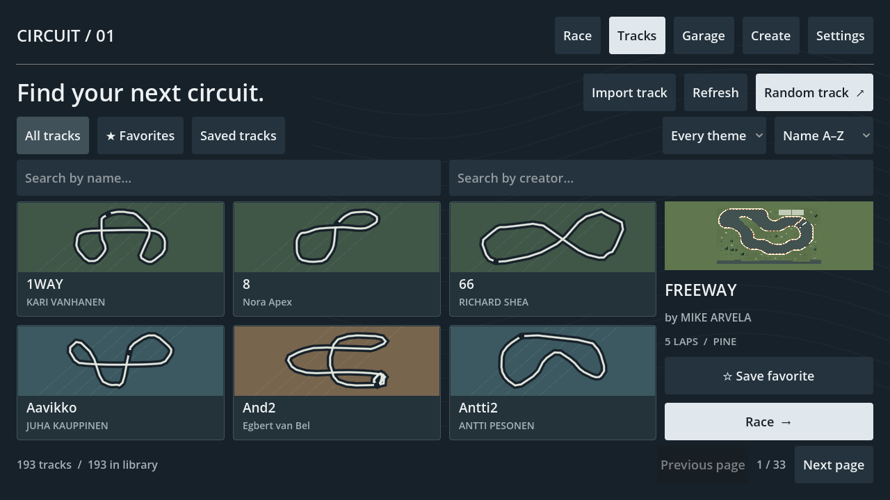
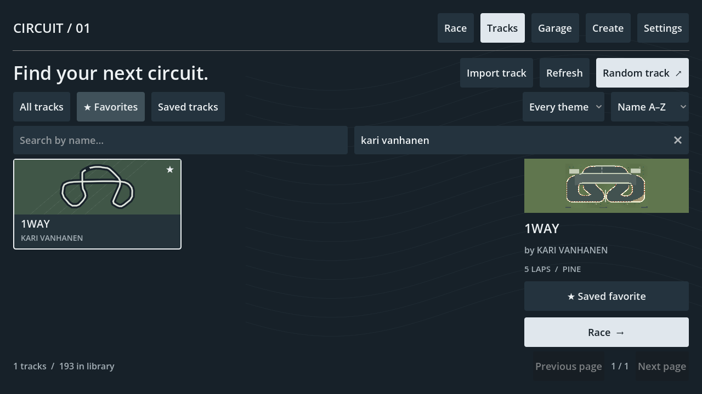
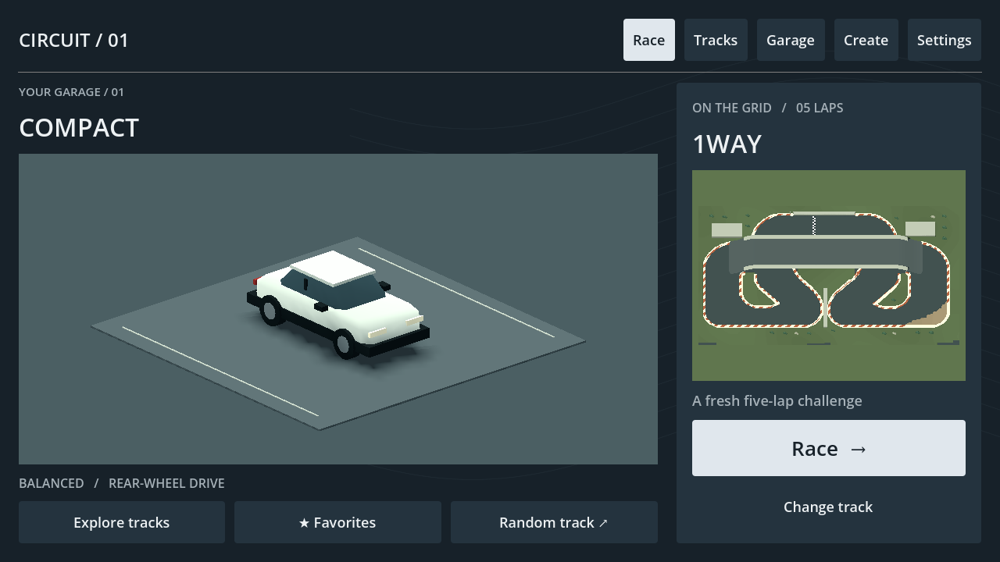
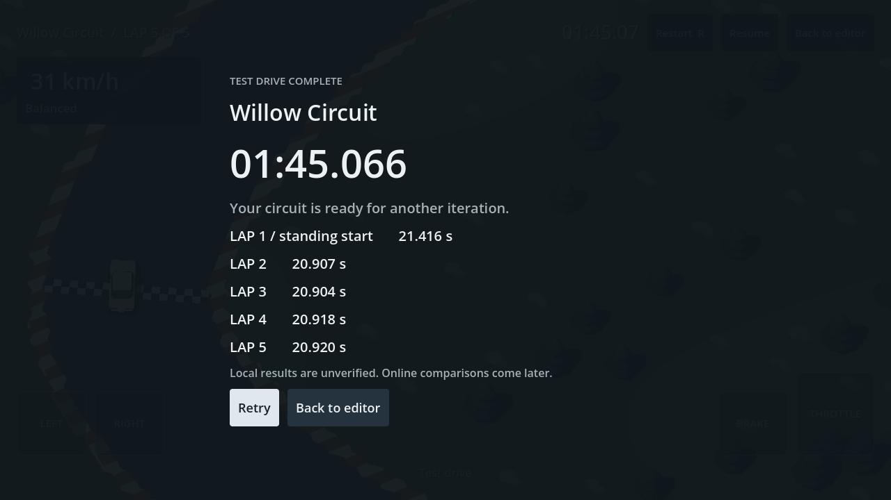

# Track discovery and five-lap racing — 2026-09-12

The owner rejected the generic menu and sequential track selection, requesting attractive menus, favorites, search by track and creator, random tracks and five laps. This implements that local slice: V03 (menu presentation), R01 (native touch navigation), R04/R06/R07 (race/records/retry), and G05/T04 (creator attribution in shared local documents).

## What changed

- **Tracks** is a first-class destination. Six route cards per page use original vector artwork derived from native route points or authoring nodes, terrain colors and a quiet contour backdrop. The selected circuit has a separate 3D preview, creator, five-lap label, favorite toggle and Race action. The home screen uses a large original car showroom, selected race panel and Explore/Favorites/Random shortcuts. Menu-only preview framing now adapts to tall panels without cropping circuit width.
- **All tracks, Favorites and Saved tracks** are separate collections. Name and creator search combine, ignoring case and surrounding spaces. Theme filtering and natural name/creator sorting also combine with those searches. Empty results explain how to recover. Page/filter state survives selection, settings/garage visits and race return within the app session.
- **Random track** chooses from the entire filtered result set, not just the displayed page, and avoids repeating the selected track when another match exists. It selects a preview before racing; no race is started unexpectedly. Zero matches disable the action; a single favorite remains selectable.
- Favorites persist by track identity in the existing atomic local save, survive control-setting/record updates and roll back on failed saves. Imported copies have separate local identities; favoriting one does not overwrite another track.
- **Creator** in the editor's heading opens a name field. The optional, bounded `creator` string travels with v2 local export/import and is searchable. Creator labels are self-reported metadata, not authenticated online accounts. Documents without a label show “Unknown creator.” Source author metadata from the separately maintained built-in catalog is used when available.
- `RaceRules.LAPS = 5` drives ordinary race sessions and creator test drives. The race HUD displays the actual target, results list all five laps, and the first standing lap is excluded from the flying-lap best. A new `standing-5-local-v1` key separates PBs from retained three-lap records. The countdown stays three seconds. Historical AI/replay fixtures explicitly request three diagnostic laps; this preserves their existing comparisons rather than redefining the physics corpus.

## Scale and boundaries

`TrackCatalog` reads bounded metadata only. It does not expand native surface cells or compile every saved track while searching. Indexing yields between batches, is cached for the app session, and is invalidated by successful local saves; Refresh rescans externally changed files. Name/creator/theme/collection filters run over the index. Favorite lookup uses a set. Only six route-card controls and one selected live 3D preview are created. Full saved-track validation and geometry compilation happen on selection. Invalid selected geometry produces an error rather than a race.

The automated scale fixture uses **5,000 synthetic metadata entries**, including 500 favorites. It checks combined searches, theme filtering, natural ordering, random/empty/single-result behavior and the actual UI's six-card bound. A desktop query batch measured about 71 ms; this is not a phone benchmark or a claim that hosted search exists. Current discovery covers the built-in collection and locally saved/imported tracks. Hosted publication, account identity and remote search remain deferred.

## Changed files

New: `game/ui/{track_catalog,track_browser,track_tile,menu_backdrop}.gd`, `game/race/race_rules.gd`, `game/tests/test_catalog.gd`, their Godot UIDs and this document. Integration: `game/core/app.gd`, `game/core/game.gd`, `game/ui/menu_style.gd`, `game/ui/track_showroom.gd`, `game/persistence/{local_records,track_library}.gd`, `game/race/track_session.gd`, `game/tests/test_{app,records,tracks,extra_tracks}.gd`, `scripts/dev.ps1`, status/plan/agent instructions and local-record documentation. Optional creator validation/schema and the explicit diagnostic lap parameter are integrated with the concurrently completed editor-v2 checkpoint. Built-in corpus conversion/content changes are a separate task.

## Validation and acceptance

Commands use `powershell -NoProfile -ExecutionPolicy Bypass -File scripts/dev.ps1` and pinned Godot `4.7.2.stable.official.ed1daf0bf`.

- `TestCatalog`: **18 checks, zero failures**. Five-thousand-entry search and actual paged UI checks; bounded metadata/creator handling and lazy resolution.
- `TestRecords`: **53 checks, zero failures**. Includes five-lap count validation, fifth-lap flying PB, old three-lap partition retention and favorite preservation alongside existing corruption/recovery/failed-write tests.
- `Validate > build/track-library-accepted-validation.txt`: exit 0, import, 49 script parses, startup and **522 checks** (56 driving, 163 original tracks, 27 extra tracks, 86 creator, 39 editor, 80 app, 53 records, 18 catalog). Historical exact diagnostic replay checks remain green.
- `CaptureApp > build/library-app-accepted-capture.txt`: exit 0, **98 checks**, zero failures. Actual Windows captures include the library, favorites, home, creator drive and five-lap results. The driven test completed five ordered laps in 105.066 seconds with zero contacts. Native viewport-injected touch selects a track; favorite persistence, combined live search, selected-track launch, return-filter retention, creator attribution import and results/retry are exercised.
- `git diff --check`: passed with existing line-ending notices.

Retained logs: [validation](evidence/track-library-validation.txt), [graphical integration](evidence/track-library-capture.txt), [catalog scale](evidence/track-library-scale.txt). The captures include the concurrently supplied larger built-in collection; content conversion and source-author population are independently maintained work, not generated menu artwork or a claim that every supplied circuit was driven in this menu task.

Intermediate failures were corrected: a newly inserted creator key used GDScript's StringName form and failed the strict plain-JSON key check; it now uses a String key. A stalled test was diagnosed with the pinned binary plus `--headless --path game --script res://tests/test_catalog.gd --quit-after 120`, then corrected and rerun through the wrapper. The full validation during that intermediate state correctly reported import-save/test-drive failures; it was not accepted as passed.

**No physical-phone test or APK export was performed; device attachment was not enumerated.** Remaining acceptance: owner judges the visual direction and discovery flow; physical Android keyboard/touch/safe-area and performance checks; hosted search when online work is authorized. Route card outlines are browsing diagrams, not race/shortcut validation. Local timing remains unverified.

