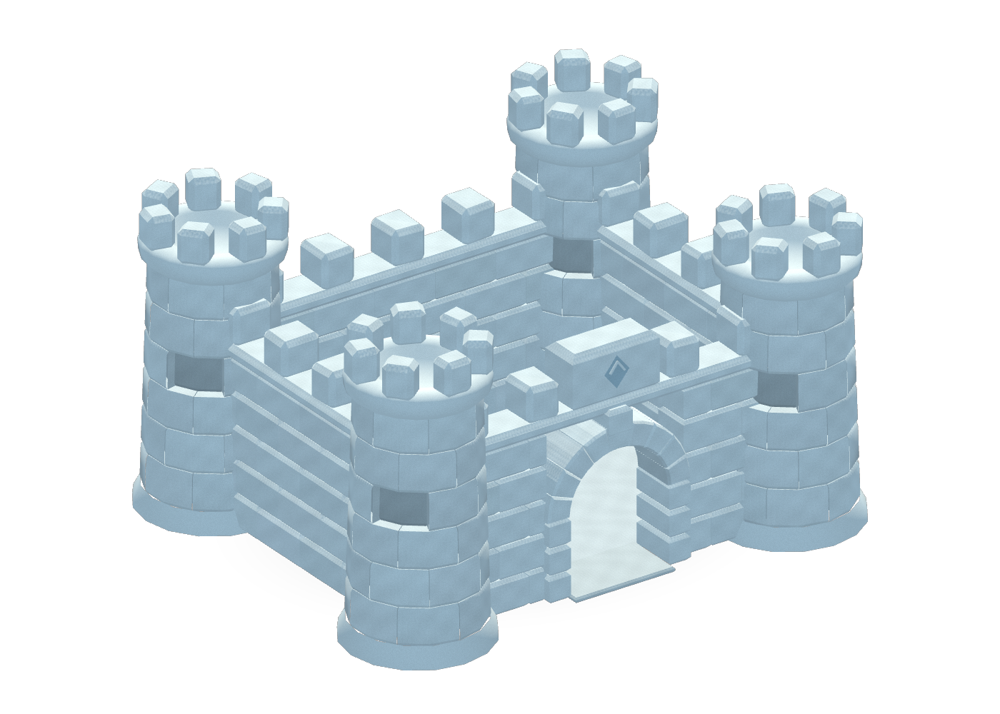
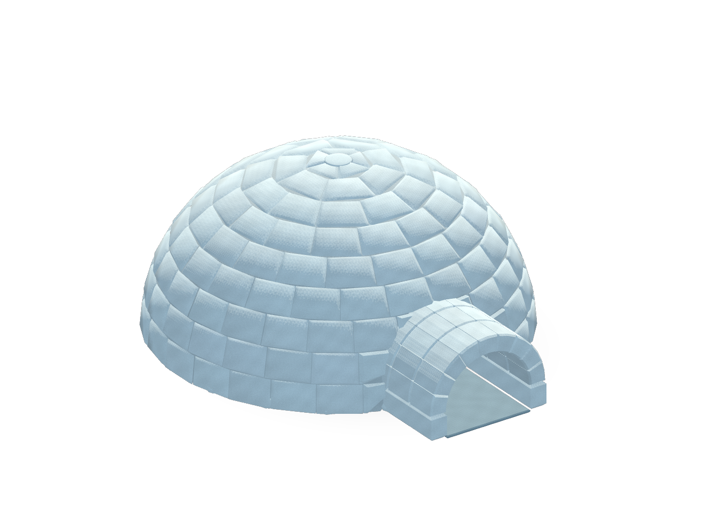
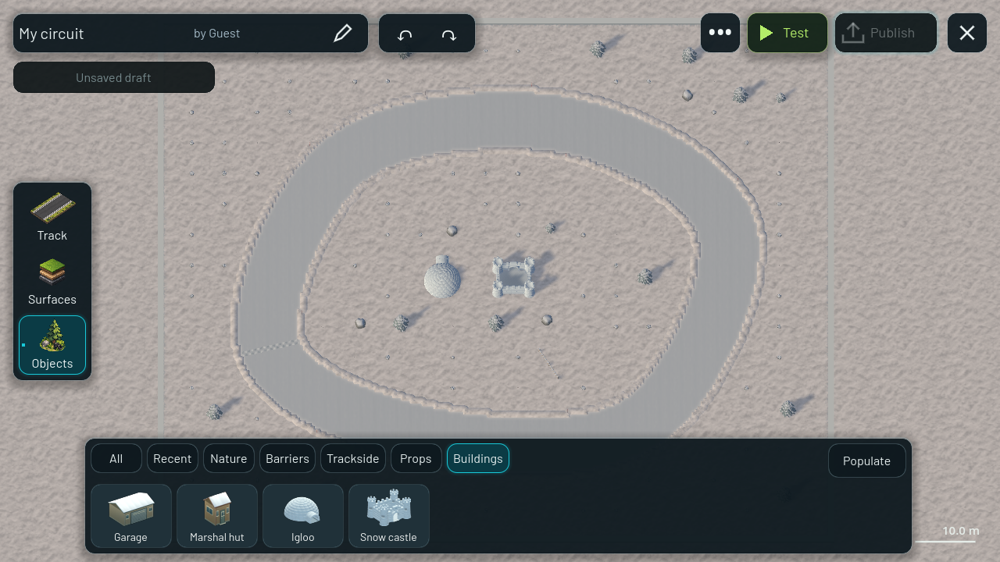

# Igloo and snow castle refinement — 2026-10-18

The owner rejected the quality of both Winter buildings and requested refinement toward the project's AAA art target. WA01 refines the igloo; WA02 refines the snow castle; WA03 retains placement, canonical contacts, saves, other Winter craft and bounded resources; WA04 records native review and remaining owner/device acceptance. G01/R01/Q01 remain applicable.

The igloo now uses gently bevelled curved snow blocks in staggered, tapering courses over a continuous recessed joint bed. A fitted intersection joins the dome to three courses of closed barrel-vault entrance blocks, with actual soffit, sidewalls, packed floor, hollow inner shell and a seated snow foot. The original had daylight gaps around a coarse omitted shell region. The revised roof is continuous away from the intended doorway, including the pole. Edges soften into the surface rather than leaving open cracks.

The castle now has battered towers built in staggered snow courses, recessed windows, bedded joints, shaped cornices, seven three-axis-bevelled merlons per tower, and running-bond curtain walls. Nine radial arch stones, deep jambs and a keystone surround a real visual opening into the court, replacing the original flat dark panel. A raised gate crest, shallow carved diamond, packed threshold and courtyard complete the construction. Small deterministic irregularities soften the crenellations without changing object scale. The architectural snow tag adds restrained compression variation and derivative-filtered crystal normals in the original opaque shader. Snowmen, lanterns, candles and ice retain their original material tags and geometry.

These are original project-authored native meshes and shader code. No downloaded or generated bitmap/model, new dependency, texture sampler, material pass, light or draw group is added. Both buildings still join the existing shared WinterCraft surface in placed scenery and use the same shipping model in the editor and thumbnail studio. The current 32 MiB prop / 24 MiB thumbnail / 64 MiB finished-world cache budgets and editor upload limits remain. `authored-props-13-winter-architecture` fences model, thumbnail and finished-world caches through their original keys.

| Default model | Original triangles | Refined triangles | Existing ceiling |
|---|---:|---:|---:|
| Igloo | 3,078 | 6,926 | <10,000 |
| Snow castle | 9,588 | 9,890 | <10,000 |

The original selection sizes (7.0×8.6 m / 7.4×6.4 m), collision predicates, schema, track/compiler identities, physics, gates and scoring are unchanged. The gate and tunnel are decorative architectural openings: this pass does not make the canonical solid buildings traversable by cars. Existing placements and saved tracks are not rewritten. Other Winter craft compare exactly against every original mesh channel. Concurrent editor preparation, road geometry and shared-cache work in the workspace is retained; only the version line changes in `creator_prop_visual.gd` for this task.

[Native before/after review](evidence/winter-architecture-2026-10-18/review.html) includes actual studio views in both desktop renderers, front/rear views, placed-model overhead and the real Winter editor Buildings palette. Screenshots are native Godot renders; no image retouching is used. The original standalone overhead fixture lacked its explicit ambient source, so that early image is retained as a diagnostic and excluded from the visual comparison. The studio before/after rig is identical.

Runtime files: `game/track/prop_winter_craft.gd`, `game/track/winter_craft_snow.gdshader`, and the version line in `game/track/creator_prop_visual.gd`. Focused test: `game/tests/test_winter_architecture.gd` (+ UID). Documentation: this file, `AGENTS.md`, `DEVELOPMENT_STATUS.md`, `docs/PHASE_0_PLAN.md`, `licenses/ASSETS.md`, and the evidence report/review. Existing source/UIDs are preserved.

Actual commands used the pinned Godot 4.7.2 project entry point. Each command starts with `powershell -NoProfile -ExecutionPolicy Bypass -File scripts/dev.ps1`:

| Arguments | Actual outcome |
|---|---|
| `-Action TestScript -ScriptPath res://tests/test_winter_architecture.gd -Graphical -RenderingMethod gl_compatibility -TestArgument '--capture-to=res://../docs/evidence/winter-architecture-2026-10-18/before' -CommandTimeoutSeconds 120` | Original models: 26 checks, two failures reproducing the false castle opening and missing sculpted crown. Before sources and views retained. |
| `-Action TestScript -ScriptPath res://tests/test_winter_architecture.gd -Graphical -RenderingMethod gl_compatibility -CommandTimeoutSeconds 180` | Final 57 checks, zero failures, including actual editor startup, saved placements and native views. |
| Same focused command with `-RenderingMethod mobile -RenderingDriver vulkan` | Final 57 checks, zero failures on desktop RTX 3090, including actual editor and shader compilation. This is not Android execution. |
| `-Action TestScript -ScriptPath res://tests/test_winter_craft.gd -CommandTimeoutSeconds 150` | 595 checks, zero failures; original collision/save/JSON/destruction/lifetime/rewind checks and all five actual driven replay fixtures. |
| `-Action TestScript -ScriptPath res://tests/test_biome_object_kits.gd -CommandTimeoutSeconds 180` | 983 checks, zero failures; curated catalogs, legacy placements, exact other-biome mesh channels and bounded shared resources. |
| `-Action TestScript -ScriptPath res://tests/test_prepared_race_load.gd -CommandTimeoutSeconds 180` | 85 checks, zero failures; finished-world cache retention, isolation and budgets. |
| `-Action TestScript -ScriptPath res://tests/test_script_parse.gd -CommandTimeoutSeconds 180` | 896 scripts, zero failures. |

The focused test checks finite unit normals, zero collapsed triangles, agreement between face winding and vertex normals, original footprints, exact repeated construction, actual tunnel/court openings and adjacent structure, a grid of roof rays, exact unchanged other-craft geometry, original cache budget and cache invalidation. It also opens the actual app editor and checks saved placements after preparing the revised world.

Initial corrections are retained in the evidence log report, not reported as passes. Sandboxed Godot could not open its ordinary user log; the project entry point then ran with approved normal local execution. The first standalone placed-model fixture used a null compiled track; it was corrected to the existing minimal native-track metadata fixture without invoking unrelated route validation. Godot rejected a conditional typed-array assignment; this was corrected. Early castle meshes exceeded the existing triangle ceiling; rectangular snow bricks, fewer curved subdivisions and efficient full-corner merlons brought the final model below the same unchanged limit. Inspection exposed an underlay protruding through the igloo crown: radial inset now scales all dome axes. Three trimmed portal triangles disagreed with smoothed normals; the cut uses its actual facet normals while the dome remains smooth. No assertion was removed or loosened.

The isolated Git checkpoint under `build/winter_architecture_checkpoint` and its task-only patch preserve the main repository index and unrelated edits. Exact commands, log provenance, hashes and checkpoint IDs are in [report.json](evidence/winter-architecture-2026-10-18/report.json).

Owner appearance acceptance remains for the refined silhouettes, snow construction, detail at racing distance and the overall AAA target. Physical-device rendering, sustained performance, memory and thermals remain untested; triangle limits and desktop captures do not establish those results. No phone attachment check or physical-device test, APK/export/install, backend/account mutation or deployment was performed.
