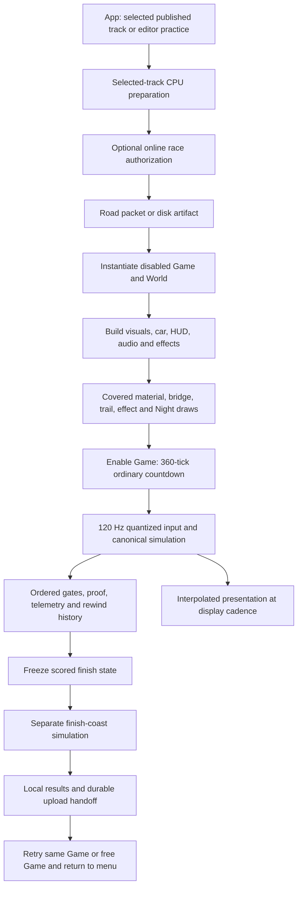

# Beat My Track — gameplay and performance audit

Date: 23 October 2026. Investigation only; no gameplay implementation changes.

Follow-up: the owner subsequently authorized fixes F01–F03. Their implementation, paired desktop measurements, exact-output validation and remaining device acceptance are documented in [GAMEPLAY_F01_F03_2026_10_23.md](GAMEPLAY_F01_F03_2026_10_23.md). Findings and measurements below retain the audit-time state.

## 1. Executive assessment

**The architecture is viable for a responsive mobile racer, but stable sustained 60 FPS on the current OnePlus Nord 2 build is not established.** The strongest parts are the independent fixed-step simulation, ordered swept checkpoints, separation of scored state from presentation, prepared spatial contact data, bounded visual pools, and extensive correctness fixtures. An engine or vehicle-controller rewrite is not justified.

The principal problem is variation in workload. A single car does not mean a small physics workload: a legal track can expand 96 tyre walls into 576 simulated stacks. The authoring limits also admit very expensive paint preprocessing, large shader-based prop aggregates, and crowded local lights. Existing optimizations are substantial, but their budgets do not form a complete mobile performance envelope.

Fresh desktop measurements identify two concrete priorities:

- Full local-record commits took **40.055 ms median for 1,000 synthetic records** and **411.081 ms for 10,000**. Racing invokes this full-store path when periodic cosmetic condition saves change. This work runs on the main thread.
- **576 separated stationary tyres took 2.188 ms per 120 Hz tick** in an isolated desktop microbenchmark, excluding real world collisions. A fresh tick with 96 coincident tyres took 9.373 ms. These are scalable workload costs, not Android timings.

A fresh rendered Winter fixture ran comfortably on the desktop RTX 3090, but that cannot establish mobile capacity. No current Android release build, phone attachment check, device execution, 15–20-minute thermal soak, or physical touch/audio latency measurement was performed. Older short Nord 2 measurements are useful context and are explicitly separated below.

The five highest-value improvements are:

1. **Remove full-store cosmetic persistence from racing callbacks.** Use a serialized, versioned, profile-owned persistence path with immutable snapshots; retain atomic commits, failure recovery, and commit-only PB/achievement semantics.
2. **Bound track-preparation work and make cancellation effective throughout it.** Eliminate repeated paint rasterization and stage race resource installation before releasing the countdown/input barrier.
3. **Make dynamic-object work follow interacting bodies.** Retain deterministic broadphase storage and introduce carefully validated active/contact islands; replace reflective rewind snapshots with an explicit compact schema.
4. **Extend existing rendering budgets to expensive prop families, lights, and effects.** Preserve the current art, contacts, and intended Desert obstruction. Apply spatial batching, supported texture compression, and measured presentation tiers.
5. **Make current release-build Android frame pacing, memory, and thermal tests a release gate.** Tune quality and content envelopes from synchronized CPU/GPU/presentation evidence, rather than desktop FPS or isolated engine counters.

No Critical handling or checkpoint defect was reproduced. Several High findings below are confirmed scalability or responsiveness problems; others are well-supported architectural risks with their device cost still unmeasured.

### Evidence and scope

The audit traced the current working tree through race start, countdown, driving, finish, results, retry, pause, rewind, and return to menus. It covered core orchestration, simulation/input/camera, track compilation/contact queries, all five biomes, rendering/effects, audio, ghosts, timing, UI, persistence, and client service callbacks. Backend internals were considered where they constrain a race contract; this is not a separate backend capacity/security audit.

Evidence is in [evidence/gameplay-audit-2026-10-23](evidence/gameplay-audit-2026-10-23/). [source-manifest.json](evidence/gameplay-audit-2026-10-23/source-manifest.json) fingerprints 285 relevant runtime/native/configuration files at final inspection; it is not a claim that every file was read line by line. The working tree contained concurrent changes, including Desert presentation and generated version metadata. These were preserved. Line references below refer to the inspected working tree, not a clean immutable commit.

The prescribed `scripts/dev.ps1` runner initially regenerated `game/core/build_identity.gd` and `game/project.godot` as a build-metadata side effect. Later executions used the verified pinned executable directly to avoid further regeneration. Another concurrent task subsequently regenerated the metadata again; it was not reset. No gameplay source was patched. Audit-only observer scripts and synthetic data live under ignored `build/`, with readable copies retained alongside the report. No APK, deployment, owner-save modification, or live account/race/publication mutation was performed.

## 2. Architecture assessment

### Actual execution path



| Boundary | Actual implementation and responsibility |
|---|---|
| Application composition | `game/core/app.gd:3590` `_start_race()` owns scope/navigation checks, authorization, preparation, scene creation, covered rendering and activation. `_leave_race()`, `:3876` `_results()` and `_retry_race()` own exit/result/retry coordination. |
| Track preparation | `game/race/selected_track_preparation.gd:8` owns one selected CPU job. `game/editor/work_job.gd:13` owns worker lifetime, cancellation and joined shutdown. `game/editor/track_compiler.gd` produces canonical grids, gates and presentation preparation. |
| Race composition | `game/core/game.tscn` contains Game and World; most children are created in `game/core/game.gd:154` `_ready()`. This is programmatic composition, rather than a large serialized scene graph. |
| Canonical vehicle step | `game/vehicle/vehicle_simulation.gd:3` is a node-independent `RefCounted` simulation. `game/core/game.gd:336` samples input, calls `sim.step`, advances rules, then records observations/effects. |
| Display presentation | `game/core/game.gd:488` interpolates previous/current positions and headings; updates car pose, camera, ghost, audio, cosmetics, weather and HUD. These visual poses do not feed back into scored driving. |
| Rule authority | `game/race/track_session.gd:332` advances ordered swept gates and sub-tick finish crossings. Versioned track/handling/physics/rules identities isolate incompatible records. |
| Optional services | Local records, ghost store, cloud outbox, resume credits, achievements and analytics are adapters outside the canonical step. HTTP is asynchronous; completion callbacks and local serialization can still execute on the main thread. |

### Work frequency

| Frequency | Work observed |
|---|---|
| 120 Hz accepted ticks | Input quantization; vehicle dynamics/contact resolution; all loose-tyre/light-prop simulation; gates and incident detection; post-contact audio observations; trail/emitter sampling. |
| 20 Hz, plus boundaries | Movement proof and personal ghost poses. Lap speed telemetry starts at this cadence and decimates at 2,048 samples. |
| 10 Hz | Approximately 101 rewind snapshots over the last ten seconds. |
| Every rendered frame | Manual car interpolation; camera; ghost playback; car suspension/weathering; vehicle audio envelopes; active biome presentation; timers/checkpoint feedback; always-enabled hitch observation. |
| About 12.5 Hz | Speed/debug/minimap value updates in `ui/playground_hud.gd:306`. Static HUD backing and map geometry are retained. |
| Every 0.15–0.25 seconds | Existing adaptive static-chunk visibility and some material-binding checks. |
| Every 0.5–1 second | App service timers; most menu refreshes are gated, but score outbox processing can remain active during racing. |
| Every five seconds | Cosmetic condition snapshot/save attempt; resume-recovery scheduling has a separate roughly five-second interval. |
| Events | Collision arrivals, lap/finish transitions, record commits, authoritative achievement refreshes, ad handoff, pause/focus transitions and lifecycle cleanup. |

### Well-designed areas to retain

- **Fixed simulation contract.** Project physics is 120 Hz with 16 maximum steps per rendered frame (`project.godot:85`); Game checks the tick rate. The simulation step contains no network, file I/O, wall-clock decisions, or display-rate integration. Do not lower this frequency as a graphics setting.
- **Efficient canonical world representation.** Surface/deck grids give direct cell access. Route continuity normally examines 25 nearby vertices (`track/native_track.gd:231`). Kerbs and snow contacts already have prepared spatial indices. Physical contact cost is largely independent of rendered triangle count.
- **Timing and finish isolation.** Ordered swept gates, bridge-layer validation and fractional finish crossing are appropriate for short competitive laps. The separate finish-coast simulation preserves scored state (`core/game.gd:432`).
- **Prepared resources with mutation isolation.** World and road caches share immutable geometry, while mutable MultiMesh buffers and run state are isolated. Native geometry kernels are optional/version checked with scalar fallbacks; they do not replace canonical simulation math.
- **Existing batching and conservative culling.** Supported static prop/bank families already use adaptive 32 m chunks; Night roads/terrain use spatial light-sized groups; Winter nature uses spatial MultiMeshes. Prepared road sections follow a separate reuse path. The adaptive culling policy considers draw-submission cost and retains the original shadow caster. “Add MultiMesh everywhere” would be an inadequate recommendation.
- **Bounded effects.** Tire marks use a 16,384-entry ring, not accumulating nodes. Audio has bounded event pools; personal ghosts use interpolated poses and a shared flattened mesh. Rewind ghosts exist during selection rather than simulating four opponents throughout a race.
- **Responsiveness and lifecycle fences.** Touch owns individual fingers and clears on cancellation/pause. Race preparation has account/navigation/selection checks. Retry reuses the existing race scene. Graphics teardown restores viewport state. Result writes and achievement notifications respect committed state.

### Architecture that limits further optimization

The canonical boundary is clearer than the presentation boundary. `Game._advance_physics()` also calls audio-contact observation, camera/car impact feedback, incident analysis, history and effects. `Game._present_frame()` repeats some contact/surface work and creates presentation dictionaries even when race music is silent. These do not inherently corrupt physics, but they complicate attribution and make headless vehicle timings underestimate the complete race tick.

App is a large coordinator spanning menus, account state, editor workers, race loading, results, uploads, achievements and ads. This is chiefly a maintainability and scheduling concern, not proof that its line count costs frame time. Extracting a small race lifecycle/service scheduling owner is reasonable; replacing the application or vehicle system wholesale is not.

## 3. Performance findings

Classification: **M** = measured in this audit; **S** = static code observation; **A** = analytical workload calculation. “Confirmed” confirms the stated measurement/code behavior, not an unmeasured Android FPS effect. Expected benefits below are deliberately not invented FPS percentages.

| ID / Priority | Subsystem | Finding | Evidence | Impact | Recommendation | Expected benefit | Effort | Confidence |
|---|---|---|---|---|---|---|---|---|
| F01 **High** | Persistence | Changing cosmetic condition commits the entire records/settings store synchronously during racing. | M/S: `core/game.gd:526,933`; `vehicle/vehicle_condition.gd:11`; `persistence/local_records.gd:70`; measured 40.055/411.081 ms medians at 1k/10k records. | Main-thread stalls, input/presentation delay; cost grows with accumulated records. | Serialize immutable, profile-versioned snapshots through one writer; separate frequent cosmetic persistence from full PB/settings commits. Preserve atomic recovery and commit semantics. | Removes the measured full-store work from the racing callback; smaller payload reduces storage/CPU work too. | Medium | Confirmed |
| F02 **High** | Track compiler | Paint exclusion repeats segment-AABB rasterization in GDScript with no internal cancellation. | S/A: `track/road_kerbs.gd:184`; called by `native_track.gd:92`; compiler cancellation surrounds `from_data` at `editor/track_compiler.gd:163`. | Extreme legal UGC can monopolize preparation and delay replacement/exit. | Reuse one exact prepared mask; native/bounded raster work and cooperative cancellation; add work-cost stress validation. | Potentially very large worst-case improvement; ordinary-track gain unmeasured. | Medium | Confirmed algorithm; Strong indication of severity |
| F03 **High** | Dynamic props | Distant/resting props still incur per-tick list construction, contact checks and tyre broadphase rebuilding. | M/S: `vehicle/light_props.gd:5,18`; `vehicle/loose_tyres.gd:22`; 96 idle cones 0.328 ms/tick; 576 separated tyres 2.188 ms/tick. | 120 Hz CPU cost scales with expanded body count. | Precompute immutable descriptors; retain scratch/broadphase storage; exact deterministic sleeping/contact-island processing. | The tyre probe alone represents 4.376 ms per nominal 60 Hz frame on this desktop. Savings depend on safely inactive bodies. | Medium–High | Confirmed |
| F04 **High** | Tyre contacts | Local pair density can still make spatial hashing quadratic. | M/S: `vehicle/loose_tyres.gd:35,79,131`; 96 coincident tyres cost 9.373 ms for a fresh stationary tick. | Physics spikes, transient allocations and compounded catch-up load. | Test dense authored walls and active pile impacts; retain ordering while introducing persistent candidates/islands. | Addresses observed >8.33 ms isolated tick; no device saving estimated. | High | Confirmed |
| F05 **High** | Race loading | The actual race build bypasses the editor/menu cooperative upload/yield budget. | S: `core/game.gd:900` calls `visual.build` without `menu_slices=true`; `track/native_track_visual.gd:143,882,2232`. | Loading cover/input can stall during synchronous node/mesh/cache work. | Sliced race installation with a complete-readiness barrier before countdown/input; measure longest slice. | Better loading responsiveness; total loading time may remain similar. | Medium | Confirmed path |
| F06 **High** | UGC rendering | WinterCraft, EgyptianStonework and NightFurniture aggregates bypass existing spatial material-family chunk selection. | S/A: `track/native_track_visual.gd:205,1862,1872,1881`; `track/prop_geometry.gd:59`; 96 × 7,950 castle triangles ≈763k source triangles. | Coarse visibility, copied vertex storage and shadow/vertex work. | Extend existing spatial policy selectively; compare spatial MultiMesh against spatial baked meshes for identical rigid props. | Offscreen geometry and repeated storage reductions; submission trade-off needs measurement. | Medium | Confirmed representation |
| F07 **High** | Night fire | Each covered fire fragment performs a 32-step volumetric march, two 3D noise reads/step, without opacity early-out. | S: `track/night_fire_volume.gdshader:22,61`; up to 32 fires in `night_prop_effects.gd:4`. | GPU fill, texture bandwidth and thermal pressure. | Device A/B 32/16/8 steps, opacity early-out and distant impostors; retain near-fire art. | 16 steps halve the noise-read count, not necessarily total GPU time. | Medium | Strong indication |
| F08 **High** | Night lights | Count limits do not constrain overlapping lights; warmup returns early beyond 64 local lights. | S: `track/native_track_visual.gd:1802`; `night_render_preparation.gd:5,12`; 96 legal objects possible. | Fragment cost; lighting omissions/flicker; uncovered variants. | Stable spatial light selection/overlap budget, appropriate cosmetic distant pools, bounded spatial warmup. | Reduces unnecessary local-light work and avoids exceeding supported per-mesh limits. | Medium | Strong indication; overlap not reproduced |
| F09 **High** | Textures | Enabling ETC2/ASTC import support does not make sampled terrain/effect textures VRAM-compressed. | S: `project.godot:91`; `assets/textures/winter_snow_v1.png.import:18`, `meadow_grass_v2.png.import:18`, `dust_puff_v1.png.import:18`; sampled metadata `vram_texture=false`. | GPU/shared memory and texture bandwidth. | Inventory actual device formats; trial supported compression for art with native-camera comparisons. Keep numeric masks/data exact unless validated otherwise. | Potentially substantial memory/bandwidth saving; resident device bytes unmeasured. | Low–Medium | Confirmed import configuration |
| F10 **Medium** | Rewind | Time-bounded history multiplies complete dynamic state and growing telemetry lists by ~101 entries. | M/S: `race/rewind_history.gd:9,23`; 576 tyres + 400 starting telemetry samples retain 16.08 MB; 0.265 ms/snapshot. | Memory amplification and periodic CPU/allocation spikes. | Explicit versioned snapshot fields, packed reusable buffers, immutable metadata sharing; consider bounded delta reconstruction. | Synthetic zero-tyre counterpart retained 2.11 MB; actual achievable reduction depends on schema. | Medium–High | Confirmed |
| F11 **Medium** | Effects scaling | Particle capacities, card area and simulation rates are fixed across hardware tiers. | S: `vehicle/sand_dust.gd:71,132,350,619,639`; four 900-capacity smoke emitters; Winter adds 12 emitters. | CPU/GPU particle work and transparent overdraw. | Independently profile count, projected area, lifetime and simulation frequency; preserve per-tick emitter origin/contact feedback. | Enables weaker-device scaling; no measured device gain. | Medium | Strong indication |
| F12 **Medium** | Storm | Screen copy/refraction/weather Canvas remains native resolution despite lowering 3D scale. | S: `track/storm_weather.gd:50`; baked wet-glass shader; full-screen BackBufferCopy. | Screen bandwidth/fill cost on high-resolution devices. | Isolate copy/glass/lens/rain costs; reduced-resolution weather composite only if justified, leaving HUD/touch native. | Makes resolution scaling effective for this separate cost where necessary. | Medium–High | Confirmed path; bottleneck hypothesis |
| F13 **Medium** | Surface/hazard queries | Multiple complete-list scans repeat per wheel, swept sample, tick and display frame. | S: `track/native_track.gd:264`; `vehicle/track_hazards.gd:5,16,24,44`; `vehicle/speed_bumps.gd:6,32`; `core/game.gd:543`. | Density-dependent CPU; duplicated presentation work. | Type-specific immutable descriptors and stable spatial candidates; reuse observations only when pose/layer/tick semantics match. | Excludes distant/unrelated objects; no reliable ms estimate. | Medium | Confirmed |
| F14 **Medium** | Memory ownership | Independent cache allowances exclude parts of textures/materials/driver memory and do not bound active/staging peaks. | S/M: `track/prepared_world_cache.gd:26,80`; `vehicle/prepared_car_cache.gd:3`; resource-cycle results below. | Android peak/retained memory pressure; no leak demonstrated. | Record deduplicated ownership plus PSS/graphics memory; measured memory-pressure eviction across caches. | Lower avoidable residency/peaks; actual saving unmeasured. | Medium | Confirmed accounting limitation |
| F15 **Medium** | Background services | Score outbox and resume recovery can still perform local reads/writes and callbacks while racing. | S: `core/app.gd:366`; `backend/cloud_tracks.gd:975,989`; `backend/resume_recovery.gd:73,105`. | Periodic I/O/serialization contention and callback spikes. | Defer optional local/transport work during driving; preserve durable enqueue, ownership, retries and credit recovery guarantees. | Removes avoidable contention; frequency/cost needs a real backlog profile. | Medium | Confirmed scheduling; bottleneck unmeasured |
| F16 **Medium** | Long attempts | Input capture caps at 216k frames, ghost capture flags overflow, but movement proof and incident lists can continue growing. | S: `core/game.gd:370`; `backend/race_proof.gd:7`; `race/personal_ghost_run.gd:17`; `race/lap_telemetry.gd:27`. | Unfinished-attempt memory growth; inconsistent evidence eligibility. | One explicit evidence budget including rewind offsets; stop unusable accumulation and preserve unlimited local driving. Never verify truncated evidence as complete. | Bounded long-attempt storage and predictable result eligibility. | Low–Medium | Confirmed boundary inconsistency |
| F17 **Medium** | Trail visibility | A visibility-selection change can repack/upload the full 16,384 × 20-float buffer. | S: `vehicle/trail_visibility.gd:118`; `vehicle/skid_trails.gd:6`; ≈1.25 MiB/full assignment. | Potential p99 CPU/upload spike. | Measure selection frequency, packed marks and upload time; incremental/page uploads only if attribution warrants it. | Avoids large transition uploads if they are a measured problem. | Medium | Strong indication |
| F18 **Medium** | Input delivery | 120 Hz sampling does not prove OS touch/drag delivery at that cadence; accumulated-input override absent. | S: `input/driver_input.gd:26`; `ui/touch_controls.gd:316`; engine default accumulation. | Possible drag/input latency, especially below 60 FPS. | Device A/B accumulation/flush behavior with event-to-tick and event-to-photon timestamps. | Unquantified; extra event-processing CPU is the trade-off. | Low | Hypothesis of user-visible benefit |
| F19 **Low** | Diagnostics | Hitch monitoring is installed by default and enables detailed Game timers, dictionaries and effect observation every frame. | M/S: `core/game.gd:144,316`; `diagnostics/race_hitch_monitor.gd:57,88,203`; desktop observer mean 124–142 µs. | Small measured CPU/allocation cost plus heavier event snapshots. | Keep a cheap release ring; sample expensive context more sparsely; compare disabled/cheap/full instrumentation. | Observer body ~0.12–0.14 ms here; nested timer/context cost is additional and not fully measured. | Low–Medium | Confirmed; not a principal measured bottleneck |
| F20 **Low** | Allocations | Wheel soil probes construct VehicleState per step; input frames and packed Arrays allocate per tick. | S: `vehicle/vehicle_simulation.gd:368`; `input/drive_frame.gd:12,21`. | Allocator/reference-count churn, not a demonstrated tracing-GC pause. | Reuse probe/basis/scratch values and compact integer input storage after higher priorities. | Small unquantified per-tick reduction. | Low–Medium | Confirmed |
| F21 **Low** | Presentation calls | Shared Winter parameters update each bound material; silent race-music presentation still creates per-frame context/volume work. | S: `track/winter_snow_wind.gd:238`; `core/game.gd:534`; `soundtrack/audio_world.gd:138,177,194`. | Repeated API calls and small allocations. | Change-only/shared run-owned parameters and an inexpensive silent-mode path; preserve material ownership and UI/result audio. | Likely modest; count calls before refactoring. | Low–Medium | Confirmed work; significance unmeasured |
| F22 **Low** | Interpolation configuration | Manual interpolation coexists with the engine default jitter fix. | S: `core/game.gd:511`; no project jitter-fix override. | Possible interpolation phase/latency variation. | Controlled default-versus-zero jitter-fix experiment; do not change automatically. | No claimed benefit without cadence/jitter tests. | Low | Hypothesis |
| F23 **Low** | Results/loading | Local PB/ghost commits occur before fully presenting results; car reuse is intentionally narrow; first sparks allocate a bounded pool. | S: `core/app.gd:3900`; `persistence/local_ghosts.gd:19`; `vehicle/prepared_car_cache.gd:27`; `car_visual.gd:500`. | Result/retry/first-use responsiveness, not continuous scored physics. | Attribute exact stalls, then stage optional work/prewarm pools; expand model reuse only after exact render/ownership checks. | Loading/tail-latency improvement; no steady FPS claim. | Medium | Confirmed paths |
| F24 **Medium** | Disk/resource cache | A cache hit can still hash, read/decompress and install resources synchronously; optional artifact serialization also has a publication cost. | S: `track/road_mesh_disk_cache.gd:19`; `track/native_track_visual.gd:949,970`. | Storage/main-thread loading tails despite avoiding geometry regeneration. | Separate safe CPU verification/decompression from main-thread publication; slice installation and schedule optional writes at safe boundaries. Preserve checksums, private paths and versions. | Better tail responsiveness; total load-time saving unmeasured. | Medium | Confirmed synchronous work |

### Fresh measurements

All fresh runs used **Godot 4.7.2.stable.official.ed1daf0bf**, a standalone Windows runtime rather than the editor. This runtime is a debug-capable executable, **not an Android release build**. Headless results exclude rendering. Rendered tests used Compatibility/OpenGL, NVIDIA RTX 3090 / driver 616.92. CPU model discovery was unavailable; the reported identifier was Intel64 Family 6 Model 167 Stepping 1. No phone hardware or emulated phone performance is implied.

**Synchronous persistence, 30 saves per synthetic store** — existing `tests/profile_condition_save.gd`, explicit disposable records path, no real player data:

| Records | Saved bytes | Median save | Maximum save |
|---:|---:|---:|---:|
| 0 | 39 | 2.088 ms | 16.015 ms |
| 1,000 | 104,038 | 40.055 ms | 52.657 ms |
| 10,000 | 1,040,038 | 411.081 ms | 527.284 ms |

This measures the actual full `LocalRecords.save_records()` implementation, including validation, JSON serialization, write/flush, verification/recovery reads and committed copies. It does not include cosmetic snapshot creation. `VehicleCondition.save()` correctly skips equal values; moving/dirtying cars still change values, so this guard does not remove the scaling problem. The 4 MiB file limit is not a frame-time limit. Logs: `save-0.log`, `save-1000.log`, `save-10000.log` in the evidence directory.

**Dynamic-object and rewind scaling** — audit-only script invoking current canonical implementations, Windows headless, no-op world contact, median of three batch means/fresh samples:

| Workload | Result |
|---|---:|
| 0 / 24 / 96 distant stationary cones | 1.36 / 78.12 / 327.98 µs per tick |
| 0 / 96 / 576 separated stationary tyres | 0 / 325 / 2,188 µs per tick |
| 24 / 96 coincident tyres, fresh stationary tick | 779 / 9,373 µs per tick |
| 101 snapshots, 0 tyres + 400 starting telemetry samples | 136.51 µs/snapshot; 2,110,340 static bytes retained |
| 101 snapshots, 576 tyres + 400 starting samples | 265.37 µs/snapshot; 16,075,812 static bytes retained |
| 101 snapshots, 576 tyres + 2,048 starting samples | 304.46 µs/snapshot; 20,580,324 static bytes retained |

One telemetry sample was appended between snapshots to represent changing copy-on-write backing. The first immutable-telemetry trial understated list-copy storage; both trials and the correction are retained in [physics-results.json](evidence/gameplay-audit-2026-10-23/physics-results.json). The 2,048-sample history probe is an upper-edge synthetic case; ordinary telemetry decimates at that threshold. The stationary coincident-tyre result exercises candidate generation/separation, **not** the 16-pass moving impulse solver. These are neither complete-track timings nor process RSS/PSS.

**Rendered Winter driving** — existing `profile_winter_desktop.gd`, 3840×2160, scale 1, MSAA setting 1, VSync disabled, unscored diagnostic AI and actual 120 Hz progression. No records adapter. Two eight-second warmed stages:

| Metric | Full | Full repeat |
|---|---:|---:|
| Frame samples | 2,186 | 2,026 |
| Frame P50 / P95 / P99 | 3.462 / 5.506 / 6.588 ms | 3.688 / 6.177 / 8.336 ms |
| Maximum frame | 9.046 ms | 13.760 ms |
| GPU P50 / P95 / P99 | 2.360 / 3.121 / 3.345 ms | 2.334 / 3.017 / 3.255 ms |
| Render CPU P50 / P95 / P99 | 1.518 / 2.371 / 2.752 ms | 1.558 / 2.587 / 3.006 ms |
| Simulation ticks | 960 | 960 |
| Last sampled draws / rendered primitives | 332 / 476,866 | 332 / 476,858 |
| Last engine video-memory counter | 454,794,549 bytes | 454,794,549 bytes |

An audit-only observer then added arithmetic means to the same workload for a separate 12-second sample: **frame mean 3.174 ms, P95 4.407 ms, P99 5.631 ms, maximum 7.097 ms; GPU mean 2.442 ms, P95 2.889 ms, P99 3.065 ms**. It advanced 1,441 ticks. Its later camera position produced 312 final draws / 438,559 primitives, so it is not an A/B comparison against the eight-second stages. Full data: `desktop-audit-gl_compatibility.json` and `desktop-audit-mean-gl_compatibility.json`.

The generic `Performance.TIME_PROCESS` samples were visibly cached/delayed: one window reported a 31.691 ms process percentile while that window's maximum measured frame interval was 9.046 ms. Those samples are **not accepted as per-frame main-thread percentiles**. GPU/render timing queries and wall-frame distributions are reported separately. Game's cumulative section counters overlap: e.g. “car” includes other presentation work. Do not add them as independent costs or extrapolate their uncapped per-frame means to 60 Hz.

**All-biome first-use probe** — `profile_race_start.gd` exercised 1,440 ticks / 12 simulated seconds in each biome on the starter route. Its direct Game path omits App's covered preparation. Driving maxima were Grass 259.197 ms, Winter 419.569 ms, Desert 234.095 ms, Night 46.796 ms and Storm 216.763 ms; countdown/start maxima were larger. These identify cold-path diagnostic stalls, **not reproduced failures of the current production warmup**, and do not attribute them to the GPU. The tool exports only the worst rows, so full-distribution averages/P95/P99 cannot be derived for these runs. The initial PowerShell array syntax also generated a sixth invalid theme `--seconds=8`; that run is excluded. Actual valid runs used the tool's default 12 seconds. Original output and parsed scope are retained in `five-biome-start.log` and `start-probe-summary.json`.

**Scene/resource lifetime probe** — 15 frozen Game builds/frees, all five biomes repeated three times, native starter fixture, real renderer, diagnostics disabled and no simulation/history/network/owner records. After every free, node count returned to **8**. Resource count settled at **415** after the first scene. End-of-round static allocations were 110,928,526; 111,142,522; 111,163,438 bytes. The last two rounds differed by 20,916 bytes. The final sampled video-memory counter was 235,464,417 bytes, with the same biome endpoints stable in rounds two/three. This supports bounded scene-node ownership and cache warming for this narrow case. It does not establish leak freedom during active races, app/menu retention, long histories, or Android memory pressure. See `resource-cycles.json` and the retained `resource_cycles.gd.txt` observer.

### Static worst cases and existing constraints

The creator contract already restricts 96 road pieces, 4,000 m total placed road, 1,600 m timed route, 96 objects, 16 bridges and 256 paint strokes / 16,384 paint points (`editor/track_document.gd:70,118,155`; `track/creator_bridges.gd:73`). These limits are valuable, but work varies dramatically within them.

For example, 32 legal free strokes of 512 points each, repeatedly crossing from (-110,-110) to (110,110), width 40 m, can require roughly 520×520 bounding-cell visits per long segment at 0.5 m resolution. Across the legal total of 16,384 points this is on the order of **4.4 billion cell visits** in the exclusion-mask loop. Each individual stroke respects the 512-point limit. This is an analytical workload bound; no multi-billion-iteration adversarial run was launched. Native acceleration of another rasterization stage does not eliminate this duplicate GDScript stage.

The heavy-castle calculation similarly describes source geometry; it is not a measured visible-triangle count. Shadow/depth passes and particles make the rendered primitive counter a different quantity. Repeated immutable craft can reuse prototypes while still copying transformed vertices into a coarse aggregate. Existing chunking is excellent for the material families it accepts; extending it is a targeted change.

A disk-cache hit is also a distinct loading case, not equivalent to an already-instantiated world. Its file integrity checks, resource decoding and node installation can still block the main thread (F24). Historical `docs/DEVICE_TRACK_LOADING_2026_10_18.md` records a 7.22 MB artifact / 37.08 MB estimated resident restoration in 121.36 ms on its desktop fixture; that is an older cache-path measurement with OS caches, not a fresh current race-start or Android result.

### Rendering and biome assessment

Compatibility is already configured on mobile and desktop (`project.godot:93`). Mobile 3D scale defaults to 0.667; Night is capped at 0.55; a 1.5-million-world-pixel cap limits larger screens (`core/game.gd:919`). HUD and touch remain native resolution. Saved shadow quality, render resolution, AA and simpler-car options already exist. The Adreno MSAA/depth workaround must remain. There is no justification to switch all devices to Vulkan without controlled device evidence.

Only one orthogonal directional shadow setup is used; local/headlight shadows are disabled. No race SSR, SSAO, SSIL or volumetric-fog configuration was found. Storm's glass data is already baked offline. Those expensive hypothetical features should not appear on an optimization to-do list as if present.

| Biome | Existing strengths | Main cost/risk requiring measurement |
|---|---|---|
| Grass | Retained static scenery/HUD, bounded vegetation/effects, specialized surface materials. | Vegetation/shadows, ground/cloud/contact passes, long trail rings, off-road clipping/mud/smoke. |
| Desert | Native relief/road preparation, specialized shaders, bounded ambient grain batch, depth-aware bridge clipping. | Wide nine-second soft vehicle plumes and depth reads; dense stonework aggregate; road/relief load and texture residency. |
| Winter | Native profiles/rasterization, indexed bank contacts, spatial nature, bounded spray and sound. | Road/bank/craft geometry, snow/ice material bandwidth, ploughing effects and per-material wind updates. |
| Night city | Lower mobile scale, light-sized road tiles, covered lighting-context preparation, bounded prop effects. | Lamp overlap, 32-step fire fragments, effect/world-wide batches, more than 64 lights bypassing warmup. |
| Storm | Baked wet-glass data, shared screen copy, bounded rain/lenses and correct pause behavior. | Native-resolution Canvas copy/refraction, wet surfaces/ripples, droplets and lightning combinations. |

At this camera distance, subpixel prop/car surface detail, full-cost distant fire volumes and offscreen aggregate vertices are better candidates than altering road silhouettes or driving cues. Any simplification needs native-camera image/motion comparisons. Desert dust deliberately obstructs driving; simply making it transparent or removing it changes the experience.

Godot documents eight OmniLights per mesh by default on Compatibility and an eight-light per-mesh limit on Mobile; exceeding those limits can cause lights to appear/disappear. This reinforces F08, but the audit did not reproduce flicker in a current crowded track. [Godot OmniLight3D documentation](https://docs.godotengine.org/en/4.7/classes/class_omnilight3d.html).

Lossy/lossless **disk** image compression is separate from GPU texture compression. Sampled 1,254² RGBA8 images would require about 6 MiB at the base level / 8 MiB including a full mip chain; this is format arithmetic, not measured residency. Keep mipmaps, and validate art compression separately from exact linear mask/refraction/packed data. [Godot image import documentation](https://docs.godotengine.org/en/stable/tutorials/assets_pipeline/importing_images.html).

### Audio, HUD, services and memory

Vehicle audio already has a selected-car six-loop bank, bounded collision/debris voices, a 24 MiB prepared-stream allowance, surface-contact sharing and teardown of streams/native handles (`vehicle/vehicle_audio.gd:68,89,106,436`). Winter's maximum includes the lazy snow loop. The Windows impact bridge is platform-specific; its measured latency cannot stand in for Android audio latency. Loop decode/mix CPU, callback deadlines and Android underruns remain unmeasured. Avoid eliminating phase-synchronized low-gain engine banks without listening tests.

Race music is currently silent by owner choice (`soundtrack/audio_world.gd:138`); the archived generative/dynamic music engine is not an active gameplay workload. Small remaining silent-mode API/context work is F21, not a major adaptive-music bottleneck.

HUD code already retains map/static drawing, updates speed at about 12.5 Hz, and changes lap/timer text only when displayed values change (`ui/playground_hud.gd:306,352,374`). Per-frame identical property assignments elsewhere are lower priority than F01–F09. Achievement refresh/notification is event-driven and commit/authority fenced, not a collection polling loop. Ad display defers to race breaks; preload/entitlement and SDK callbacks still belong in device traces.

Optional product telemetry explicitly disables persistence/transport during racing (`core/app.gd:3477,5157`; `backend/product_telemetry.gd:360,405`). Client quality uses bounded buckets and roughly one positional observation per second. Preserve this design. Score outbox/recovery has different scheduling and should be audited with an actual pending backlog; “async HTTP” does not mean all its local work is off-thread.

Existing independent allowances include a shared road CPU/GPU/intermediate cache of 32 MiB, compiled tracks 32 MiB/five, prepared worlds 64 MiB/five, cars 16 MiB/four, prepared audio 24 MiB, plus smaller prototype/material/effect caches. Disk roads are capped at eight artifacts/96 MiB total, with per-artifact compressed/expanded limits. These weights overlap shared resources and omit some costs; adding them does not predict PSS. Active world, prepared world, raw arrays, snapshot/serialization copies, driver allocations, textures and retained menus can coexist.

No leak was proven. The short cycle probe is encouraging for nodes. Remaining risks are peak ownership, retained cross-biome textures, large histories and long unfinished attempts. Per-key ghost JSON has a 16 MiB limit (`persistence/local_ghosts.gd:5`) but that is not a total lifetime disk quota. Any future pruning must preserve current PB bindings and the user's saved data.

## 4. Gameplay correctness and reliability findings

### Observed validation

**2,824 focused checks passed, zero failures:** driving 72; checkpoints 266; mobile controls 747; personal ghosts 38; rewind 61; camera modes 1,499; App lifecycle 141. These are clean direct pinned-runtime runs with isolated save roots. The road-cache subaudit additionally logged 70 assertions / zero failures, but its wrapper returned exit 1 with certificate/stdout access errors; it is not counted as a clean suite pass.

The checkpoint suite's narrow 12,000-tick benchmark measured 6.1803 µs/tick on Windows. It does not establish every notice/projection path's mobile cost. Full regression suites, cross-platform comparisons and device acceptance were not rerun.

| Issue / status | Evidence and consequence | Required action without changing accepted driving |
|---|---|---|
| **Severe-stall timing policy needs validation.** | Fixed 120 Hz stepping protects numerical integration. With 16 maximum steps/frame, at most 133.33 ms of simulation can be processed in one rendered frame. Wall time and accepted simulation ticks can diverge under overload. | Inject 50/100/200/500 ms stalls and sustained overload; record wall elapsed, accepted ticks, input delivery, gates and results. Keep scoring tied to the accepted simulation; changing to wall-clock time would create a different fairness problem. |
| **Cross-platform bit equivalence is unproven.** | `vehicle_simulation.gd:4` limits its equivalence claim to one engine/platform. Current Windows tests cover 1/2/4/8 grouped ticks per rendered frame, not ARM64 floating-point/trig/contact equivalence. | Run the pinned input corpus on Android ARM64 and Windows/Linux diagnostics, including piles, flight, bridges, hazards and rewind branches. Do not claim exact replay portability from the Windows pass. |
| **Long-attempt evidence overflow is inconsistent (F16).** | Input capture can stop before the scored finish while proof grows; rewinds make input offsets differ from scored ticks. | Define one eligibility boundary and an explicit failure mode; preserve local play and never silently accept incomplete evidence. Add boundary and three-rewind tests. |
| **Legal preprocessing can resist cancellation (F02).** | The worker can remain inside exclusion rasterization after cancellation; `selected_track_preparation.gd:61` waits for discarded jobs, and `work_job.gd:35` joins on exit. | Internal cancellation/work bounds and a maximum-cost validation fixture; ensure a new selection and shutdown remain responsive. |
| **Input-delivery latency is not measured (F18).** | Correct finger ownership does not establish physical event-to-photon latency or drag behavior under slow rendering. | Real-device timestamp/high-speed-video tests at 60/45/30 FPS, including release, gesture cancellation and background/resume. |
| **Camera smoothing is intentional driving feel.** | Default response 9/s (`camera/camera_profile.gd:23`) corresponds to about 111 ms for 63% response to a focus step. Look-ahead anticipates travel; heading-follow is slower and capped (`follow_camera.gd:114`). | Separate camera delay from control delay. Any response/heading tuning is a feel change requiring owner/device acceptance, not a free performance fix. |
| **Dense-light behavior may be unreliable (F08).** | Content limits permit more local lights than warmup and per-mesh lighting envelopes. No current flicker reproduction was performed. | Clustered/distributed lamp fixtures and frame captures; stable selection rather than arbitrary order-dependent dropping. |
| **Network dependencies are bounded but real.** | Ordinary driving does not wait for network each tick. Verified starts/retries require authorization; explicit offline fallback exists for ordinary races. Resume confirmation is server-owned and can keep the rewind UI paused while pending. | Test outage before start, during race, finish/upload and resume; maintain durable receipts and scope fences. Do not move score eligibility onto ghost/network presentation. |

Godot documents catch-up slowdown and custom interpolation/jitter-fix considerations. Those engine semantics motivate testing; they do not prove that a particular stall pattern currently loses ticks on this build. [Godot Engine timing properties](https://docs.godotengine.org/en/stable/classes/class_engine.html).

The server's current ordinary acceptance is the owner-approved **trajectory/gate plausibility** path. It is not full tyre/collision reproduction and is not comprehensive anti-cheat. This audit does not recommend restoring automatic full replay as ordinary acceptance. Keep exact offline replay/equivalence tools for development and behavior-preserving optimizations.

The 36-callback rewind-return easing intentionally changes how often simulation steps are accepted while retaining 1/120 integration for each accepted step (`race/rewind_return.gd:28`). It is existing authorized behavior, not an accidental frame-rate bug.

No source evidence justifies changing steering, grip curves, drift behavior, collision solver iterations, contact ordering, physical dimensions, checkpoint tolerances or the fixed timestep to gain performance. Those changes would affect gameplay/contracts. Spatial optimization must preserve candidate order and interacting-body results even when bodies are offscreen.

## 5. Performance and scalability assessment

### Can the reference phone sustain 60 FPS?

**Plausible on a controlled content/quality envelope; not demonstrated for the current build, and not defensible for every legal track.** Current structure supports one-car racing, cheap grid contacts, pose ghosts and mobile pixel/shadow controls. F01–F09 show why raw content caps and short ordinary-track samples are insufficient. The highest uncertainty is the warmed, hot-phone mix of fragment work, 120 Hz expanded object simulation and memory bandwidth.

The reference Nord 2 has a 2400×1080, 90 Hz display, Dimensity 1200-AI and Mali-G77 MC9; record the actual handset RAM/OS/driver variant when testing. Request a stable 60 Hz display mode where supported: a nominal 60 FPS target on a fixed 90 Hz display needs separate cadence evaluation. [OnePlus hardware specification](https://www.oneplus.com/qa_en/nord-2-5g/specs).

Historical repository evidence is encouraging but not current certification:

- `docs/WINTER_PHONE_PERFORMANCE.md`, 25 September: Nord 2 debug build, 0.667 scale, 120-second ordinary sample; engine interval median/P95/P99 **16.812 / 20.508 / 21.994 ms**. A separate 61.65-second presentation window had P99 **17.057 ms**. These are different windows and different measurements.
- `docs/NIGHT_LIGHTING_PERFORMANCE.md`, 18 September: older lighting on/off/on isolation and subsequent road tiling / 0.55-scale improvement. It predates current effects and maximum-content cases.
- The historical 974.903 ms phone event discussed in `docs/RACING_RENDER_REVIEW_2026_10_14.md` predates newer covered trail preparation. It is not a fresh reproduction of a current defect.

Before a definitive conclusion, measure the exact current release-like GLES build on the handset, with synchronized presented frames, main/render CPU, GPU attribution, PSS/graphics memory, effect occupancy, physics ticks and thermal/frequency data. Include cold first use and minutes 15–20, not just an initial cool run.

### Provisional budgets

These are engineering **targets to validate**, not existing measured capacities or automatic content-rejection rules. CPU and GPU execute partly in parallel; their budgets must not be added into one 16.67 ms total.

| Domain | Initial hot-reference target | Interpretation |
|---|---|---|
| Complete fixed-tick path | ≤1.0 ms/tick at P95; ≤2.0 ms per ordinary 60 Hz frame | Includes vehicle, canonical objects, rules, recording and tick observers. Aim for canonical vehicle/contact core ≤0.5–0.75 ms/tick inside this allowance. Preserve 120 Hz. |
| Presentation/effect CPU | ≤1.25 ms/frame | Car/camera/ghost/weather/contact presentation; count nested scopes once. |
| Rendering submission CPU | ≤2.5 ms/frame | Driver/resource submission, visibility and scene rendering CPU. |
| HUD/input CPU | ≤0.35 ms/frame | Preserve immediate input delivery; avoid rebuilding static controls. |
| Audio-control CPU | ≤0.35 ms/frame | Mixer-thread deadline and underruns measured separately. |
| Optional service callbacks | ≤0.10 ms/frame normally | No synchronous bulk persistence, hashing or large JSON processing during active driving. |
| Engine/OS/reserve | ~1.45 ms within an 8 ms main-thread target | Do not spend all 16.67 ms in cool steady-state logic. |
| Overall main CPU | ~8 ms warmed target; P99 ≤12 ms | Needs actual device scheduling traces, not stale aggregate monitors. |
| GPU | P95 ≤11–12 ms; P99 ≤14 ms | Leave presentation/thermal headroom. |
| GPU effects | Initial ~2 ms inside GPU allowance | Includes transparency/weather; verify composition and art, not just counts. |
| Loading publication | Cooperative slices ~2–4 ms; loading UI P99 ≤33.3 ms | Total cold-load time is a separate metric; no scored simulation/input begins before complete readiness. |
| Memory planning | Start investigation around ≤400 MiB steady PSS / ≤512 MiB load peak on reference; lower tier ≤250/350 MiB | Provisional guardrails, not observed values or OS kill thresholds. Measure per-device and graphics accounting; revise from evidence. |

Use draw/primitive counters as regression signals rather than universal guarantees. Initially investigate sustained totals above about 250 submissions or 300k rendered primitives on the reference profile, then replace those investigation thresholds with measured per-biome envelopes. A fragment-heavy scene can fail well below them; a cheap mesh can pass above them. The desktop Winter fixture already exceeds these provisional geometry signals and needs device verification.

### Scaling behavior

| Axis | Current behavior | Assessment |
|---|---|---|
| Track length/roads | Bounded authoring, prepared grids, section caches and spatial uploads. | Good ordinary runtime scaling; cold geometry/material/resource publication remains important. |
| Paint complexity | Per-segment AABB/polygon raster work; duplicate kerb exclusion preparation. | Can grow far faster than document bytes or visible result. Needs work bounds/cancellation. |
| Objects | Count bounded, expanded bodies and cost vary greatly. | Heavy craft, many bumps, tyres and dense pairs need separate envelopes. |
| Ghost count | One ordinary pose ghost; four temporary rewind displays share geometry. | Appropriate current design. Multiple live opponents are a new capacity problem and must be budgeted explicitly. |
| Effects | Fixed pools and active gating; varying large transparent coverage. | Memory lifetime bounded, fill/simulation cost still hardware-sensitive. |
| Graphics settings | Existing scale, shadows, AA and simple cars. | Good foundation; effects/local lights/weather resolution and texture residency are incomplete tiers. |
| Long sessions | Most pools/caches bounded; history per-race; some long-attempt proof/events lack a common cap. | Fifteen short scene cycles are encouraging; active 20-minute thermal/memory behavior remains open. |
| Repeated loading | CPU/world/disk reuse and same-scene retry. | Retained working set is intentional, not automatically a leak; measure peaks and eviction under memory pressure. |
| Lower-end devices | Render cost can be reduced independently of canonical simulation. | Offer measured presentation tiers and, if necessary, a 30 FPS render target with unchanged 120 Hz simulation. This does not reduce physics work per second; F03/F04 must still fit. |
| Windows / potential iOS | Canonical core is platform-independent in structure; adapters and native acceleration are platform-specific. | Windows was tested. Android ARM64 and any iOS build/execution/fallback performance remain unverified here. |

## 6. Recommended optimization roadmap

### Phase 1 — Quick wins and reliable baselines

1. Establish matching current release-build Nord 2 traces and the test matrix below. Capture instrumentation off/cheap/full variants and actual 60 Hz presentation. This prevents optimizing a stale or misattributed profile.
2. Prepare immutable per-kind prop/hazard descriptors and reuse small probes/scratch storage. Begin with transformations that provably do not alter candidate ordering or numerical results. Verify exact replay and branch state.
3. Remove avoidable silent-mode music context work, identical parameter writes and expensive release diagnostic context frequency. Preserve bounded hitch evidence rather than removing observability.
4. Inventory actual mobile texture formats/residency. Trial art compression with native-camera image comparison, masks/data excluded until proven safe.
5. Define/test evidence overflow behavior and maximum-cost fixtures before adding further UGC content. Audit optional service I/O under a pending-result backlog.

Expected benefit: smaller recurring overhead, better memory/bandwidth on selected art and much stronger attribution. No speculative FPS promise. Validation: focused logic suites, exact surface/visual comparisons, persistence recovery, current device CPU/GPU/presentation traces.

### Phase 2 — Structural optimizations with measured justification

1. Move periodic cosmetics into a smaller/serialized persistence workflow. Use immutable data, one writer per profile, sequence numbers and account/lifecycle fences. PB/achievement visibility remains tied to authoritative commits. Re-run the 0/1k/10k save fixture and verify racing callbacks stay within budget under full storage/retry conditions.
2. Prepare/reuse the paint exclusion mask once; add cooperative cancellation throughout expensive work. Slice race installation and resource/cache publication behind the existing ready/countdown barrier. Validate unchanged grids, road geometry, materials, start state and cancellation semantics.
3. Retain broadphase storage and implement exact active/contact islands for movable objects. Replace reflection-heavy snapshots with explicit packed run-state storage. Compare every interacting state, impulse, checkpoint, rewind branch and result against originals.
4. Extend spatial rendering to the excluded heavy prop material families. Evaluate spatial MultiMeshes for repeated rigid props; retain conservative shadows and immutable geometry ownership.
5. Add measured presentation tiers for Night fire/lights, particle coverage, weather compositing and biome residency. Preserve silhouettes, occlusion/contact feedback and deliberate dust obstruction. Changes to obstruction or camera feel require explicit gameplay acceptance.

Expected benefit: addresses the measured persistence/dynamic-state costs and the strongest UGC/rendering tails. Validation: adversarial legal-content fixtures, hot-phone repeat tests, corruption/storage failure paths, exact physics and native-camera rendering comparisons.

### Phase 3 — Long-term scalability and maintenance

1. Build cost-weighted content reporting from expanded dynamic bodies, local candidate pairs, geometry/shadow work, light overlap, paint coverage and transparent area. Prefer deterministic presentation adaptation and safe work limits to relying on creators to optimize manually. Changing already accepted physical content requires a contract decision.
2. Establish a deduplicated global resource/memory-pressure policy across active/prepared worlds, biome art, roads, cars, audio and retained menus. Keep currently needed resources pinned; evict safe cached resources in priority order.
3. Separate race lifecycle/service scheduling from the large App coordinator, retaining existing adapters and ownership fences. Keep canonical stepping independent of service completion.
4. Add cross-platform replay diagnostics and a versioned performance corpus in CI/device automation. Make release-source fingerprints, device/driver/quality settings and 20-minute results comparable.
5. If sustained traces justify it, add slow, hysteretic thermal presentation adaptation. Avoid oscillating resolution/effects and never adapt the fixed physics timestep or checkpoint rules. Android thermal APIs require capability/rate checks and device validation. [Android Thermal API](https://developer.android.com/games/optimize/adpf/thermal).

Expected benefit: predictable content/hardware envelopes, lower peak memory and safer future feature growth. Broad C++ rewrites, engine replacement and canonical handling reductions remain unjustified without new evidence.

## 7. Performance testing strategy

### Test matrix

Use version-pinned local fixtures and unscored practice/diagnostic attempts. Do not generate live leaderboard records merely to benchmark. Keep a real human-control session alongside repeatable input/diagnostic driving; AI workload and touch latency differ.

| Dimension | Required cases |
|---|---|
| Devices | Reference Nord 2 actual RAM/OS/driver; one weaker Mali device; one weaker Adreno device; one current midrange/high-end device; high-resolution tablet; Windows Compatibility. iOS separately if support is pursued. |
| Route/content | Starter/verified oval baseline, Ajorata, Star spline, crossing/hairpin/bridge cases; maximum legal road/route fixtures; 96 cheap vs 96 heavy props; dispersed and clustered variants. |
| Dynamic density | 0/24/96 soft props; 0/96/576 separated tyres; overlapping walls; active pile impact; breakables/fragments; 96 bumps with distant and clustered variants. |
| Paint | Ordinary, maximum total points, repeated long segments, wide coverage and complex area polygons; cancel during kerb exclusion, replace selection, exit/join. |
| Grass | Dense vegetation, off-road drift, clippings/mud/smoke, full trail ring and cloud/shadow passes. |
| Desert | Ordinary driving and prolonged overlapping plumes; bridges/roofs; current ambient grains; dense stonework. |
| Winter | Repeated snowbank entry/side/reverse ploughing; wind/spray; ice/bridge transitions; many craft/castles. |
| Night | 0/8/16/32/64/96 authored lamps, clustered/distributed; maximum fires/bushes/barrels; first camera/light/material combinations. |
| Storm | Water drift, droplets, rain/lenses/glass, lightning; high-resolution Canvas with several 3D scales. |
| Quality | Saved Auto and each lower tier; scale/shadows/AA/simple cars changed independently first, then chosen tier combinations. Preserve Adreno safe depth. |
| Ghost/history | Off, lap, race ghost; full ten-second history; three confirmed branches; rewind cancel; late/failed resume receipt; near evidence cap. |
| Lifecycle | Cold process/cold cache; warm CPU/world/disk cache; repeated retry; return/load another biome; pause/resume/focus loss; orientation/resize if supported; low storage/corrupt cache fallback. |
| Services | Guest/offline; previously authorized race with network lost; pending outbox backlog; completed upload callback; optional analytics on/off; ad preload/result handoff. |
| Duration | Three short repeat samples per scenario; 20 minutes continuous ordinary races/retries; separate 20-minute worst-biome/effect sessions; at least 30 race/menu/load cycles and 100 same-scene restarts. |

Fix brightness, requested refresh rate, power mode, ambient temperature and battery range; record charging state, case and starting thermal status. Use unplugged repeatable runs for the primary sustained test. Report minutes 0–2, 5–10 and 15–20 separately. Allow repeatable cooldown; never hide throttling behind a short cool-run average.

### Measurements and attribution

1. **Presented frame intervals:** collect actual game-surface presentations, mean/P50/P95/P99/max, missed deadlines and counts over 25/33.34/50/100 ms. Preserve chronological samples and separate driving/loading/paused/background windows. Request 60 Hz; record actual mode and game frame pacing.
2. **CPU:** Perfetto scheduler/frequency/system trace plus short Godot profiler captures or instrumented section counters. Record per-frame summed physics time **and ticks/frame**, per-tick distributions, main/render/audio/worker activity, blocked calls and callback/I/O work. Do not sum overlapping scopes or treat delayed monitors as fresh samples.
3. **GPU:** supported timestamp/counter capture, overdraw/texture bandwidth, shader/driver compilation, shadows/local lights, render passes and actual draw/primitive counts. Use controlled resolution/shadow/effect A/B tests to distinguish fragment, vertex, submission and main-thread bottlenecks. Godot pre/post-draw wall boundaries are not GPU timestamps.
4. **Memory:** process PSS/RSS and graphics categories at one-second intervals, plus engine static/resource/node/texture/mesh/cache counters. Mark active/prepared overlap, first biome use, eviction, result serialization and return-to-menu. Record peak and same-state round endpoints; distinguish cache warming from continuing growth.
5. **Responsiveness/correctness:** OS event receipt → quantized tick → visible steering, touch release, haptics and audio arrival; wall/accepted tick ratio; checkpoint/lap results and exact replay state. Use high-speed physical capture where timestamps cannot measure display/output latency.
6. **Thermals:** thermal status/headroom where available, CPU/GPU frequencies and frame time over time. AGI availability depends on OS/OEM/driver validation; Nord 2 support must not be assumed. Use available vendor tools/system traces when GPU counters are unavailable. [Android profiling tools](https://developer.android.com/games/tools), [AGI device support](https://developer.android.com/agi/supported-devices).

Android HWUI/View frame bars are not a complete measure of this game's GL surface. Start with actual game presentation and system traces. A frame capture can alter timing; use it for attribution and retain an uncaptured release baseline.

### Acceptance criteria

These are proposed gates, not passed tests:

- At 60 Hz, target at least **99% of active-driving presentation intervals on the next display opportunity**, P95/P99 near 16.67 ms with a small device timestamp tolerance (initially ≤17.5 ms), intervals >25 ms below 0.1%, no repeatable >50 ms driving stall. Report every outlier rather than trimming it. Treat OS interruptions separately with timestamps, not discretionary removal.
- Meet the hot-phone CPU/GPU budgets above and retain headroom at minutes 15–20. Final-five-minute results must still satisfy the frame gate; a cool-to-hot average must not mask failure.
- No physics backlog saturation in admitted normal/stress races. Injected stalls preserve finite/stable state, ordered gates and reproducible accepted-input results; explicitly document simulation/wall-time behavior.
- Loading cover remains interactive; countdown/input start only after complete valid preparation. Canceled maximum-cost work acknowledges promptly (initial target <100 ms, shutdown join <1 s) or fails gracefully within an explicit bound.
- Same-state memory after warmup shows no continuing retained-node/resource trend; investigate growth >1 MiB/minute or >5% over the final ten minutes. These are investigation gates, not proof that smaller growth is harmless. No low-memory termination, audio underrun or driver error in sustained runs.
- Every physics-query/island/snapshot optimization passes exact current-platform replay, collision/gate/bridge/rewind differentials; cross-platform diagnostics are reported independently. No tolerance is weakened to make a speed optimization pass.
- Rendering optimizations preserve native-camera silhouettes, depth/roof clipping, material identity, accepted shadow appearance and intended obstruction. Fewer shader samples/particles require visual and motion review, not just a count assertion.

### Reproduction and retained commands

Use the pinned executable directly for a strict read-only audit because the current dev runner refreshes generated source metadata. The shell variable below affects only the process and isolates user data inside the workspace:

```powershell
$env:APPDATA = Join-Path (Get-Location).Path 'build/gameplay-audit-2026-10-23/appdata'
$godotAudit = 'C:\apps\Godot 4.7.2\Godot_v4.7.2-stable_win64_console.exe'
& $godotAudit --version
& $godotAudit --headless --path game --script res://tests/test_driving.gd
& $godotAudit --headless --path game --script res://tests/test_checkpoint_rules.gd
& $godotAudit --headless --path game --script res://tests/test_mobile_controls.gd
& $godotAudit --headless --path game --script res://tests/test_personal_ghosts.gd
& $godotAudit --headless --path game --script res://tests/test_rewind.gd
& $godotAudit --headless --path game --script res://tests/test_camera_modes.gd
& $godotAudit --headless --path game --script res://tests/test_app.gd
& $godotAudit --path game --rendering-method gl_compatibility `
  --script res://tests/profile_race_start.gd -- `
  '--themes=pine,winter,desert,night_city,storm' '--seconds=12'
& $godotAudit --path game --rendering-method gl_compatibility `
  --script res://tests/profile_winter_desktop.gd -- `
  '--profile-dir=res://../docs/evidence/gameplay-audit-2026-10-23' `
  '--tag=reproduce' '--seconds=8' '--modes=full,full_repeat' '--4k'
```

The six physics suite commands/results, benchmark method, hashes and initial startup restrictions are recorded in `physics-results.json`. Root app output is in `app-tests.log`. The exact first all-biome command and its argument correction are documented above and retained in its log/build receipt. Root persistence used `profile_condition_save.gd -- --records=res://../build/gameplay-audit-2026-10-23/records-N.json` for N=0,1000,10000. Both custom observers are retained as `.gd.txt` artifacts and were executed from ignored `build/`; they did not modify runtime code.

For later authorized Android profiling against an already installed matching release-like build, collect package-specific memory/thermal data and the game's surface presentation, for example:

```powershell
adb shell dumpsys meminfo org.circuit01.handlinglab
adb shell dumpsys thermalservice
adb shell dumpsys display
adb shell dumpsys SurfaceFlinger --list
# After manually opening the local unscored fixture and selecting the correct surface:
powershell -NoProfile -ExecutionPolicy Bypass -File scripts/profile_android_frames.ps1 `
  -Seconds 1200 -Output build/gameplay-audit-device/present
```

Create the output directory first. The existing presentation script deduplicates actual-present timestamps across polls but lacks complete drop/window/refresh-mode validation. Confirm timestamp support/refresh mode and retain raw timestamps; use FrameTimeline/Perfetto where available. The current mobile in-app probe clamps stages to at most 180 seconds (`diagnostics/mobile_race_probe.gd:84`), so its `sustained` flag alone does **not** run a 20-minute soak. Future tooling must extend it or use external continuous sampling over repeated fixture races; record that work as new tooling rather than claiming it already exists.

No commands in this Android section were executed during this audit. APK build/install, device testing, production profiling, cross-platform equivalence and owner appearance/feel acceptance remain outstanding.
