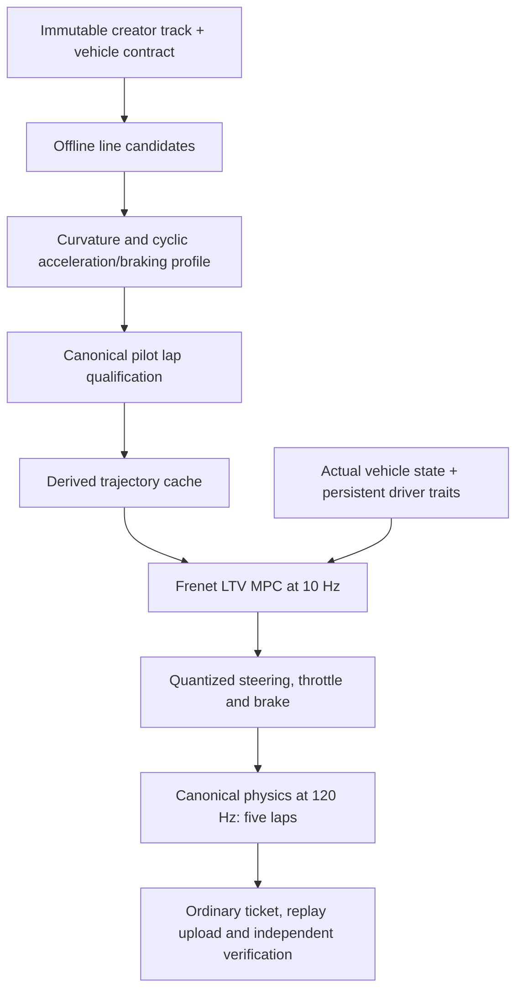

# Precomputed trajectories and predictive test drivers — 2026-10-07

The owner's trajectory/MPC proposal authorizes this local artificial-driver improvement. `profiled-trajectory-4` replaces the reactive controller for newly generated development races. It still emits ordinary quantized steering/throttle/brake and finishes five ordered laps through the existing canonical simulation and verifier.

Requirements: **TD02 / TD03 / TD05 / TD06 / TD08 / T01–T04 / Q01**, plus task-local **TD09** (precomputed constrained trajectories, predictive following and measurable driving errors). Public population isolation, persistent profile traits, verification, ticket/upload idempotency and ordinary racing remain intact. This task changes no physics, handling resource, map geometry, camera, menu or player files.

## Implemented architecture

- The offline planner samples at 0.5 m, with a maximum of 8,192 samples and adaptive spacing for longer routes. It measures connected road corridors, subtracts the vehicle footprint/margin, excludes solid cells and starting tyre obstacles, and preserves local road/bridge branch hints. It does not take width from another crossing branch.
- A bounded coordinate solver reduces integral squared geometric curvature. Variable chord length matters: minimizing second differences alone can favour a smaller circular radius. The planner also considers a smoothed line and a center-line candidate. Real canonical diagnostic pilot laps choose the fastest qualifying candidate with an explicit contact cost. These pilot laps create no PB, points, ticket or upload; ordinary generated races remain five laps.
- A cyclic forward/backward speed envelope considers grip/surface/coating, acceleration, braking, steering reduction, maximum yaw and speed. Braking propagates across the lap seam. The reference lap estimate is **not a guaranteed lower bound or a globally optimal lap time**. Its filtered tangent/curvature reflects a finite vehicle rather than isolated raster/chord kinks.
- The online controller uses a 1.6-second horizon, 16 prediction steps and a fixed maximum of 14 projected-gradient iterations with bounded line search. Five Frenet states include lateral and heading error, yaw response, lateral velocity and speed error; steering and acceleration are controls. The LTV model includes the game's speed-dependent steering, yaw/lateral response and progressive grip saturation derivative. Numerical adjoint derivatives are checked independently.
- Input/steering slew bounds are hard; the lateral corridor is a soft objective. A bounded correction around geometric guidance keeps the linearization local in sharp bends. Large missed-gate recovery and explicit reverse/detour fallback remain physical driving. No gates, speed, vehicle state or reported time are bypassed.
- Skill changes braking preview, corridor margin, steering smoothness, acceleration response and reference utilization. Existing seeded form, surface strengths, learning and hesitation remain. The vehicle's actual maximum speed/configuration does not change between profiles.

The planner runs **before a recorded race**, lazily on first use of a published revision/vehicle. Subsequent drivers share the cache. This slice does not put extra fields in immutable public track documents or add a publishing-time worker. The derived cache is beside backend object storage, uses atomic replacement and is bounded to 128 files of at most 2 MB each. Identity pins trajectory version, content hash, compiler version, physics version, rules key and complete vehicle configuration. Malformed/stale data regenerates. Fresh planning is normalized through the exact persisted numeric representation so JSON rounding cannot change later quantized controls.

The approach follows the separation of line planning and forward/backward speed profiles described in [TUM's minimum-curvature racing work](https://portal.fis.tum.de/de/publications/minimum-curvature-trajectory-planning-and-control-for-an-autonomo/), and receding-horizon progress/track-error control described by [ETH's autonomous racing research](https://control.ee.ethz.ch/research/team-projects/autonomous-rc-car-racing/research.html). The implementation is original, tailored to the game's canonical arcade model and uses no new solver dependency.

## Safe controller upgrades

New controller versions can produce different recordings for the same profile. The private, development-gated `GET /dev/test-drivers/uploads/{upload_key}` requires both the operator key and that artificial player's authenticated session. It looks up only the player's committed upload and returns its existing run status; it exposes no raw replay and creates no result. Another player cannot retrieve that run.

The scheduler probes this capability before regenerating a waiting job. A previously committed upload survives complete loss of the local plan/recording cache and a changed controller. Retired uploads are not recreated. Existing recordings/results remain untouched. Older servers without the advertised recovery capability keep the prior flow. No database migration is needed.

Controller errors are detected while the native process is running. Failure/shutdown stops only the spawned process tree, including the Windows console child, before closing its temporary log. This avoids a parse failure occupying the entire controller timeout or masking the error with a locked-log cleanup failure.

## Actual evidence and validation

The benchmark uses seed 27, skill 0.5, consistency 1.0, aggression 0.5 and pace scale 1.0 across the 27 original local corpus documents. The before controller is retained verbatim as [profiled-route-3.gd.txt](evidence/predictive-drivers-2026-10-07/profiled-route-3.gd.txt). Both sides use identical per-track canonical manifests: physics **0.53**, compiler **22**, rules **v20** and the same compact configuration. No old time is rescaled or renamed into a new contract.

Final comparison and per-track limits are in [verified-summary.json](evidence/predictive-drivers-2026-10-07/verified-summary.json), [comparison.csv](evidence/predictive-drivers-2026-10-07/comparison.csv) and [comparison.svg](evidence/predictive-drivers-2026-10-07/comparison.svg) / [inspected PNG](evidence/predictive-drivers-2026-10-07/comparison.png). The full actual documents/inputs are retained in [verified-recordings.json.gz](evidence/predictive-drivers-2026-10-07/verified-recordings.json.gz); [final-telemetry.json](evidence/predictive-drivers-2026-10-07/final-telemetry.json) contains reference geometry/speed, actual trajectory/speed and controls. These are test evidence, outside the shipping export.

The final corpus completes **27/27**, versus **26/27** before. Every final five-lap input recording is independently accepted by the ordinary verifier, with identical recorded/verified ticks and manifests. Median race time improves about **21.1%** over the 26 previously completed circuits. Recorded contacts fall from **8,346 to 5**; the old total includes the incomplete Ellipse run's repeated contacts, so it is not a count of distinct crashes or physics ticks. The final five contacts are on Over and under, Ellipse and Ajorata.

Four circuits remain slower: **Dust cloud, Narrow night, Knit and Saw**. Their exact regressions are retained in the comparison; this is not universal human-level or near-optimal pace acceptance. The owner-supplied sharp **Star** and the independent **five-point spline** additionally generate five verified ordered laps without missed-gate fallback.

On the desktop bridge-circuit cache measurement, cold planning takes **4,082.5 ms**, cached loading **1.3 ms**; total generation falls from **7.61 s to 3.21 s**. Predictive updates average about **0.78 ms**, with an observed maximum **6.37 ms**, against a 100 ms update interval. Cold/warm quantized recordings are exactly equal. See [cache-performance.json](evidence/predictive-drivers-2026-10-07/cache-performance.json). This is a Windows host measurement with concurrent work, not a phone or cloud CPU benchmark.

Actual commands (the pinned build is always `4.7.2.stable.official.ed1daf0bf`):

| Command | Actual final outcome |
| --- | --- |
| `powershell -NoProfile -ExecutionPolicy Bypass -File scripts/dev.ps1 -Action Import` | New script classes registered. |
| `... -Action TestScript -ScriptPath res://tests/test_predictive_driver.gd` | 1,382 checks, zero failures: geometric-curvature improvement, obstacle clearance, cyclic braking, cache round trip/invalidation, MPC gradients and five-car physical recovery. |
| `$env:BMT_DRIVER_REPLAYS='1'; ... -Action TestScript -ScriptPath res://tests/benchmark_test_drivers.gd -CommandTimeoutSeconds 900` | Actual final 27-track, five-lap input/telemetry capture. |
| `.tools/backend-venv/Scripts/python.exe backend/tools/report_predictive_drivers.py --report build/driver-benchmark.json --evidence docs/evidence/predictive-drivers-2026-10-07 --godot 'C:/apps/Godot 4.7.2/Godot_v4.7.2-stable_win64_console.exe' --project game` | All 27 independently verified; no reported-vs-recorded time/manifest differences. |
| `...python.exe -m pytest backend/tests/test_predictive_drivers.py backend/tests/test_test_drivers.py backend/tests/test_automatic_test_drivers.py backend/tests/test_worker_lifecycle.py backend/tests/test_rivalry.py backend/tests/test_test_drivers_integration.py::test_profiles_generate_repeatable_distinct_verified_five_lap_races -k 'not postgres' -q --tb=short --show-capture=no` | 49 passed, four skipped, 15 deselected. Includes exact oval/bridge cold/warm recordings, corrupt/stale-cache regeneration, packaged native execution, skill ordering, real idle upload/verification, private upgrade recovery and creator splines. Existing Starlette deprecation warning remains. |
| `... -Action TestApp` | 99 checks, zero failures. |
| `... -Action TestScript -ScriptPath res://tests/test_script_parse.gd` | Project-wide parse checks pass; 347 scripts, zero failures. |
| Ruff over the affected Python controller/API/scheduler/packager/tests/report utility | Passed. |

Initial failures were retained rather than treated as passes: PowerShell execution policy and sandbox log access; unregistered new classes; a concurrently added compiler helper missing from the standalone package; low-speed nominal-state prediction; the wrong circle-curvature surrogate; a cleanup fixture that accidentally intercepted `taskkill`; float/int layer membership after JSON restore; and float64 persistence rounding causing a one-bit bridge control difference. Each received a concrete correction, with final targeted/broad checks rerun. The minimum-curvature solution can retain an already good seed, rather than claiming an improvement that was not measured.

## Changed source and review checkpoint

- `game/input/racing_trajectory.gd`, `trajectory_planner.gd`, `trajectory_mpc.gd`, and the existing `profiled_route_driver.gd`.
- `game/backend/generate_test_driver.gd` and new native benchmark/recovery/constraint scripts in `game/tests/`.
- `backend/bmt_backend/test_driver_generator.py`, `test_drivers.py`, `test_population_tool.py`, and the additive bootstrap recovery capability in `app.py`.
- `backend/deploy/stage_verifier.py` includes the new driver modules and the current compiler's already-existing `object_runs`/`roadside_boundary` dependencies. This task does not edit those editor helpers.
- `backend/tests/test_predictive_drivers.py`, the strengthened loss-of-cache automatic-worker test, `backend/tools/report_predictive_drivers.py`, and `backend/schemas/racing-trajectory-v2.schema.json`.
- This document, current status/plan entries and the linked evidence. The recorded profile/replay/track contracts themselves remain unchanged.

The workspace contains substantial concurrent/uncommitted work. The [scoped Git patch](evidence/predictive-drivers-2026-10-07/task.patch), [checkpoint description](evidence/predictive-drivers-2026-10-07/checkpoint.json) and [source hashes](evidence/predictive-drivers-2026-10-07/source-hashes.json) describe this task without resetting, staging or committing unrelated work. Reverse snapshots are reconstructed for this task's edits on top of preserved surrounding work; the original route-3 controller is retained verbatim. `git apply --reverse --check --ignore-space-change .../task.patch` passes; the flag handles the Windows working files' CRLF endings.

## Remaining acceptance

No cloud/NAS/backend rollout or database migration was performed by this task. The active cloud worker continues using its deployed controller until this update is rolled out; its existing results are preserved. The newly generated development flow is implemented and verified locally. No production deployment, purchase or external message was sent.

Phone attachment was not checked; **no phone/emulator driving, Android export/install or mobile performance test was performed**. There is no visible app UI change requiring new menu captures. Full `Validate`, PostgreSQL-specific checks, a new 150/200-driver population, long-running worker throughput and cross-platform deterministic equality were not run. The four slower circuits, extreme/unfinishable creator geometry, moving-obstacle recovery and final skill calibration against real human PBs remain acceptance work. Cache planning currently adds cold worker latency; publishing-time precomputation and a true minimum-lap-time optimizer are future extensions, not completed features.

